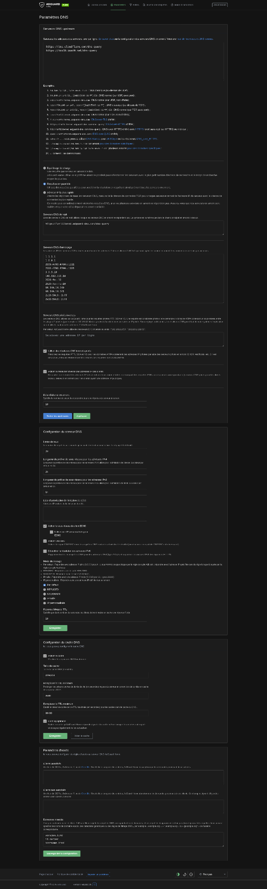
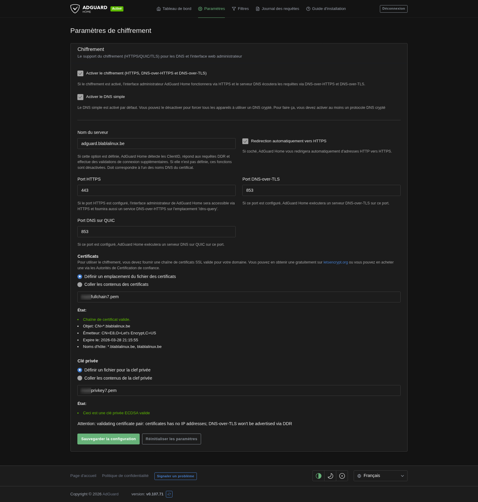
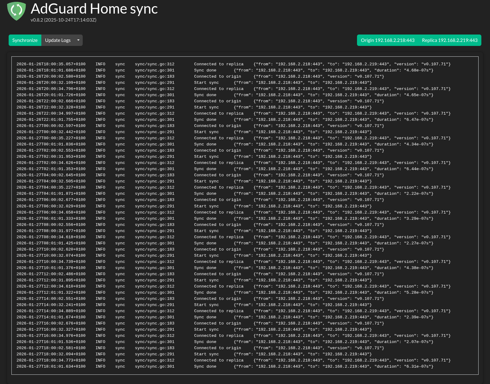

## Liens utiles

* AdGuard Home (web) : [https://adguard.com/fr/adguard-home/overview.html](https://adguard.com/fr/adguard-home/overview.html)
* AdGuard Home (GitHub) : [https://github.com/AdguardTeam/AdGuardHome](https://github.com/AdguardTeam/AdGuardHome)
* Proxmox VE Helper-Scripts (web) : [https://community-scripts.github.io/ProxmoxVE/](https://community-scripts.github.io/ProxmoxVE/)
* Proxmox VE Helper-Scripts (GitHub) : [https://github.com/community-scripts/ProxmoxVE](https://github.com/community-scripts/ProxmoxVE)
* AdGuard Home Sync (GitHub) : [https://github.com/bakito/adguardhome-sync](https://github.com/bakito/adguardhome-sync)

## 1. Introduction et présentation

**AdGuard Home** est un logiciel réseau orienté sécurité et confidentialité, agissant comme un **serveur DNS récursif** avec des capacités de blocage de publicités et de trackers au niveau du réseau. Contrairement aux extensions de navigateur classiques, il fonctionne de manière centralisée : une seule installation protège l’intégralité des appareils de la maison ou du parc informatique (ordinateurs, smartphones, objets connectés, Smart TV) sans nécessiter de configuration logicielle sur chaque client.

### Pourquoi utiliser AdGuard Home ?

En tant qu’alternative libre et performante à Pi-hole, AdGuard Home offre plusieurs avantages clés pour un administrateur système :

* **Respect de la vie privée :** Bloque les requêtes vers les serveurs de télémétrie et de tracking avant même qu’elles ne quittent le réseau local.
* **Optimisation de la bande passante :** En empêchant le chargement des publicités et des scripts inutiles, la navigation devient plus fluide, ce qui est idéal pour valoriser du matériel reconditionné.
* **Sécurité renforcée :** Protection native contre le phishing et les domaines malveillants.
* **Protocoles modernes :** Support natif et simplifié du **DNS-over-HTTPS (DoH)** et du **DNS-over-TLS (DoT)** pour chiffrer les requêtes DNS.
* **Contrôle parental :** Possibilité de restreindre l’accès à certains services (YouTube, Twitch, réseaux sociaux) de manière globale ou par client spécifique.

### Fonctionnement technique

AdGuard Home intercepte les requêtes DNS. Lorsqu’un appareil demande l’adresse IP d’un domaine publicitaire, le serveur répond par une adresse nulle ou vide (NXDOMAIN), empêchant ainsi la connexion. Pour les requêtes légitimes, il les transmet à des résolveurs amonts sécurisés ou utilise son propre cache pour accélérer les réponses futures.

## 2. Installation

Il existe plusieurs méthodes pour déployer AdGuard Home. Bien que l'installation binaire ou Docker soit possible, l'utilisation d'un conteneur LXC via les scripts de la communauté Proxmox est la solution la plus optimisée pour une infrastructure Proxmox.

### A. Méthode recommandée : Proxmox VE Helper Scripts (LXC)

Cette méthode automatise la création d'un conteneur Debian léger et l'installation d'AdGuard Home. C’est la solution la plus performante pour isoler le service DNS.

* **Lien source :** [Community Scripts - AdGuard Home](https://community-scripts.github.io/ProxmoxVE/scripts?id=adguard)

**Commandes à utiliser (dans le shell Proxmox) :**

```bash
# Via GitHub (Source principale)
bash -c "$(curl -fsSL https://raw.githubusercontent.com/community-scripts/ProxmoxVE/main/ct/adguard.sh)"

# Via le miroir alternatif
bash -c "$(curl -fsSL https://git.community-scripts.org/community-scripts/ProxmoxVE/raw/branch/main/ct/adguard.sh)"

```

### B. Méthode Docker Compose

Idéal si tu souhaites une portabilité totale ou si tu n'utilises pas Proxmox.

```yaml
services:
  adguardhome:
    image: adguard/adguardhome:latest
    container_name: adguardhome
    restart: unless-stopped
    # network_mode: host # Recommandé pour utiliser AdGuard comme serveur DHCP
    ports:
      - "53:53/tcp"
      - "53:53/udp"
      - "67:67/udp"    # Serveur DHCP
      - "80:80/tcp"    # Interface Web Admin
      - "443:443/tcp"  # HTTPS / DNS-over-HTTPS (DoH)
      - "443:443/udp"  # DNS-over-QUIC (DoQ)
      - "853:853/tcp"  # DNS-over-TLS (DoT)
      - "853:853/udp"  # DNS-over-QUIC (DoQ)
      - "3000:3000/tcp" # Assistant d'installation (initial)
    volumes:
      - ./confdir:/opt/adguardhome/conf
      - ./workdir:/opt/adguardhome/work

```

### C. Installation via binaire (standard)

Pour une installation native sur Debian/Ubuntu :

```bash
curl -s -S -L https://raw.githubusercontent.com/AdguardTeam/AdGuardHome/master/scripts/install.sh | sh -s -- -v

```

---

### ⚠️ Point d'attention : conflit avec systemd-resolved

Sur Ubuntu/Debian, le port **53** est souvent déjà utilisé. Il faut libérer ce port avant de lancer AdGuard Home :

1. **Modifier la configuration :**

```bash
sudo sed -i "s/#DNSStubListener=yes/DNSStubListener=no/" /etc/systemd/resolved.conf

```

2. **Redémarrer le service :**

```bash
sudo systemctl restart systemd-resolved

```

## 3. Configuration initiale (assistant)

Une fois l'installation terminée, la configuration finale s'effectue via l'assistant web.

### A. Accès à l'assistant

Ouvrez votre navigateur et saisissez l'adresse IP de votre serveur suivie du port **3000** :
`http://<IP_DU_SERVEUR>:3000`

### B. Étape 1 : interfaces réseau

Cette étape définit les ports d'écoute internes au service.

1. **Interface web (dashboard) :**
* **Installation LXC / binaire :** Par défaut sur le port `80`. Si un autre service (comme Nginx) occupe déjà ce port, modifiez-le ici (ex: `81` ou `8080`).
* **Installation Docker :** **Attention !** L'assistant vous affichera le port interne du conteneur (généralement `80`). Vous devez laisser ce port tel quel dans l'interface web. C'est dans votre fichier `docker-compose.yml` que vous gérez la redirection (ex: `- "8080:80"`).


2. **Serveur DNS :**
* **Port :** Doit rester sur **53** pour répondre aux requêtes standard des appareils.
* **Interface :** Sélectionnez "Toutes les interfaces" pour assurer la visibilité sur votre réseau local.


### C. Étape 2 : configuration du compte admin

Créez votre utilisateur et un mot de passe robuste. Cette interface est sensible car elle contient l'historique de navigation (logs DNS) de votre réseau.

### D. Étape 3 : guide de configuration

L'assistant vous montre comment configurer vos clients. Une fois validé, le port `3000` est désactivé. L'interface est désormais accessible sur le port défini à l'étape B (ou celui mappé via Docker).

---

### 🔍 Test de bon fonctionnement

Pour vérifier que votre instance traite bien les demandes, lancez une requête test depuis une autre machine :

```bash
# Remplacer <IP_ADGUARD> par l'IP de votre instance
nslookup google.com <IP_ADGUARD>

```

## 4. Paramètres DNS

Cette section permet de définir la stratégie de résolution de noms et les serveurs tiers qui seront interrogés par AdGuard Home.

### A. Serveurs DNS amont (upstream)

Le champ "Serveurs DNS amont" accepte plusieurs protocoles. Pour garantir la confidentialité, il est recommandé d'utiliser des protocoles chiffrés comme le **DNS-over-HTTPS (DoH)**.

**Exemples basés sur une configuration sécurisée :**

* `https://dns10.quad9.net/dns-query` (Quad9 avec protection contre les domaines malveillants)
* `https://dns.cloudflare.com/dns-query` (Cloudflare pour la rapidité)

### B. Mode de sélection du serveur

AdGuard Home propose plusieurs méthodes pour interroger ces serveurs. Dans une configuration optimisée pour la performance, on utilise généralement :

* **Requêtes en parallèle :** AdGuard interroge tous les serveurs listés simultanément et retient la réponse la plus rapide. C'est la méthode qui offre la latence la plus faible à l'utilisation.

### C. DNS d'amorçage (bootstrap DNS)

Ces serveurs (renseignés par leur adresse IP) sont indispensables pour résoudre les noms de domaine de vos serveurs amonts chiffrés.

**Exemple de liste de bootstrap DNS robuste :**

* `9.9.9.10` (Quad9)
* `149.112.112.10` (Quad9 secondaire)
* `1.1.1.1` (Cloudflare)
* `1.0.0.1` (Cloudflare secondaire)
* `8.8.8.8` (Google)

### D. Optimisation du cache

Le cache permet de répondre instantanément aux requêtes déjà effectuées sans interroger l'extérieur.

* **Taille du cache :** Par exemple `4 194 304` octets (4 Mo) pour un usage domestique standard.
* **Caching optimiste (optimistic caching) :** Lorsqu'elle est activée, cette option permet à AdGuard de servir une réponse en cache même si elle vient d'expirer, tout en effectuant la mise à jour en arrière-plan. Cela rend la navigation extrêmement fluide.



> *Capture d'écran : Configuration des serveurs amonts (DoH) et réglages du cache.*

## 5. Filtrage et protection

C'est ici que s'opère la "magie" d'AdGuard Home. Cette section permet de définir précisément ce qui doit être bloqué ou autorisé sur votre réseau.

### A. Listes de blocage DNS (blocklists)

Les listes de blocage sont des fichiers textes (locaux ou distants) contenant des milliers de domaines publicitaires, de trackers ou de sites malveillants.

* **Ajouter une liste :** Vous pouvez choisir parmi les listes pré-configurées (AdGuard DNS filter, EasyList, etc.) ou ajouter vos propres URL (comme celles de *Steven Black* ou *OISD*).
* **Mise à jour automatique :** AdGuard Home vérifie périodiquement si les listes distantes ont été modifiées pour maintenir votre protection à jour.

### B. Listes d'autorisation DNS (allowlists)

Si un site légitime est bloqué par erreur (faux positif), vous pouvez ajouter son domaine ici. Les règles d'autorisation ont toujours priorité sur les règles de blocage.

### C. Filtres personnalisés

Cette partie permet d'ajouter vos propres règles manuellement en utilisant la syntaxe de type "Adblock".

* `||exemple.com^` : Bloque le domaine et tous ses sous-domaines.
* `@@||exemple.com^` : Autorise spécifiquement ce domaine (whitelist manuelle).
* `127.0.0.1 site-local.lan` : Permet de faire de la réécriture DNS simple.

### D. Services bloqués

Une fonctionnalité très pratique qui permet, en un seul clic, de couper l'accès à des plateformes entières (Facebook, YouTube, Twitch, TikTok, etc.) de manière globale ou pour certains clients. C'est l'outil de contrôle parental le plus rapide à mettre en œuvre.

## 6. Gestion des clients

Par défaut, AdGuard Home applique les mêmes règles à tout le monde. La gestion des clients permet de personnaliser le filtrage appareil par appareil.

### A. Identification des clients

AdGuard Home peut identifier les appareils de ton réseau de plusieurs façons :

* **Par adresse IP :** (Le plus courant) Utile si tes appareils ont des baux statiques (IP fixes).
* **Par adresse MAC :** Très fiable si AdGuard Home est aussi ton serveur DHCP.
* **Par nom d'hôte (hostname) :** Pratique pour identifier rapidement qui est quoi (ex: `iPhone-Amaury`😜).

### B. Paramètres spécifiques par client

Pour chaque client ajouté, tu peux définir des règles d'exception :

* **Filtrage personnalisé :** Désactiver le blocage pour un PC de test ou un serveur de monitoring.
* **Services bloqués :** Restreindre YouTube ou TikTok uniquement sur la tablette des enfants, tout en laissant l'accès libre sur ton poste de travail.
* **Paramètres DNS :** Forcer un client spécifique à utiliser un résolveur amont différent des autres.

## 7. Services bloqués

Cette section est l'une des plus simples et des plus puissantes de l'outil. Au lieu de chercher des listes de domaines complexes, AdGuard Home propose des commutateurs pour les plateformes majeures.

* **Usage :** Un simple bouton permet de bloquer ou d'autoriser l'accès à **Facebook, Discord, YouTube, Twitch, Telegram**, etc.
* **Planification :** Il est possible de définir des horaires de blocage (par exemple, couper les réseaux sociaux après 21h).
* **Compatibilité :** Ces réglages s'appliquent globalement, sauf si une règle spécifique a été définie dans la "Gestion des clients" (section 6).

## 8. Paramètres DHCP (optionnel)

Si vous souhaitez qu'AdGuard Home gère entièrement l'attribution des adresses IP de votre réseau (à la place de votre box ou routeur), vous devez activer son serveur DHCP intégré.

### A. Pourquoi utiliser le DHCP d'AdGuard Home ?

L'avantage principal est la visibilité : AdGuard pourra associer chaque requête DNS à un **nom d'hôte précis** (ex: *Google-Home*, *PC-Salon*) plutôt qu'à une simple adresse IP. Cela rend les journaux de requêtes et les statistiques de filtrage beaucoup plus simples à analyser.

### B. Configuration et mise en œuvre

* **En LXC (Proxmox) :** Comme sur l'installation de **BlablaLinux**, le serveur DHCP fonctionne nativement sans configuration complexe. Le conteneur ayant un accès direct au pont réseau (*bridge*), il diffuse les baux sans encombre sur tout le segment réseau.
* **En Docker :** Attention, pour que le DHCP fonctionne dans ce mode, le conteneur doit impérativement être lancé avec le paramètre `network_mode: host` pour ne pas être isolé par le bridge interne de Docker.

### C. Paramètres clés (exemple de configuration)

Pour activer le service, vous devrez renseigner :

* **Passerelle (gateway) :** L'adresse IP de votre routeur (ex: `192.168.2.1`).
* **Plage d'adresses IP :** Le pool d'adresses distribuées aux appareils (ex: de `192.168.2.10` à `192.168.2.50`).
* **Baux statiques :** Cette fonction permet de fixer une IP à un appareil spécifique via son adresse MAC. C'est indispensable pour assurer la stabilité des serveurs, des NAS ou des objets domotiques.

## 9. Maintenance et mise à jour

Garder AdGuard Home à jour est crucial pour bénéficier des dernières optimisations du moteur de filtrage et des correctifs de sécurité.

### A. La méthode recommandée : via l'interface web

C'est la méthode la plus simple, la plus rapide et elle fonctionne parfaitement pour la majorité des installations (notamment en LXC ou installation binaire).

* Lorsqu'une mise à jour est disponible, une notification apparaît en haut du tableau de bord.
* Un simple clic suffit : AdGuard Home télécharge la nouvelle version, l'installe et redémarre le service automatiquement en quelques secondes.

### B. Spécificité pour Docker

Si vous utilisez Docker, la mise à jour via l'interface peut parfois échouer ou être réinitialisée au prochain redémarrage du conteneur. Il est alors préférable de mettre à jour l'image :

```bash
docker compose pull
docker compose up -d

```

### C. Cas particulier du script Proxmox (LXC)

Pour les installations réalisées sur Proxmox (méthode privilégiée par **BlablaLinux**), si vous préférez passer par la console, vous pouvez relancer le script de la communauté. Il détectera l'instance existante et effectuera la mise à niveau proprement.

### D. Sauvegarde de sécurité

Avant toute mise à jour majeure, il reste prudent de sauvegarder votre configuration. Le fichier essentiel qui contient tous vos réglages est :
`/opt/AdGuardHome/AdGuardHome.yaml`

## 10. Chiffrement et accès HTTPS

Pour sécuriser l'accès à votre interface d'administration et permettre l'utilisation des protocoles **DNS-over-HTTPS (DoH)** ou **DNS-over-TLS (DoT)**, il est nécessaire de configurer le chiffrement.

### A. Certificats SSL

Comme on le voit sur la configuration de **blablalinux.be**, il est recommandé d'utiliser des certificats valides (ex: Let's Encrypt).

* **Nom du serveur :** Renseignez votre nom de domaine (ex: `adguard.blablalinux.be`).
* **Chemins des fichiers :** Indiquez l'emplacement de votre chaîne de certificats (`fullchain.pem`) et de votre clé privée (`privkey.pem`).
* **Redirection automatique :** Activez la redirection vers HTTPS pour garantir que votre connexion à l'interface web soit toujours cryptée.



> *Capture d'écran : Paramétrage du certificat SSL anonymisé pour sécuriser l'interface.*

### B. Ports de chiffrement

Une fois le chiffrement activé, AdGuard Home peut écouter sur les ports sécurisés standard :

* **Port HTTPS :** `443` (pour l'interface web et le DoH).
* **Port DNS-over-TLS :** `853`.
* **Port DNS-over-QUIC :** `853`.

---

## 11. Réécritures DNS (DNS rewrites)

Cette fonctionnalité est extrêmement utile pour la gestion de votre réseau local. Elle permet de faire pointer un nom de domaine (ou un sous-domaine) vers une adresse IP spécifique de votre réseau.

### A. Usage local

Plutôt que de retenir des adresses IP complexes, vous pouvez créer des noms faciles à retenir :

* `adguard.blablalinux.be` -> `192.168.2.218`.
* `*.adguard.blablalinux.be` -> `192.168.2.218` (le caractère générique `*` permet de rediriger tous les sous-domaines vers la même IP).

### B. Avantages

* **Simplicité :** Accédez à vos services (NAS, Proxmox, Home Assistant) via des noms clairs.
* **Indépendance :** Ces réécritures ne fonctionnent qu'à l'intérieur de votre réseau, ce qui renforce la sécurité et la rapidité d'accès à vos services locaux.

## 12. BONUS : haute disponibilité et synchronisation

### A. Pourquoi deux instances AdGuard Home ?

Le DNS est le pilier de votre navigation. Si votre serveur unique tombe (maintenance, mise à jour, panne matérielle), tout le réseau perd l'accès à Internet. Avoir deux instances (un DNS primaire et un DNS secondaire) assure une **continuité de service totale**. En cas de défaillance du premier, les clients basculent automatiquement sur le second.

### B. Déploiement rapide par clonage (Proxmox VE)

Si vous utilisez Proxmox, inutile de tout réinstaller manuellement :

1. **Clonage :** Faites un clic droit sur votre premier LXC configuré et choisissez **"Clone"**.
2. **Ajustements :** Sur le nouveau conteneur, modifiez simplement son **Hostname** et son **adresse IP** statique.
3. **Résultat :** En 2 minutes, votre second serveur est prêt. Il ne reste plus qu'à automatiser la synchronisation des réglages.

### C. Méthodes d'installation de Sync

Pour lier vos instances, l'outil de référence est **AdGuard Home Sync** de Bakito. Deux méthodes s'offrent à vous :

* **Via Proxmox Helper Scripts :** Idéal si vous voulez rester sur des conteneurs LXC natifs.
👉 [Script Proxmox Helper - AdGuard Home Sync](https://community-scripts.github.io/ProxmoxVE/scripts?id=adguardhome-sync)
* **Via Docker Compose :** La méthode privilégiée par **BlablaLinux** pour sa flexibilité. Créez un dossier et utilisez le fichier `docker-compose.yml` disponible sur ByteStash.

### D. Configuration via Docker Compose

Voici le fichier de déploiement utilisé dans l'infrastructure **BlablaLinux** :

```yaml
# Modifications apportées par Blabla Linux : https://link.blablalinux.be
services:
  adguardhome-sync:
    image: ghcr.io/bakito/adguardhome-sync:latest
    container_name: adguardhome-sync
    command: run --config /config/adguardhome-sync.yaml
    environment:
      - TZ=Europe/Brussels
    volumes:
      - ./config/adguardhome-sync.yaml:/config/adguardhome-sync.yaml
    ports:
      - 8080:8080
    restart: always

```

### E. Configuration du fichier `adguardhome-sync.yaml`

Le fichier de configuration (`./config/adguardhome-sync.yaml`) doit être ajusté pour établir la liaison. Voici les points **impératifs** :

1. **L'instance d'origine (Origin) :** Votre serveur de référence (ex: `https://192.168.2.218:443`).
* `insecureSkipVerify: true` : Indispensable pour ignorer les alertes SSL sur vos IP locales.


2. **L'instance de réplication (Replicas) :** Votre serveur "esclave" (ex: `192.168.2.219`).
3. **Le Cron :** La fréquence de synchronisation (ex: `"0 */2 * * *"` pour une synchro toutes les 2 heures).

### F. Attention aux paramètres à ne PAS synchroniser

Dans la section `features` du fichier YAML, certains éléments doivent être désactivés pour éviter de casser votre réseau :

> ⚠️ **Le serveur DHCP :** Doit être configuré sur **`false`**. Un réseau local ne peut supporter qu'**un seul serveur DHCP actif**. Si vous synchronisez et activez le DHCP sur vos deux instances simultanément, vous provoquerez des conflits d'adresses IP majeurs.

* **`statsConfig` / `queryLogConfig` :** À laisser sur `false` pour que chaque instance conserve ses propres statistiques.

### G. Ressources et liens

* **Dépôt officiel :** [GitHub bakito/adguardhome-sync](https://github.com/bakito/adguardhome-sync)
* **Fichiers complets (Compose et YAML) :** [ByteStash BlablaLinux - Configuration Sync](https://bytestash.blablalinux.be/s/122ea0cd5e2848ecbea449bd6740cee1)



> *Capture d'écran : Validation de la synchronisation réussie entre les deux instances.*

---

<blockquote class="mastodon-embed" data-embed-url="https://mastodon.blablalinux.be/@blablalinux/115441781574515778/embed" style="background: #263238; border-radius: 8px; border: 1px solid #37474f; margin: 0; max-width: 540px; min-width: 270px; overflow: hidden; padding: 0;"> 
  <a href="https://mastodon.blablalinux.be/@blablalinux/115441781574515778" target="_blank" style="align-items: center; color: #eceff1; display: flex; flex-direction: column; font-family: system-ui, -apple-system, sans-serif; font-size: 14px; justify-content: center; padding: 24px; text-decoration: none;"> 
    <svg xmlns="http://www.w3.org/2000/svg" width="32" height="32" viewBox="0 0 79 75" style="fill: #2b90d9; margin-bottom: 16px;"><path d="M63 45.3v-20c0-4.1-1-7.3-3.2-9.7-2.1-2.4-5-3.7-8.5-3.7-4.1 0-7.2 1.6-9.3 4.7l-2 3.3-2-3.3c-2-3.1-5.1-4.7-9.2-4.7-3.5 0-6.4 1.3-8.6 3.7-2.1 2.4-3.1 5.6-3.1 9.7v20h8V25.9c0-4.1 1.7-6.2 5.2-6.2 3.8 0 5.8 2.5 5.8 7.4V37.7H44V27.1c0-4.9 1.9-7.4 5.8-7.4 3.5 0 5.2 2.1 5.2 6.2V45.3h8ZM74.7 16.6c.6 6 .1 15.7.1 17.3 0 .5-.1 4.8-.1 5.3-.7 11.5-8 16-15.6 17.5-.1 0-.2 0-.3 0-4.9 1-10 1.2-14.9 1.4-1.2 0-2.4 0-3.6 0-4.8 0-9.7-.6-14.4-1.7-.1 0-.1 0-.1 0s-.1 0-.1 0 0 .1 0 .1 0 0 0 0c.1 1.6.4 3.1 1 4.5.6 1.7 2.9 5.7 11.4 5.7 5 0 9.9-.6 14.8-1.7 0 0 0 0 0 0 .1 0 .1 0 .1 0 0 .1 0 .1 0 .1.1 0 .1 0 .1.1v5.6s0 .1-.1.1c0 0 0 0 0 .1-1.6 1.1-3.7 1.7-5.6 2.3-.8.3-1.6.5-2.4.7-7.5 1.7-15.4 1.3-22.7-1.2-6.8-2.4-13.8-8.2-15.5-15.2-.9-3.8-1.6-7.6-1.9-11.5-.6-5.8-.6-11.7-.8-17.5C3.9 24.5 4 20 4.9 16 6.7 7.9 14.1 2.2 22.3 1c1.4-.2 4.1-1 16.5-1h.1C51.4 0 56.7.8 58.1 1c8.4 1.2 15.5 7.5 16.6 15.6Z"/></svg> 
    <div style="color: #90a4ae; margin-bottom: 8px;">Post par @blablalinux@mastodon.blablalinux.be</div> 
    <div style="font-weight: 500; color: #2b90d9;">Voir sur Mastodon</div> 
  </a> 
</blockquote> 
<script async src="https://mastodon.blablalinux.be/embed.js"></script>
