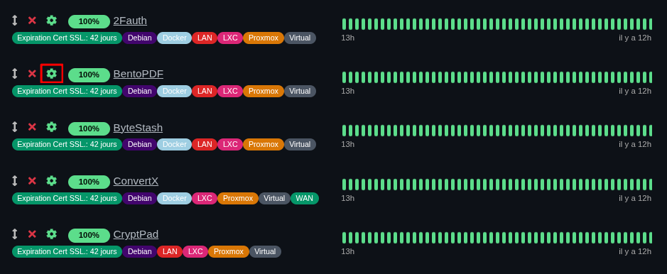
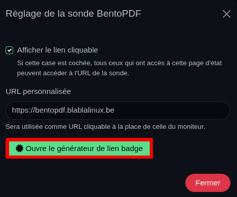
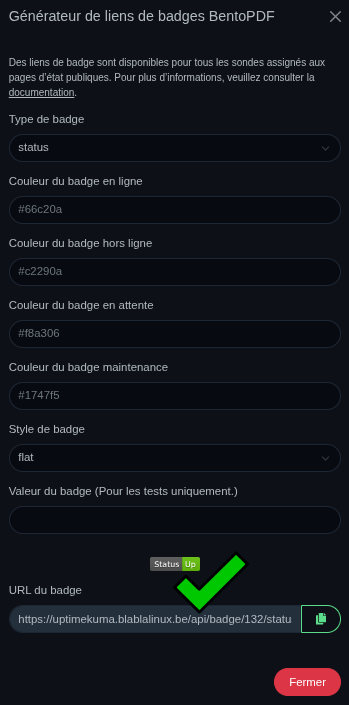

Ce guide explique comment intégrer des badges de statut dynamiques provenant d'une instance **Uptime Kuma** dans un tableau **WordPress** ou une page **HTML**, afin de créer un tableau de bord de services public.

## Prérequis

* Une instance **Uptime Kuma** fonctionnelle.
* Des moniteurs déjà configurés pour vos services.
* Un accès à l'éditeur de votre site (WordPress ou autre).

---

## Étape 1 : récupérer les badges dans Uptime Kuma

1. Connectez-vous à votre tableau de bord **Uptime Kuma**.
2. Repérez le service que vous souhaitez afficher.

> 
> *(Cette capture montre la liste des sondes et l'icône de réglage à cliquer)*

3. Cliquez sur l'icône de réglage (la roue crantée) du moniteur concerné.
4. Dans la fenêtre qui s'ouvre, cliquez sur le bouton vert **« Ouvre le générateur de lien badge »**.

> 
> *(Cette capture montre l'emplacement du bouton vert dans les réglages de la sonde)*

## Étape 2 : personnaliser le style du badge

Une fois le générateur ouvert, vous pouvez configurer l'apparence de votre badge :

1. **Type de badge** : choisissez "status".
2. **Style de badge** : sélectionnez `flat`, `flat-square` (recommandé pour les tableaux), `plastic`, etc.
3. **Couleurs** : vous pouvez personnaliser les codes hexadécimaux pour correspondre à votre charte graphique.
4. **URL du badge** : copiez l'URL générée en bas de la fenêtre.

> 
> *(Cette capture illustre l'interface complète de personnalisation des couleurs et du style)*

## Étape 3 : insérer le badge dans votre tableau

Dans la colonne « État » de votre tableau (WordPress ou HTML), insérez l'image en utilisant l'URL récupérée.

* **En HTML pur :**

```html


```

* **Dans WordPress :** utilisez le mode « Modifier en HTML » sur la cellule du tableau pour coller la balise ``.

## Étape 4 : optimiser pour le mobile (responsive)

Pour éviter que le tableau ne soit écrasé sur smartphone, ajoutez ce CSS dans les réglages de votre thème :

```css
.wp-block-table {
    overflow-x: auto !important;
    display: block;
    width: 100%;
}
.wp-block-table table {
    min-width: 650px; /* Force une largeur lisible */
}

```

### Exemple concret

Vous pouvez voir une mise en œuvre réelle de ce tutoriel sur ma page dédiée :
👉 **[Voir le dashboard dynamique de Blabla Linux](https://blablalinux.be/mes-services-publics/)**

### Sources et documentation officielle

* Pour plus d'options de personnalisation (uptime, ping, temps de réponse), consultez la **[documentation officielle d'Uptime Kuma sur les badges](https://github.com/louislam/uptime-kuma/wiki/Badge)**.

### Astuce de Blabla Linux 🐧

> Pensez à utiliser les paramètres `upLabel` et `downLabel` dans l'URL si vous souhaitez traduire les textes « Up » et « Down » en français !
