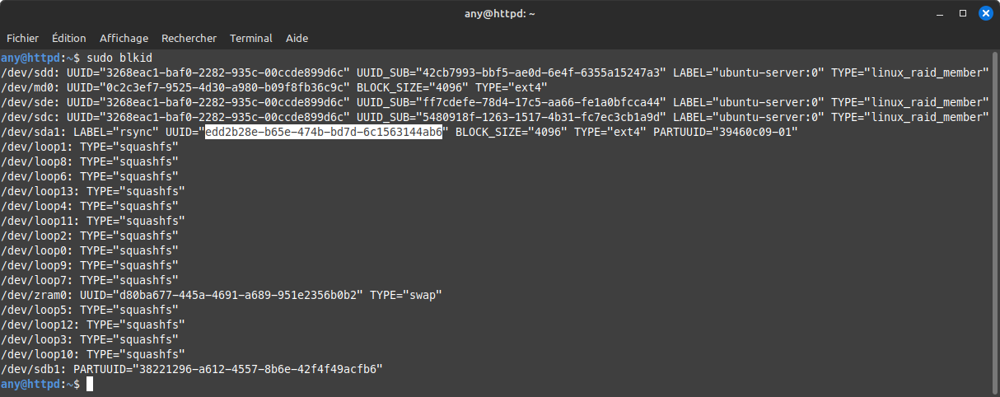

## 🚧 Situation Initiale et Problématique

Votre système démarre correctement à partir d'un premier périphérique [USB](https://fr.wikipedia.org/wiki/USB) contenant la partition `/boot`. Cependant, l'ajout d'un second périphérique de stockage [USB](https://fr.wikipedia.org/wiki/USB) configuré pour un montage automatique dans `/etc/fstab` provoque un échec au démarrage.

### Pourquoi le démarrage bloque-t-il ?

Pourquoi ?

> Dans votre firmware [BIOS](https://fr.wikipedia.org/wiki/BIOS_\(informatique\))/[EFI](https://fr.wikipedia.org/wiki/UEFI), vous avez défini le démarrage sur périphérique amovible USB, mais vous ne pouvez pas spécifier sur quel périphérique précisément le démarrage doit s'effectuer \! Comme il y en a plusieurs, le démarrage bloque.

### L'astuce : Le montage après le démarrage (Post-Boot)

Pour garantir un démarrage correct, nous devons retirer l'entrée du deuxième périphérique de `/etc/fstab`. Cela permet à la machine de démarrer sur le bon disque, mais empêche le montage automatique du second.

> Vous pouvez désactiver l'entrée du deuxième périphérique dans le fichier /etc/fstab. Le démarrage s'effectuera correctement sur le premier périphérique contenant la partition /boot, mais le montage automatique du deuxième périphérique ne se fera pas \!

L'astuce consiste alors à demander un montage automatique, non pas au démarrage via `/etc/fstab`, mais juste après l'initialisation du système en utilisant [Crontab](https://fr.wikipedia.org/wiki/Cron) avec la directive `@reboot`.

-----

## I. Préparation : Identification et Point de Montage

### 1\. Connaître l'UUID

La première chose à faire est de connaître l'[UUID](https://fr.wikipedia.org/wiki/Universally_unique_identifier) (Identifiant Universel Unique) de la partition que vous souhaitez monter. L'UUID est un identifiant fiable et permanent.

  - Nous allons utiliser cette commande…

<!-- end list -->

```plaintext
sudo blkid
```

Vous devriez obtenir ce genre de sortie…



On peut voir en surbrillance le numéro UUID que je vais utiliser. Il concerne un disque externe USB dédié aux sauvegardes [RSYNC](https://fr.wikipedia.org/wiki/Rsync).

### 2\. Répertoire du point de montage

Nous devons créer le répertoire qui servira de point de montage pour ce périphérique.

  - Nous allons maintenant créer un répertoire (pour moi backup-rsync) dans /media pour accueillir notre point de montage…

<!-- end list -->

```plaintext
sudo mkdir /media/backup-rsync
```

-----

## II. Configuration du montage différé avec Crontab

### 1\. Ajout dans Crontab

Nous allons éditer le fichier Crontab de l'utilisateur avec `sudo` pour planifier la commande de montage.

  - Nous pouvons maintenant éditer Crontab…

<!-- end list -->

```plaintext
sudo crontab -e
```

### 2\. Planification du montage au redémarrage

Ajoutez la ligne de commande suivante à la fin du fichier. La directive **`@reboot`** garantit que le montage sera effectué une seule fois, immédiatement après le démarrage complet du système.

  - Nous pouvons ajouter la ligne suivante (**à adapter** selon vos besoins : UUID et point de montage) à la fin du fichier…

<!-- end list -->

```plaintext
@reboot sudo mount -U edd2b28e-b65e-474b-bd7d-6c1563144ab6 /media/backup-rsync
```

> **Attention :** N'oubliez pas de remplacer l'UUID (`edd2b28e-b65e-474b-bd7d-6c1563144ab6`) par celui de votre propre périphérique.

Vous pouvez redémarrer, le tout est joué 😎
