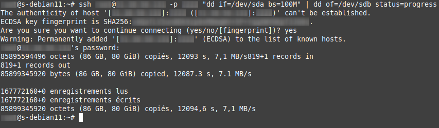

## 💡 Contexte de l'opération

Vos services (notamment [Mastodon](https://mastodon-blablalinux.be/@blablalinux) et [PeerTube](https://peertube-blablalinux.be/a/anyblabla/video-channels)) sont actuellement hébergés sur des [VPS](https://w.wiki/CG6P) chez [OVH](https://www.ovhcloud.com/fr/) et vous souhaitez les rapatrier sur votre cluster [Proxmox VE](https://www.proxmox.com/en/proxmox-virtual-environment/overview) local.

La méthode employée se déroule en deux phases :

1.  **Clonage initial** du disque à froid (copie brute bloc par bloc) avec `dd`.
2.  **Synchronisation finale** des données modifiées à chaud avec `rsync`.

## I. Phase 1 : Clonage initial du disque (DD sur SSH)

Nous utilisons ici `dd` pour réaliser un clone complet du disque source (`/dev/sda`) vers le disque de destination sur la machine locale (`/dev/sdb`) au travers d'une connexion [SSH](https://w.wiki/Acov). Cette commande est lancée **à partir du serveur local**.

> Voici la commande magique que j'ai utilisée, à partir du serveur local, afin de réaliser un clone complet du disque au travers de [SSH](https://w.wiki/Acov).

```plaintext
ssh root@xx.xx.xx.xxx -p xxxx "dd if=/dev/sda bs=100M" | dd of=/dev/sdb status=progress
```

### Explications détaillées des paramètres :

| Partie | Description |
| :--- | :--- |
| **`ssh root@xx.xx.xx.xxx`** | Appel [SSH](https://w.wiki/Acov) vers l'adresse IP et le nom d'utilisateur `root` du serveur distant. |
| **`-p xxxx`** | Précise le port [SSH](https://w.wiki/Acov) si celui-ci est différent du port 22 par défaut. |
| **`dd if=/dev/sda bs=100M`** | Commande DD pour cloner : `if` (input file/source) est le disque source. `bs=100M` définit la taille des blocs de transfert (adapté ici pour un disque SSD). |
| **`| dd of=/dev/sdb status=progress`** | Le *pipe* (`|`) transfère le flux de données vers la commande DD locale. `of` (output file/destination) est le disque de destination local. `status=progress` affiche l'avancement de l'opération. |

Sur l'image ci-dessous, on peut voir que l'opération de clonage avec la commande DD au travers de [SSH](https://w.wiki/Acov), d'un serveur distant vers un serveur local, s'est déroulé sans problème.



-----

## II. Phase 2 : Synchronisation des données à chaud (Rsync)

Si vous ne coupez pas immédiatement le serveur distant après le clonage initial, des données ont pu être modifiées. Pour synchroniser ces changements avant la bascule finale, nous utilisons `rsync`.

La commande suivante est lancée **à partir du serveur local** pour synchroniser uniquement les différences entre la source distante et la destination locale, en excluant les dossiers temporaires ou système non essentiels.

> Si comme moi, vous n'arrêtez pas directement le serveur distant pour mettre en route le serveur local à la place, il va falloir lancer une synchronisation, à partir du serveur local, au moment arrivé \! Voici la commende magique 😉

```plaintext
rsync -avz --inplace --delete -P --stats --human-readable --progress --exclude={"/dev/*","/proc/*","/sys/*","/tmp/*","/run/*","/media/*","/lost+found"} -e "ssh -p xxxx" root@xx.xx.xx.xxx:/ /media/mastodon/
```

### Explications détaillées des options Rsync :

| Option(s) | Nom | Description |
| :--- | :--- | :--- |
| **`-avz`** | Archives, Verbose, Compression | `-a` (archive) active la récursivité et préserve la majorité des attributs. `-v` (verbose) augmente le niveau d'information. `-z` (compress) compresse les données pour les connexions lentes. |
| **`--inplace`** | Écriture directe | Modifie les fichiers de destination directement au lieu de créer des copies temporaires, ce qui est utile après un clonage DD. |
| **`--delete`** | Suppression | Indique à rsync de supprimer les fichiers de la destination qui n'existent plus à la source. |
| **`-P`** | Partiel + Progression | Équivaut à `--partial --progress`. Permet de reprendre un transfert interrompu et affiche la progression détaillée. |
| **`--stats`** | Statistiques | Affiche un ensemble de statistiques sur l'efficacité du transfert. |
| **`--human-readable`** | Lisibilité | Affiche les tailles des fichiers dans un format plus lisible (Ko, Mo, Go). |
| **`--progress`** | Progression | Affiche l'avancement du transfert en cours. |
| **`--exclude`** | Exclusions | Exclut sélectivement les dossiers/fichiers qui ne doivent pas être copiés, comme les systèmes de fichiers virtuels de Linux (essentiel pour un clone à chaud \!). |
| **`-e "ssh -p xxxx"`** | Shell distant | Permet de spécifier le programme shell distant à utiliser, ici [SSH](https://w.wiki/Acov) avec le port précisé. |

Pour le restant de la commande…

  - **`"ssh -p xxxx" root@xx.xx.xx.xxx:/ /media/mastodon/`**

…c'est ce que l'on a vu plus haut. Connexion [SSH](https://w.wiki/Acov) avec précision de la source (`root@xx.xx.xx.xxx:/`) et de la destination (`/media/mastodon/`).

### Liens utiles

  - [https://linux.die.net/man/1/rsync](https://linux.die.net/man/1/rsync)
  - [https://ss64.com/bash/rsync\_options.html](https://ss64.com/bash/rsync_options.html)
