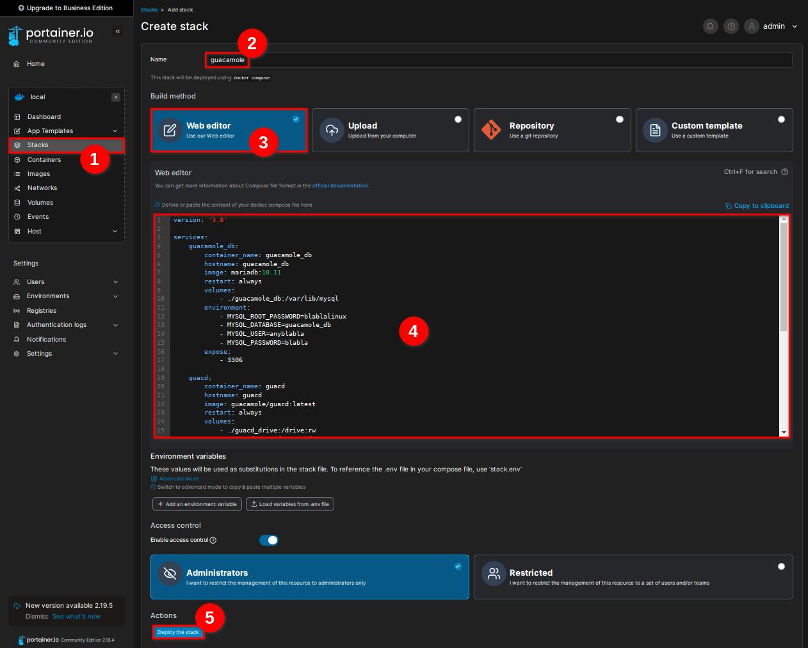

Je pars du principe que vous maîtrisez un minimum Docker avec Portainer 😉

-----

## 1\. Apache Guacamole, c'est quoi ?

*Apache Guacamole est une passerelle de* [bureau à distance](https://w.wiki/Acop) *sans client.*

*Il prend en charge les protocoles standards tels que* [VNC](https://w.wiki/Acot)*,* [RDP](https://w.wiki/Acou) *et* [SSH](https://w.wiki/Acov)*.*

*Nous l'appelons sans client, car aucun* [plugin](https://w.wiki/Acox) *ou logiciel client n'est requis.*

*Grâce au* [HTML5](https://w.wiki/9mA4)*, une fois Guacamole installé sur un serveur, tout ce dont vous avez besoin pour accéder à vos bureaux est un navigateur Web.*

### Liens utiles

  - [Site officiel](https://guacamole.apache.org)
  - [Documentation](https://guacamole.apache.org/doc/gug/)
  - [Code source](https://github.com/search?utf8=%E2%9C%93&q=repo%3Aapache%2Fguacamole-client+repo%3Aapache%2Fguacamole-server+repo%3Aapache%2Fguacamole-manual+repo%3Aapache%2Fguacamole-website&type=repositories&ref=searchresults)

-----

## 2\. Installation Manuelle ou via Portainer

Ce guide couvre les deux méthodes de déploiement basées sur le même fichier `docker-compose.yml`.

> “[sudo](https://fr.wikipedia.org/wiki/Sudo)” OU PAS “sudo” ? À vous de savoir. Personnellement, je suis sur un [LXC](https://fr.wikipedia.org/wiki/LXC) [Debian](https://fr.wikipedia.org/wiki/Debian) [Proxmox](https://fr.wikipedia.org/wiki/Proxmox_VE), je travaille donc en “[root](https://fr.wikipedia.org/wiki/Root)”, pas besoin de “sudo” \!

### 2.1. Configuration de l'environnement (Manuelle)

  - Créer un dossier qui va contenir les différents fichiers et dossiers pour notre environnement Guacamole…

<!-- end list -->

```plaintext
mkdir guacamole
```

  - Dans le dossier “guacamole”, créer le fichier “docker-compose.yml”…

<!-- end list -->

```plaintext
touch docker-compose.yml
```

  - Ouvrez maintenant “docker-compose.yml” pour l'éditer…

<!-- end list -->

```plaintext
nano docker-compose.yml
```

### 2.2. Le Fichier docker-compose.yml

Le fichier Compose définit les trois services nécessaires : la base de données (`guacamole_db`), le démon de connexion (`guacd`), et l'interface web (`guacamole`).

  - Voici le contenu du fichier “docker-compose.yml”, **adaptez-le à votre environnement**…

<!-- end list -->

```plaintext
version: '3.8'

services:
    guacamole_db:
        container_name: guacamole_db
        hostname: guacamole_db
        image: mariadb:10.11
        restart: always
        volumes:
            - ./guacamole_db:/var/lib/mysql
        environment:
            - MYSQL_ROOT_PASSWORD=blablalinux
            - MYSQL_DATABASE=guacamole_db
            - MYSQL_USER=anyblabla
            - MYSQL_PASSWORD=blabla
        expose:
            - 3306
    
    guacd:
        container_name: guacd
        hostname: guacd
        image: guacamole/guacd:latest
        restart: always
        volumes:
            - ./guacd_drive:/drive:rw 
            - ./guacd_record:/record:rw 
        expose:
            - 4822

    guacamole:
        container_name: guacamole
        hostname: guacamole
        restart: always
        image: guacamole/guacamole:latest
        depends_on:
            - guacamole_db
            - guacd
        ports:
            - 8080:8080
        links:
            - guacd
        environment:
            - GUACD_HOSTNAME=guacd
            - MYSQL_HOSTNAME=guacamole_db
            - MYSQL_DATABASE=guacamole_db
            - MYSQL_USER=anyblabla
            - MYSQL_PASSWORD=blabla
            - REMOTE_IP_VALVE_ENABLED=true
```

Fichier compose également disponible sur [ByteStash Blabla Linux](https://bytestash.blablalinux.be/public/snippets).

### 2.3. Personnalisation du Compose

#### 🔑 Informations de Base de Données

**Important :** Les variables d'environnement des services `guacamole_db` et `guacamole` doivent correspondre \!

*Dans “environment” du service “guacamole\_db”…*

  - N'oubliez pas de personnaliser le mot de passe “root” pour MySQL…

`- MYSQL_ROOT_PASSWORD=blablalinux`

  - N'oubliez pas de personnaliser le nom utilisateur pour MySQL…

`- MYSQL_USER=anyblabla`

  - N'oubliez pas de personnaliser le mot de passe pour MySQL…

`- MYSQL_PASSWORD=blabla`

**Les informations “environement” du service “guacamole\_db” doivent être identiques que les informations “environment” du service “guacamole” \!**

#### 🌐 Options de Sécurité (Bonus)

  - La variable “- REMOTE\_IP\_VALVE\_ENABLED=” est à activer si vous utilisez un [Proxy inverse](https://w.wiki/Acu3)…

`- REMOTE_IP_VALVE_ENABLED=true`

  - Pour activer la [double authentification](https://w.wiki/Acu6) :

`- TOTP_ENABLED=true`
*(Ajouter cette variable en dessous de la variable “- REMOTE\_IP\_VALVE\_ENABLED=true”)*

### 2.4. Déploiement via Portainer

  - Il suffit de créer une pile stack avec le nom de votre choix, ici, “guacamole”, et de coller le contenu du fichier Compose ci-dessus…
  


-----

## 3\. Démarrage et Initialisation

### 3.1. Démarrer la Pile

  - Avec une installation manuelle, simplement être dans le répertoire “guacamole” et…

<!-- end list -->

```plaintext
docker-compose up -d
```

  - Avec une pile stack Portainer, un clic sur “Deploy the stack”…

L'identifiant et le mot de passe par défaut est : **guacadmin**

### 3.2. Initialisation de la Base de Données

Il faut maintenant initialiser la base de données MySQL avec les tables Guacamole.

  - Si vous n'êtes pas en “root”, passez-y…

<!-- end list -->

```plaintext
sudo su
```

  - Récupérer le script d’initialisation de la base de données MySQL…

<!-- end list -->

```plaintext
docker run --rm guacamole/guacamole /opt/guacamole/bin/initdb.sh --mysql > initdb.sql
```

  - Injecter le fichier de la base de données MySQL…

<!-- end list -->

```plaintext
docker exec -i guacamole_db mysql --user anyblabla --password=blabla guacamole_db < initdb.sql
```

  - La commande doit être adaptée à votre environnement (n'oubliez pas de changer `--user` et `--password` si vous les avez modifiés)…

`--user anyblabla --password=blabla`

-----

## 4\. Guacamole en fonctionnement

Pour vous rendre compte du résultat de cette installation :

  - [Facebook](https://www.facebook.com/blablalinux/videos/320245721056954/)
  - [X (Twitter)](https://x.com/BlablaLinux/status/1810306929278832882)
