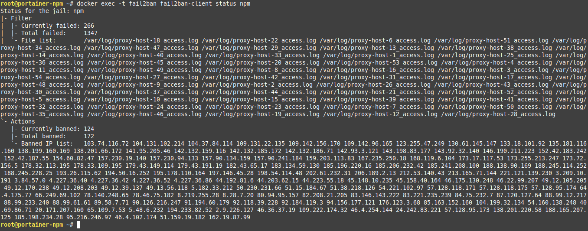

aJe pars du principe que vous maîtrisez un minimum Docker avec Portainer 😉

-----

## 1\. Fail2ban, qu'est-ce que c'est ?

Fail2ban est un service qui analyse en temps réel les journaux d'évènement de divers services (SSH, Apache, FTP, entre autres) à la recherche de comportements malveillants. Il permet d'exécuter une ou plusieurs actions (comme bannir une adresse IP) lorsqu'un nombre défini d'événements malveillants est détecté.

La suite, c'est [ICI](https://fr.wikipedia.org/wiki/Fail2ban).




### Liens utiles

  - [Site officiel](https://github.com/fail2ban/fail2ban)
  - [Wikipédia](https://fr.wikipedia.org/wiki/Fail2ban)
  - [Docker Linuxserver.io sur DockerHub](https://hub.docker.com/r/linuxserver/fail2ban)
  - [Docker par CrazyMax sur GitHub](https://github.com/crazy-max/docker-fail2ban) (**image utilisée pour la suite**)

-----

## 2\. Configuration du Fichier `docker-compose.yml`

Pour déployer Fail2ban, nous allons créer un répertoire de travail et le fichier de configuration Compose qui liera le conteneur Fail2ban aux logs de NPM.

  - Partons du principe que l'on déploie avec Docker, nous créons un répertoire “fail2ban” :

<!-- end list -->

```plaintext
mkdir fail2ban
```

  - On se place dedans :

<!-- end list -->

```plaintext
cd fail2ban
```

  - On crée notre fichier docker-compose.yml :

<!-- end list -->

```plaintext
nano docker-compose.yml
```

  - On colle ce qui suit (mon fichier .yml docker-compose personnel) :

<!-- end list -->

```plaintext
version: "3.7"
services:
  fail2ban:
    image: crazymax/fail2ban:latest
    container_name: fail2ban
    network_mode: host
    cap_add:
      - NET_ADMIN
      - NET_RAW
    volumes:
      - ./data:/data
      - /data/compose/1/data/logs:/var/log:ro
    environment:
      - TZ=Europe/Brussels
      - F2B_LOG_TARGET=STDOUT
      - F2B_LOG_LEVEL=INFO
      - F2B_DB_PURGE_AGE=28d
    restart: always
```

### Détail des lignes cruciales

| Ligne | Description |
| :--- | :--- |
| `network_mode: host` | Nécessaire pour que Fail2ban puisse manipuler les règles **iptables** sur l'hôte. |
| `cap_add: NET_ADMIN, NET_RAW` | Droits étendus requis pour la gestion des pare-feux et des paquets réseau par Fail2ban. |
| **`- ./data:/data`** | **Montage essentiel :** Ce volume contient les fichiers de configuration de Fail2ban (`action.d`, `filter.d`, `jail.d`). |
| **`- /data/compose/1/data/logs:/var/log:ro`** | **Ligne à modifier \!** C'est l'emplacement des logs de NPM sur l'hôte, monté en lecture seule (`:ro`) dans le conteneur. (Le chemin `/data/compose/1/` indique un déploiement Portainer). |
| `- F2B_DB_PURGE_AGE=28d` | Purge la base de données interne de Fail2ban tous les 28 jours (par défaut à 1). |

> **ATTENTION :** La ligne `- /data/compose/1/data/logs:/var/log:ro` est la plus importante \! Si vous ajoutez Fail2ban au compose de Nginx Proxy Manager sans avoir modifié les volumes de ce dernier, la ligne sera plutôt : `- ./data/logs:/opt/log`

-----

## 3\. Configuration de Fail2ban : Actions, Filtres et Jails

Les répertoires de travail **`action.d`**, **`filter.d`** et **`jail.d`** se trouvent dans le volume monté localement (ici `./data`).

### 3.1. Fichier d'Action (`action.d/docker-action.conf`)

Une action définit l'outil ou le script exécuté lors de la détection d'une intrusion. Ici, nous définissons des règles **iptables** pour l'environnement Docker.

  - Dans le répertoire **`action.d`**, vous allez créer un fichier **`docker-action.conf`**, et coller ce qui suit :

<!-- end list -->

```plaintext
[Definition]

actionstart = iptables -N f2b-npm-docker
              iptables -A f2b-npm-docker -j RETURN
              iptables -I FORWARD -p tcp -m multiport --dports 0:65535 -j f2b-npm-docker

actionstop = iptables -D FORWARD -p tcp -m multiport --dports 0:65535 -j f2b-npm-docker
             iptables -F f2b-npm-docker
             iptables -X f2b-npm-docker

actioncheck = iptables -n -L FORWARD | grep -q 'f2b-npm-docker[ \t]'

actionban = iptables -I f2b-npm-docker -s <ip> -j DROP

actionunban = iptables -D f2b-npm-docker -s <ip> -j DROP
```

### 3.2. Fichier de Filtre (`filter.d/npm.conf`)

Un filtre est une expression régulière (`failregex`) utilisée pour scanner les logs et détecter les tentatives d'intrusion.

  - Dans le répertoire **`filter.d`**, vous allez créer un fichier **`npm.conf`**, et coller ce qui suit :

<!-- end list -->

```plaintext
[INCLUDES]

[Definition]

#failregex = ^\s*(?:\[\] )?\S+ \S+ (?:[4-5]0\d) - \S+ \S+ \S+ "[^"]*" \[Client <ADDR>\] (?:\[\w+ [^\]]*\] )*\[Sent-to <F-CONTAINER>[^\]]*</F-CONTAINER>\] "<F-USERAGENT>[^"]*</F-USERAGENT>"

failregex = ^\s*(?:\[\] )?\S+ \S+ (?:(?P<nf>404)|[4-5]0(?!4)\d|504) - \S+ \S+ \S+ "(?(nf)/(?:[^/]*/)*[^\.]*(?!\.(?:png|txt|jpg|ico|js|css|ttf|woff|woff2)[^\."]*)|[^"]*)" \[Client <ADDR>\] (?:\[\w+ [^\]]*\] )*\[Sent-to <F-CONTAINER>[^\]]*</F-CONTAINER>\] "<F-USERAGENT>[^"]*</F-USERAGENT>"
```

> **Note sur les Regex :** Ces deux expressions régulières ont été écrites spécifiquement pour NPM. Le second regex ignore les erreurs 404/504 si elles portent sur des fichiers statiques courants (`png`, `jpg`, `css`, `js`, etc.), réduisant ainsi les faux positifs.

### 3.3. Fichier Jail (`jail.d/npm.local`)

La *Jail* est le fichier de configuration principal qui lie le filtre à l'action et définit les règles de bannissement. La section `[DEFAULT]` gère les paramètres généraux.

  - Dans le répertoire **`jail.d`**, vous allez créer un fichier **`npm.local`**, et coller ce qui suit :

<!-- end list -->

```plaintext
[DEFAULT]

# "bantime.increment" allows to use database for searching of previously banned ip's to increase a
# default ban time using special formula, default it is banTime * 1, 2, 4, 8, 16, 32...
bantime.increment = true


# "bantime.rndtime" is the max number of seconds using for mixing with random time
# to prevent "clever" botnets calculate exact time IP can be unbanned again:
bantime.rndtime = 1200


# "bantime.maxtime" is the max number of seconds using the ban time can reach (don't grows further)
#bantime.maxtime =


# "bantime.factor" is a coefficient to calculate exponent growing of the formula or common multiplier,
# default value of factor is 1 and with default value of formula, the ban time
# grows by 1, 2, 4, 8, 16 ...
bantime.factor = 1


# "bantime.formula" used by default to calculate next value of ban time, default value bellow,
# the same ban time growing will be reached by multipliers 1, 2, 4, 8, 16, 32...
bantime.formula = ban.Time * (1<<(ban.Count if ban.Count<20 else 20)) * banFactor

# more aggressive example of formula has the same values only for factor "2.0 / 2.885385" :
#bantime.formula = ban.Time * math.exp(float(ban.Count+1)*banFactor)/math.exp(1*banFactor)


# "bantime.multipliers" used to calculate next value of ban time instead of formula, coresponding
# previously ban count and given "bantime.factor" (for multipliers default is 1);
# following example grows ban time by 1, 2, 4, 8, 16 ... and if last ban count greater as multipliers count,
# always used last multiplier (64 in example), for factor '1' and original ban time 600 - 10.6 hours
#bantime.multipliers = 1 2 4 8 16 32 64

# following example can be used for small initial ban time (bantime=60) - it grows more aggressive at begin,
# for bantime=60 the multipliers are minutes and equal: 1 min, 5 min, 30 min, 1 hour, 5 hour, 12 hour, 1 day, 2 day
#bantime.multipliers = 1 5 30 60 300 720 1440 2880


[npm]
enabled = true
ignoreself = true
ignoreip =  127.0.0.1/8 ::1 # A good idea is to mention your LAN IP address range (example: 192.168.2.0/24) as well as your WAN IP.
chain = DOCKER-USER
logpath = /var/log/proxy-host-*_access.log
maxretry = 5
findtime = 1h
bantime  = 10h
action = docker-action
```

#### Explications des paramètres de la Jail `[npm]`

| Paramètre | Valeur | Explication |
| :--- | :--- | :--- |
| **`ignoreip`** | `127.0.0.1/8 ::1` | Adresses IP à ne **jamais** bannir. **Ajoutez ici votre plage IP LAN (ex: 192.168.2.0/24) et votre IP WAN \!** |
| `chain` | `DOCKER-USER` | Indique la chaîne `iptables` à cibler dans un environnement Docker. |
| `logpath` | `/var/log/proxy-host-*_access.log` | Chemin du log NPM **à l'intérieur du conteneur** Fail2ban. |
| `maxretry` | `5` | Nombre maximal de tentatives échouées avant bannissement. |
| `findtime` | `1h` | Période de temps pour compter les tentatives (`maxretry`). |
| `bantime` | `10h` | Durée initiale du bannissement. |
| `action` | `docker-action` | Nom de l'action à exécuter (correspond à `docker-action.conf`). |

#### Incrémentation du temps de bannissement (Section `[DEFAULT]`)

L'option `bantime.increment = true` est activée pour durcir les bannissements en cas de récidive :

  - La formule par défaut (`bantime.formula`) utilise un facteur qui double la durée du bannissement à chaque fois (1, 2, 4, 8, 16, etc. fois la durée initiale).
  - `bantime.rndtime = 1200` ajoute jusqu'à 20 minutes (1200 secondes) de temps aléatoire au bannissement pour contrer les robots qui calculent l'heure exacte de la levée d'interdiction.

-----

## 4\. Lancement et Commandes Utiles

  - Il est plus que temps de créer et de lancer notre conteneur :

<!-- end list -->

```plaintext
docker compose up -d
```

### Commandes de gestion de Fail2ban (via le conteneur)

Je vais vous donner quelques commandes sympas à utiliser directement via le conteneur.

  - **Status Jail (Général) :** Affiche l'état des jails actives.

<!-- end list -->

```plaintext
docker exec -t fail2ban fail2ban-client status
```

  - **Status Jail NPM (Détaillé) :** Affiche le nombre d'IPs bannies pour la jail NPM.

<!-- end list -->

```plaintext
docker exec -t fail2ban fail2ban-client status npm 
```

  - **Recherche de requêtes d'une IP bannie (sur l'hôte) :**

<!-- end list -->

```plaintext
grep <IP-ADRESS> /EMPLACEMENT/RĖPERTOIRE/LOGS/proxy-host-*_access.log
```

⇒ Ce qui donne chez moi avec un exemple :

```plaintext
grep 20.171.207.160 /data/compose/1/data/logs/proxy-host-*_access.log
```

  - **Ban list :** Affiche la liste de toutes les IPs bannies.

<!-- end list -->

```plaintext
docker exec -t fail2ban fail2ban-client banned
```

  - **Ban IP :** Bannit manuellement une IP.

<!-- end list -->

```plaintext
docker exec -t fail2ban fail2ban-client set npm banip <IP>
```

  - **UnBan IP :** Lève manuellement le bannissement d'une IP.

<!-- end list -->

```plaintext
docker exec -t fail2ban fail2ban-client set npm unbanip <IP>
```

  - **Fail2Ban version :**

<!-- end list -->

```plaintext
docker exec -t fail2ban fail2ban-client version
```

  - **Aide complète :**

<!-- end list -->

```plaintext
docker exec -t fail2ban fail2ban-client --help
```

-----

## 5\. Bonus : Autres Configurations de la Jail

Voici trois configurations alternatives pour le fichier `jail.d/npm.local` qui proposent différentes approches pour l'incrémentation de la durée de bannissement.

Le fichier compose ainsi que l'ensemble des fichiers de configurations sont également disponibles sur [ByteStash Blabla Linux](https://bytestash.blablalinux.be/public/snippets), [ICI](https://bytestash.blablalinux.be/s/88d0b59ad29d4c29d9fabb1b803b0d8d). Une version optimisée des fichiers de configurations (filter.d et jail.d) est également disponible sur [ByteStash Blabla Linux](https://bytestash.blablalinux.be/public/snippets), [ICI](https://bytestash.blablalinux.be/s/813dda2b72865920117bec4416326c3c).

### 5.1. `bantime.multipliers` (Croissance exponentielle agressive)

Cette configuration utilise des multiplicateurs basés sur les minutes pour une croissance agressive du temps de bannissement, notamment utile avec un temps initial (`bantime`) plus court (ex: 1h).

```plaintext
[DEFAULT]

# "bantime.increment" allows to use database for searching of previously banned ip's to increase a
# default ban time using special formula, default it is banTime * 1, 2, 4, 8, 16, 32...
bantime.increment = true


# "bantime.rndtime" is the max number of seconds using for mixing with random time
# to prevent "clever" botnets calculate exact time IP can be unbanned again:
bantime.rndtime = 1200


# "bantime.maxtime" is the max number of seconds using the ban time can reach (don't grows further)
#bantime.maxtime =


# "bantime.factor" is a coefficient to calculate exponent growing of the formula or common multiplier,
# default value of factor is 1 and with default value of formula, the ban time
# grows by 1, 2, 4, 8, 16 ...
#bantime.factor = 1


# "bantime.formula" used by default to calculate next value of ban time, default value bellow,
# the same ban time growing will be reached by multipliers 1, 2, 4, 8, 16, 32...
#bantime.formula = ban.Time * (1<<(ban.Count if ban.Count<20 else 20)) * banFactor

# more aggressive example of formula has the same values only for factor "2.0 / 2.885385" :
#bantime.formula = ban.Time * math.exp(float(ban.Count+1)*banFactor)/math.exp(1*banFactor)


# "bantime.multipliers" used to calculate next value of ban time instead of formula, coresponding
# previously ban count and given "bantime.factor" (for multipliers default is 1);
# following example grows ban time by 1, 2, 4, 8, 16 ... and if last ban count greater as multipliers count,
# always used last multiplier (64 in example), for factor '1' and original ban time 600 - 10.6 hours
#bantime.multipliers = 1 2 4 8 16 32 64

# following example can be used for small initial ban time (bantime=60) - it grows more aggressive at begin,
# for bantime=60 the multipliers are minutes and equal: 1 min, 5 min, 30 min, 1 hour, 5 hour, 12 hour, 1 day, 2 day
bantime.multipliers = 1 5 30 60 300 720 1440 2880


[npm]
enabled = true
ignoreself = true
ignoreip =  127.0.0.1/8 ::1 # A good idea is to mention your LAN IP address range (example: 192.168.2.0/24) as well as your WAN IP.
chain = DOCKER-USER
logpath = /var/log/proxy-host-*_access.log
maxretry = 5
findtime = 1h
bantime  = 1h
action = docker-action
```

### 5.2. `bantime.multipliers` (Croissance par facteur de 2)

Utilisation d'une série de multiplicateurs qui double la durée de bannissement à chaque récidive.

```plaintext
[DEFAULT]

# "bantime.increment" allows to use database for searching of previously banned ip's to increase a
# default ban time using special formula, default it is banTime * 1, 2, 4, 8, 16, 32...
bantime.increment = true


# "bantime.rndtime" is the max number of seconds using for mixing with random time
# to prevent "clever" botnets calculate exact time IP can be unbanned again:
bantime.rndtime = 1200


# "bantime.maxtime" is the max number of seconds using the ban time can reach (don't grows further)
#bantime.maxtime =


# "bantime.factor" is a coefficient to calculate exponent growing of the formula or common multiplier,
# default value of factor is 1 and with default value of formula, the ban time
# grows by 1, 2, 4, 8, 16 ...
#bantime.factor = 1


# "bantime.formula" used by default to calculate next value of ban time, default value bellow,
# the same ban time growing will be reached by multipliers 1, 2, 4, 8, 16, 32...
#bantime.formula = ban.Time * (1<<(ban.Count if ban.Count<20 else 20)) * banFactor

# more aggressive example of formula has the same values only for factor "2.0 / 2.885385" :
#bantime.formula = ban.Time * math.exp(float(ban.Count+1)*banFactor)/math.exp(1*banFactor)


# "bantime.multipliers" used to calculate next value of ban time instead of formula, coresponding
# previously ban count and given "bantime.factor" (for multipliers default is 1);
# following example grows ban time by 1, 2, 4, 8, 16 ... and if last ban count greater as multipliers count,
# always used last multiplier (64 in example), for factor '1' and original ban time 600 - 10.6 hours
bantime.multipliers = 1 2 4 8 16 32 64

# following example can be used for small initial ban time (bantime=60) - it grows more aggressive at begin,
# for bantime=60 the multipliers are minutes and equal: 1 min, 5 min, 30 min, 1 hour, 5 hour, 12 hour, 1 day, 2 day
#bantime.multipliers = 1 5 30 60 300 720 1440 2880


[npm]
enabled = true
ignoreself = true
ignoreip =  127.0.0.1/8 ::1 # A good idea is to mention your LAN IP address range (example: 192.168.2.0/24) as well as your WAN IP.
chain = DOCKER-USER
logpath = /var/log/proxy-host-*_access.log
maxretry = 5
findtime = 1h
bantime  = 10h
action = docker-action
```

### 5.3. Désactivation de l'incrémentation (`bantime.increment = false`)

Cette configuration utilise uniquement le temps de bannissement initial (`bantime = 10h`), sans durcissement en cas de récidive.

```plaintext
[DEFAULT]

# "bantime.increment" allows to use database for searching of previously banned ip's to increase a
# default ban time using special formula, default it is banTime * 1, 2, 4, 8, 16, 32...
#bantime.increment = true


# "bantime.rndtime" is the max number of seconds using for mixing with random time
# to prevent "clever" botnets calculate exact time IP can be unbanned again:
bantime.rndtime = 1200


# "bantime.maxtime" is the max number of seconds using the ban time can reach (don't grows further)
#bantime.maxtime =


# "bantime.factor" is a coefficient to calculate exponent growing of the formula or common multiplier,
# default value of factor is 1 and with default value of formula, the ban time
# grows by 1, 2, 4, 8, 16 ...
#bantime.factor = 1


# "bantime.formula" used by default to calculate next value of ban time, default value bellow,
# the same ban time growing will be reached by multipliers 1, 2, 4, 8, 16, 32...
#bantime.formula = ban.Time * (1<<(ban.Count if ban.Count<20 else 20)) * banFactor

# more aggressive example of formula has the same values only for factor "2.0 / 2.885385" :
#bantime.formula = ban.Time * math.exp(float(ban.Count+1)*banFactor)/math.exp(1*banFactor)


# "bantime.multipliers" used to calculate next value of ban time instead of formula, coresponding
# previously ban count and given "bantime.factor" (for multipliers default is 1);
# following example grows ban time by 1, 2, 4, 8, 16 ... and if last ban count greater as multipliers count,
# always used last multiplier (64 in example), for factor '1' and original ban time 600 - 10.6 hours
#bantime.multipliers = 1 2 4 8 16 32 64

# following example can be used for small initial ban time (bantime=60) - it grows more aggressive at begin,
# for bantime=60 the multipliers are minutes and equal: 1 min, 5 min, 30 min, 1 hour, 5 hour, 12 hour, 1 day, 2 day
#bantime.multipliers = 1 5 30 60 300 720 1440 2880


[npm]
enabled = true
ignoreself = true
ignoreip =  127.0.0.1/8 ::1 # A good idea is to mention your LAN IP address range (example: 192.168.2.0/24) as well as your WAN IP.
chain = DOCKER-USER
logpath = /var/log/proxy-host-*_access.log
maxretry = 5
findtime = 1h
bantime  = 10h
action = docker-action
```
