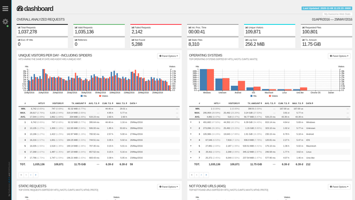

aJe pars du principe que vous maîtrisez un minimum Docker avec Portainer 😉

-----

## 1\. GoAccess, qu'est-ce que c'est ?

GoAccess est un analyseur de journaux web en temps réel et interactif, qui s'exécute dans un terminal ou via HTML.

GoAccess va vous permettre de visualiser en temps réel, sous forme de tableaux, l'ensemble des logs (fichiers journaux) des hôtes proxy de votre proxy inverse Nginx Proxy Manager.

<p style="text-align: center"></p>

### Liens utiles

  - [Site officiel](https://goaccess.io)
  - [Live Demo](http://rt.goaccess.io/?20250113204951)
  - [GitHub](https://github.com/allinurl/goaccess)
  - [Pour Nginx Proxy Manager](https://github.com/xavier-hernandez/goaccess-for-nginxproxymanager)

-----

## 2\. Configuration du Fichier `docker-compose.yml`

Nous allons créer le répertoire de travail et le fichier Compose pour le service GoAccess, qui utilisera l'image spécialisée pour NPM.

  - Partons du principe que l'on déploie avec Docker, nous créons un répertoire “goaccess” :

<!-- end list -->

```plaintext
mkdir goaccess
```

  - On se place dedans :

<!-- end list -->

```plaintext
cd goaccess
```

  - On crée notre fichier docker-compose.yml :

<!-- end list -->

```plaintext
nano docker-compose.yml 
```

  - On colle ce qui suit (mon fichier .yml docker-compose personnel - fichier compose également disponible sur [ByteStash Blabla Linux](https://bytestash.blablalinux.be/public/snippets)) :

<!-- end list -->

```plaintext
version: '3.8'
services:
  goaccess:
    image: 'xavierh/goaccess-for-nginxproxymanager:latest'
    container_name: goaccess
    restart: always
    ports:
      - '7880:7880'
    environment:
      - TZ=Europe/Brussels #optional
      - LANG=fr_FR.UTF-8 #optional
      - LANGUAGE=fr_FR.UTF-8 #optional
      - SKIP_ARCHIVED_LOGS=False #optional
      - DEBUG=False #optional
      - BASIC_AUTH=False #optional
      - BASIC_AUTH_USERNAME=user #optional
      - BASIC_AUTH_PASSWORD=pass #optional    
      - EXCLUDE_IPS=127.0.0.1 #optional - comma delimited 
      - LOG_TYPE=NPM+R #optional
      - ENABLE_BROWSERS_LIST=True #optional
      - CUSTOM_BROWSERS=Kuma:Uptime,TestBrowser:Crawler #optional - comma delimited
      - HTML_REFRESH=5 #optional - Refresh the HTML report every X seconds. https://goaccess.io/man
      - KEEP_LAST=30 #optional - Keep the last specified number of days in storage. https://goaccess.io/man
      - PROCESSING_THREADS=1 #optional - This parameter sets the number of concurrent processing threads in the program's execution, affecting log data analysis, typically adjusted based on CPU cores. Default is 1. https://goaccess.io/man
    volumes:
      - /data/compose/1/data/logs:/opt/log
      #- /path/to/host/custom:/opt/custom #optional, required if using log_type = CUSTOM
```

### Lignes et paramètres essentiels

Le point crucial de cette configuration est de s'assurer que le conteneur GoAccess puisse **accéder aux logs de NPM** sur votre machine hôte.

| Paramètre | Ligne à Modifier | Explication |
| :--- | :--- | :--- |
| **Log Path (Volume)** | `- /data/compose/1/data/logs:/opt/log` | **La ligne la plus importante.** Doit pointer vers le répertoire des logs de NPM sur l'hôte. `/opt/log` est le chemin d'entrée dans le conteneur. Le chemin `/data/compose/1/` indique ici un déploiement Portainer. |
| **Log Path (Alternative)** | `- ./data/logs:/opt/log` | Si vous ajoutez GoAccess au Compose de NPM et que vous n'avez pas modifié les volumes de ce dernier. |
| **Port** | `'7880:7880'` | Le service web de GoAccess sera accessible via le port **7880**. |
| **Fuseau Horaire** | `- TZ=Europe/Brussels` | Permet d'ajuster l'heure affichée dans les statistiques. |
| **Langue** | `- LANG=fr_FR.UTF-8` et `- LANGUAGE=fr_FR.UTF-8` | Passe l'interface GoAccess en français. |
| **Exclusion d'IP** | `- EXCLUDE_IPS=127.0.0.1` | Permet d'exclure les adresses IP internes du monitoring. Vous pouvez ajouter plusieurs adresses IP séparées par une virgule. |
| **Type de Log** | `- LOG_TYPE=NPM+R` | Définit la configuration de GoAccess pour lire les logs de NPM. |

### Détail des options de `LOG_TYPE`

Le paramètre `- LOG_TYPE` est essentiel pour déterminer quels logs sont analysés :

| Valeur | Logs analysés | Instances GoAccess créées |
| :--- | :--- | :--- |
| **`NPM`** | Fichiers `proxy-host-*_access.log` et `.log.gz`. | 1 (Accès direct à `http://localhost:7880`) |
| **`NPM+R`** | Logs `NPM` **PLUS** logs de redirection, fallback et dead-host. | 2 (La seconde instance est accessible via `http://localhost:7880/redirection/`) |
| **`NPM+ALL`** | Logs `NPM` **PLUS** logs de redirection et logs d'erreur. | 3 (Instances sur `/redirection/` et `/error/`) |

### Configuration de l'Authentification (Optionnel)

Par défaut, l'authentification n'est pas activée.

  - **Sans authentification (Défaut) :**
    `- BASIC_AUTH=False #optional`

  - **Avec authentification :**
    Il faut définir le statut à `True` et définir le nom d'utilisateur et le mot de passe.

    ```plaintext
    - BASIC_AUTH=True #optional
    - BASIC_AUTH_USERNAME=anyblabla #optional
    - BASIC_AUTH_PASSWORD=blablalinux #optional
    ```

### Options de Rétention et de Rafraîchissement

  - **Rafraîchissement HTML :**
    `- HTML_REFRESH=5 #optional` (La page HTML sera rafraîchie toutes les **cinq secondes**.)

  - **Rétention des données :**
    `- KEEP_LAST=30 #optional` (Les statistiques sur les **trente derniers jours** seront prises en compte.)

-----

## 3\. Lancement du Conteneur

  - **Une fois que tout est réglé, on peut lancer notre conteneur :**

<!-- end list -->

```plaintext
docker compose up -d
```

Vous pouvez ensuite accéder à l'interface de GoAccess via votre navigateur à l'adresse **`http://<Votre_IP_Hôte>:7880`**.

## Remarque

Je vous conseille de vous rendre sur [la page de projet GitHub](https://github.com/xavier-hernandez/goaccess-for-nginxproxymanager), ou encore mieux, [sur la page “man” du site officiel](https://goaccess.io/man) pour plus de détails sur les options avancées.
