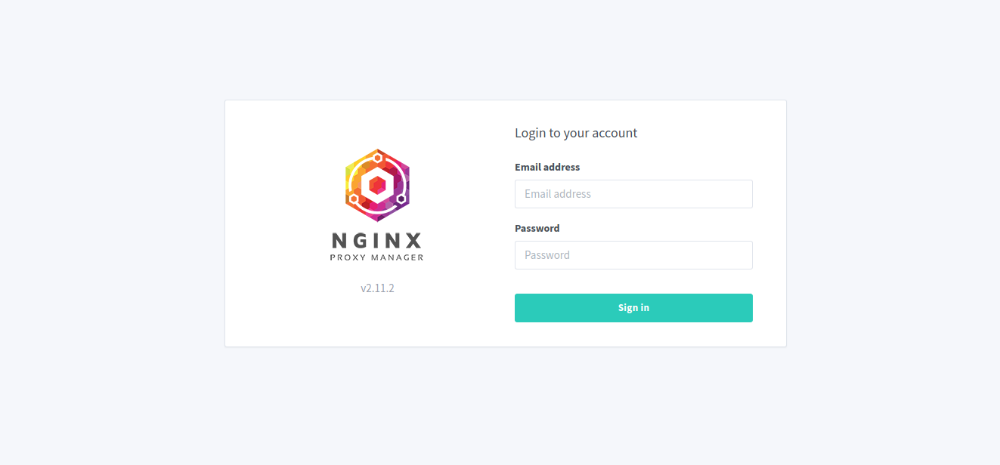
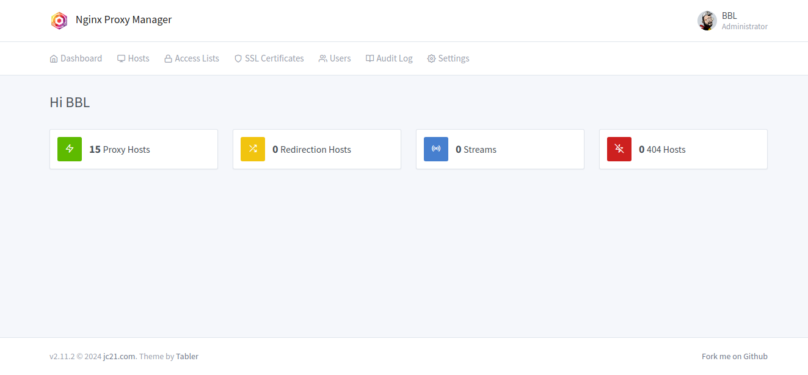
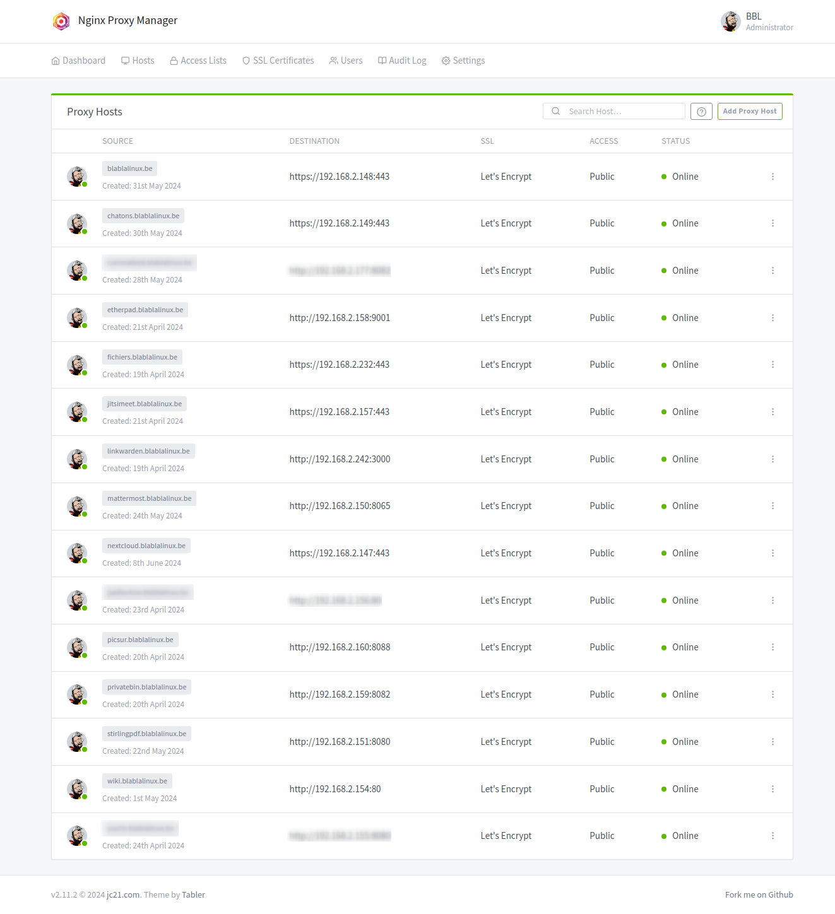

Je pars du principe que vous maîtrisez un minimum Docker avec Portainer 😉

-----

## 1\. Nginx Proxy Manager, c'est quoi ?

**Nginx Proxy Manager (NPM)** est un **proxy inverse** *open source* qui facilite la redirection du trafic web vers les services appropriés. Il permet d'utiliser une **seule adresse IP publique** pour héberger de nombreux services Web différents, en gérant automatiquement les certificats **Let's Encrypt** via une interface utilisateur graphique.

### Liens utiles

  - [NPM Site officiel](https://nginxproxymanager.com)
  - [NPM sur GitHub](https://github.com/NginxProxyManager/nginx-proxy-manager)
  - [NPM sur Docker Hub](https://hub.docker.com/r/jc21/nginx-proxy-manager)

-----

## 2\. Docker Compose : Options de Base de Données

NPM peut utiliser une base de données MariaDB externe (option la plus robuste) ou SQLite (base de données par défaut, plus simple, incluse dans le conteneur NPM).

### Option A : Avec MariaDB (Base de données séparée)

Cette configuration utilise un service **`db`** dédié pour MariaDB et le lie au service **`app`** (NPM).

```plaintext
version: '3.8'
services:
  app:
    image: 'jc21/nginx-proxy-manager:latest'
    restart: always
    ports:
      # These ports are in format <host-port>:<container-port>
      - '80:80' # Public HTTP Port
      - '443:443' # Public HTTPS Port
      - '81:81' # Admin Web Port
      # Add any other Stream port you want to expose
      # - '21:21' # FTP
    environment:
      # Mysql/Maria connection parameters:
      DB_MYSQL_HOST: "db"
      DB_MYSQL_PORT: 3306
      DB_MYSQL_USER: "npm"
      DB_MYSQL_PASSWORD: "npm"
      DB_MYSQL_NAME: "npm"
      # Uncomment this if IPv6 is not enabled on your host
      # DISABLE_IPV6: 'true'
    volumes:
      - ./data:/data
      - ./letsencrypt:/etc/letsencrypt
    depends_on:
      - db

  db:
    image: 'jc21/mariadb-aria:latest'
    restart: always
    environment:
      MYSQL_ROOT_PASSWORD: 'npm'
      MYSQL_DATABASE: 'npm'
      MYSQL_USER: 'npm'
      MYSQL_PASSWORD: 'npm'
    volumes:
      - ./mysql:/var/lib/mysql
```

#### Variables MariaDB à personnaliser

Les informations de connexion à la base de données doivent correspondre entre le service **`app`** (où NPM lit) et le service **`db`** (où MariaDB est configuré).

  - Vous pouvez personnaliser ces variables (faire correspondre les variables entre elles) :

| Service `app` | Service `db` | Description |
| :--- | :--- | :--- |
| `DB_MYSQL_USER: "npm"` | `MYSQL_USER: 'npm'` | Nom d'utilisateur NPM/MariaDB. |
| `DB_MYSQL_PASSWORD: "npm"` | `MYSQL_PASSWORD: 'npm'` | Mot de passe NPM/MariaDB. |

### Option B : Avec SQLite (Base de données interne)

Pour une installation plus légère, NPM utilise par défaut une base de données **SQLite** stockée dans le volume `./data`. Cette configuration n'inclut que le service NPM.

```plaintext
services:
  npm:
    image: 'jc21/nginx-proxy-manager:latest'
    container_name: npm
    restart: always
    ports:
      # These ports are in format <host-port>:<container-port>
      - '80:80' # Public HTTP Port
      - '443:443' # Public HTTPS Port
      - '81:81' # Admin Web Port
      # Add any other Stream port you want to expose
      # - '21:21' # FTP

    environment:
      # Uncomment this if you want to change the location of
      # the SQLite DB file within the container
      # DB_SQLITE_FILE: "/data/database.sqlite"

      # Uncomment this if IPv6 is not enabled on your host
      # DISABLE_IPV6: 'true'

      # X-FRAME-OPTIONS Header
      X_FRAME_OPTIONS: "sameorigin"

    volumes:
      - ./data:/data
      - ./letsencrypt:/etc/letsencrypt
      - ./logrotate.custom:/etc/logrotate.d/nginx-proxy-manager

    healthcheck:
      test: ["CMD", "/usr/bin/check-health"]
      interval: 10s
      timeout: 3s
```

-----

## 3\. Exécution et Accès Initial

Après la première exécution du Docker Compose :

1.  Les clés JWT (JSON Web Token) seront générées et enregistrées dans le dossier `./data`.
2.  La base de données s'initialisera.
3.  Un utilisateur administrateur par défaut sera créé.

Ce processus peut prendre quelques minutes selon votre machine.

  - **URL d'administration :** Accédez à l'interface via le port 81 : `http://<VOTRE_IP>:81`

### Utilisateur administrateur par défaut

  - Email : **`admin@example.com`**
  - Password : **`changeme`**

> **ATTENTION :** Il est impératif de changer ces identifiants dès la première connexion.

#### Captures



Nginx Proxy Manager - Login



Nginx Proxy Manager - Dashboard



Nginx Proxy Manager - Proxy Hosts

-----

## 4\. Optimisation et Configuration Avancée (Bonus)

### Optimisation des Performances (Versions 1.12.5+)

À partir de la version **1.12.5** de NPM, deux variables d'environnement ont été ajoutées pour corriger les problèmes de lenteur au démarrage :

```plaintext
services:
  npm:
    image: jc21/nginx-proxy-manager:2.12.6
    container_name: npm
    # ... autres paramètres ...
    environment:
      IP_RANGES_FETCH_ENABLED: false # Désactive la récupération des plages IP (corrige la lenteur)
      SKIP_CERTBOT_OWNERSHIP: true # Contourne la vérification de propriété Certbot (corrige la lenteur)
    # ... autres paramètres ...
```

### Autres Options de Configuration

| Option | Code à ajouter au service `app` ou `npm` | Explication |
| :--- | :--- | :--- |
| **Vérification de Santé** | `healthcheck: test: ["CMD", "/usr/bin/check-health"] interval: 10s timeout: 3s` | Ajoute un contrôle d'état pour vérifier si le conteneur est opérationnel. |
| **En-tête X-FRAME-OPTIONS** | `environment: X_FRAME_OPTIONS: "sameorigin"` | Configure l'en-tête pour autoriser l'affichage dans une `iframe` sur le même domaine (par défaut : `DENY`). |
| **Rotation des logs (Logrotate)** | `volumes: - ./logrotate.custom:/etc/logrotate.d/nginx-proxy-manager` | Permet de personnaliser la rotation des logs en montant un fichier `logrotate.custom` sur la configuration interne de NPM. |
| **Module GeoIP2** | Inclure dans le volume `/data/nginx/custom/root_top.conf` : `load_module /usr/lib/nginx/modules/ngx_http_geoip2_module.so; load_module /usr/lib/nginx/modules/ngx_stream_geoip2_module.so;` | Active les modules de géolocalisation pour Nginx. |

**Référence Logrotate par défaut :**

```plaintext
/data/logs/*_access.log /data/logs/*/access.log {
    su npm npm
    create 0644
    weekly
    rotate 4
    missingok
    notifempty
    compress
    sharedscripts
    postrotate
    kill -USR1 `cat /run/nginx/nginx.pid 2>/dev/null` 2>/dev/null || true
    endscript
}

/data/logs/*_error.log /data/logs/*/error.log {
    su npm npm
    create 0644
    weekly
    rotate 10
    missingok
    notifempty
    compress
    sharedscripts
    postrotate
    kill -USR1 `cat /run/nginx/nginx.pid 2>/dev/null` 2>/dev/null || true
    endscript
}
```

Cette configuration est disponible [ICI](https://github.com/NginxProxyManager/nginx-proxy-manager/blob/develop/docker/rootfs/etc/logrotate.d/nginx-proxy-manager).
