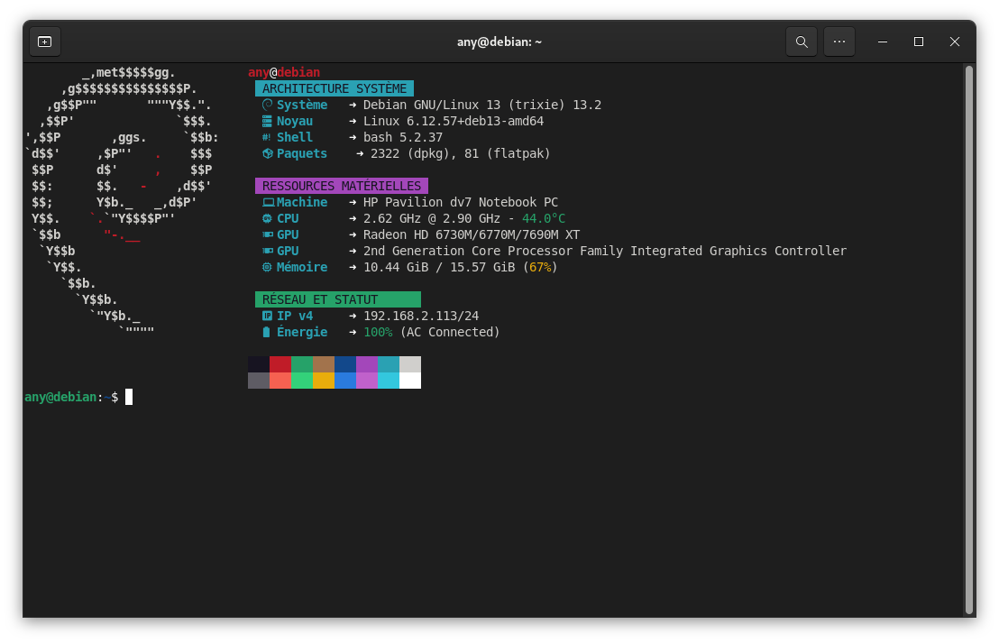
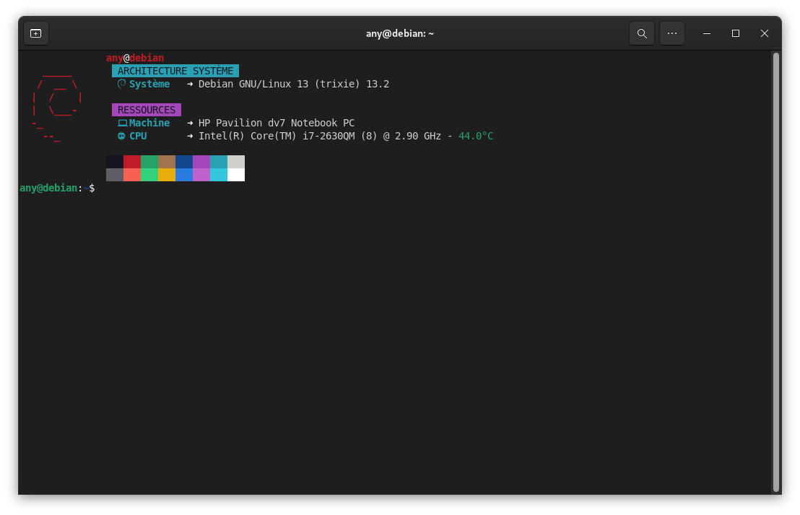
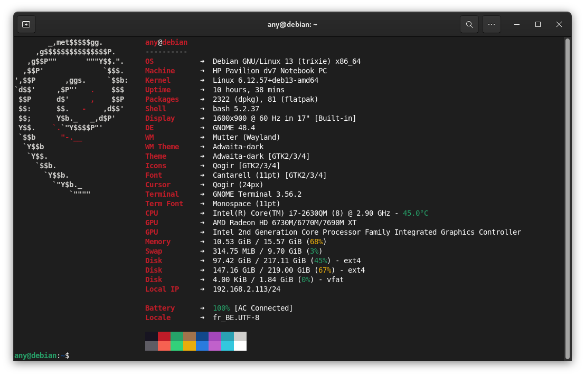
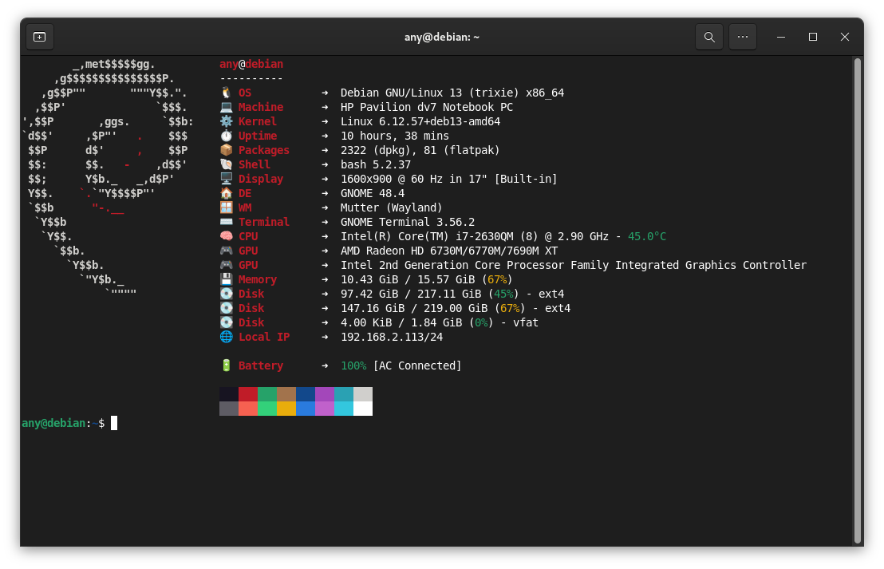
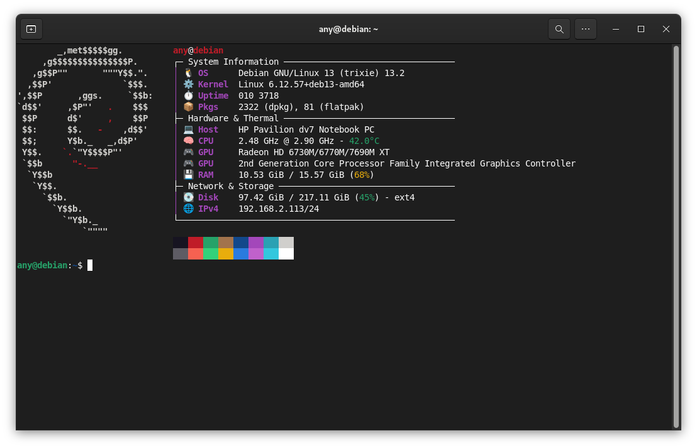
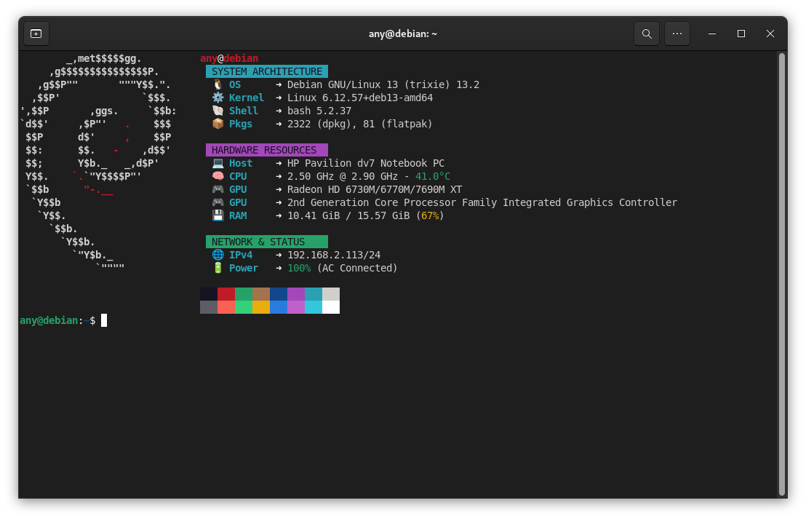
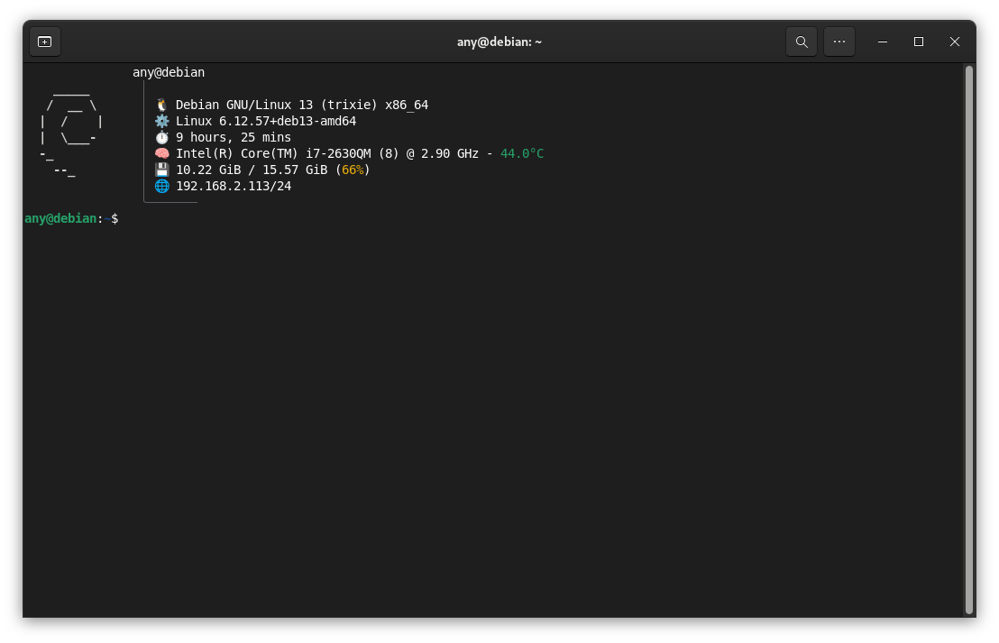
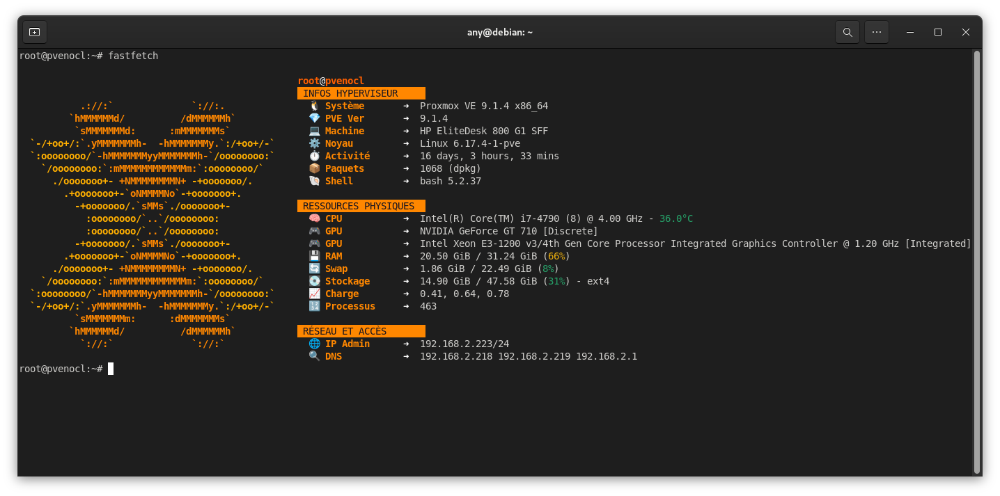

Je vous partage ici mon expérience avec **Fastfetch**, l'outil que j'utilise au quotidien pour afficher les informations système de mes machines. C'est, selon moi, la meilleure alternative à Neofetch pour allier rapidité et design.

## Installation de l'outil

Pour commencer, je vous explique comment l'installer sur vos systèmes basés sur Debian ou Ubuntu.

* **Sur Debian (Trixie/Sid) et Ubuntu (24.04+) :**

```bash
sudo apt update && sudo apt install fastfetch

```

* **Via PPA pour les versions plus anciennes :**

```bash
sudo add-apt-repository ppa:zhangsongcui3371/fastfetch
sudo apt update && sudo apt install fastfetch

```

## Gestion de ma configuration

Je centralise toutes mes modifications dans un seul fichier. Voici comment je procède pour appliquer mes réglages.

### Créer le fichier de base

Si vous voulez voir toutes les options disponibles, je vous conseille de générer le fichier par défaut :

```bash
fastfetch --gen-config

```

Le fichier se trouvera dans votre dossier personnel : `~/.config/fastfetch/config.jsonc`.

Sinon : `fastfetch --gen-config .config/fastfetch/config.jsonc`.

### Utiliser mes réglages personnalisés

1. Je m'assure que le dossier existe : `mkdir -p ~/.config/fastfetch`
2. J'édite le fichier avec mon éditeur favori : `nano ~/.config/fastfetch/config.jsonc`
3. Je remplace tout le contenu par l'un de mes modèles ci-dessous.

---

## 🎨 Aller plus loin : Les Nerd Fonts (Icônes HD)

Si vous voulez remplacer les émojis classiques par des icônes haute définition (logos de distribs, processeurs, etc.), vous devez installer une **Nerd Font**.

### 1. Installation rapide (Script)

Voici une commande pour installer la police **Hack Nerd Font** (très lisible) sur votre système :

```bash
mkdir -p ~/.local/share/fonts && cd ~/.local/share/fonts
wget https://github.com/ryanoasis/nerd-fonts/releases/latest/download/Hack.zip
unzip Hack.zip && rm Hack.zip && fc-cache -fv

```

### 2. L'astuce pour un rendu parfait

Inutile de forcer la police dans les réglages de votre terminal ! Dans les préférences de votre terminal (comme GNOME Terminal), **décochez "Police personnalisée"**. Le système utilisera sa police par défaut pour le texte et piochera automatiquement dans la Nerd Font fraîchement installée pour afficher les icônes.

> 💡 **Voici le résultat du rendu avec les Nerd Fonts sur mon terminal :**
> 

---

## ⚙️ Personnaliser votre fichier config.jsonc

Le fichier est structuré en **JSONC** (JSON avec commentaires). Voici comment adapter les modèles à votre machine :

### 🖼️ Changer le logo

Par défaut, Fastfetch détecte votre distribution. Mais vous pouvez forcer un logo spécifique (comme le `debian_small` que j'affectionne) ou même une image. Cela se place **avant** la section des modules :

```jsonc
    "logo": {
        "source": "debian_small", // Options : debian_small, ubuntu_small, arch_small, etc.
        "padding": {
            "top": 1,
            "left": 2
        }
    },

```

### 🧩 Les Modules

Chaque bloc `{ "type": "..." }` est un module.

* **Key :** C'est l'étiquette à gauche (ex: `"key": "󰻠 CPU"`).
* **Format :** Permet de choisir quelles données afficher.
* **Temp :** Ajoutez `"temp": true` pour afficher la température.
* **Le Host :** Par défaut, il affiche le nom du modèle détecté par le système.

### 📄 Exemple d'un fichier complet personnalisé

Voici à quoi ressemble la structure globale d'un fichier `config.jsonc` intégrant un logo spécifique et le style Néon :

<details>
<summary>Voir le code complet (Exemple Logo + Néon)</summary>

```jsonc
// # Modifications apportées par Blabla Linux
{
    "$schema": "https://github.com/fastfetch-cli/fastfetch/raw/dev/doc/json_schema.json",
    "logo": {
        "source": "debian_small",
        "padding": { "top": 1, "left": 2 }
    },
    "display": { "separator": " ➜ ", "color": { "keys": "cyan", "output": "white" } },
    "modules": [
        "title",
        { "type": "custom", "format": " \u001b[46m\u001b[30m ARCHITECTURE SYSTÈME \u001b[0m", "key": " " },
        { "type": "os", "key": "   Système  ", "format": "{3} {8}" },
        "break",
        { "type": "custom", "format": " \u001b[45m\u001b[30m RESSOURCES \u001b[0m", "key": " " },
        { "type": "host", "key": "  󰌢 Machine  " },
        { "type": "cpu", "key": "  󰻠 CPU       ", "temp": true },
        "break", "colors"
    ]
}

```

</details>



---

## Mes modèles de configuration

### 1. Style classique et épuré

C'est le modèle le plus complet en termes de données brutes. Je l'utilise quand j'ai besoin d'un rapport détaillé sans fioritures.

<details>
<summary>Voir le code (Classique)</summary>

```jsonc
// # Modifications apportées par Blabla Linux : https://link.blablalinux.be
{
    "$schema": "https://github.com/fastfetch-cli/fastfetch/raw/dev/doc/json_schema.json",
    "display": { "separator": " ➜  " },
    "modules": [
        "title", "separator",
        { "type": "os", "key": "Système     " },
        { "type": "host", "key": "Machine     " },
        { "type": "kernel", "key": "Noyau       " },
        { "type": "uptime", "key": "Activité    " },
        { "type": "packages", "key": "Paquets     " },
        { "type": "shell", "key": "Shell       " },
        { "type": "display", "key": "Écran       " },
        { "type": "de", "key": "Bureau      " },
        { "type": "terminal", "key": "Terminal    " },
        { "type": "cpu", "key": "Processeur  ", "temp": true },
        { "type": "gpu", "key": "Graphique   ", "hideType": "all", "format": "{1} {2}" },
        { "type": "memory", "key": "Mémoire     " },
        { "type": "swap", "key": "Swap        " },
        { "type": "disk", "key": "Disque      " },
        { "type": "localip", "key": "IP locale   ", "showIpv6": false },
        "break",
        { "type": "battery", "key": "Batterie    " },
        { "type": "poweradapter", "key": "Secteur     " },
        "colors"
    ]
}

```

</details>



### 2. Style moderne avec émojis

Parfait pour une identification visuelle instantanée des composants.

<details>
<summary>Voir le code (Émojis)</summary>

```jsonc
// # Modifications apportées par Blabla Linux : https://link.blablalinux.be
{
    "$schema": "https://github.com/fastfetch-cli/fastfetch/raw/dev/doc/json_schema.json",
    "display": { "separator": " ➜  " },
    "modules": [
        "title", "separator",
        { "type": "os", "key": "🐧 Système     " },
        { "type": "host", "key": "💻 Machine     " },
        { "type": "kernel", "key": "⚙️  Noyau       " },
        { "type": "uptime", "key": "⏱️  Activité    " },
        { "type": "packages", "key": "📦 Paquets     " },
        { "type": "shell", "key": "🐚 Shell       " },
        { "type": "cpu", "key": "🧠 Processeur  ", "temp": true },
        { "type": "gpu", "key": "🎮 Graphique   ", "hideType": "all", "format": "{1} {2}" },
        { "type": "memory", "key": "💾 Mémoire     " },
        { "type": "disk", "key": "💽 Disque      " },
        { "type": "localip", "key": "🌐 IP locale   ", "showIpv6": false },
        "break",
        { "type": "battery", "key": "🔋 Batterie    " },
        { "type": "poweradapter", "key": "🔌 Power       " },
        "colors"
    ]
}

```

</details>



### 3. Style tableau de bord (Dashboard)

Ce modèle organise l'information par catégories.

<details>
<summary>Voir le code (Tableau de bord)</summary>

```jsonc
// # Modifications apportées par Blabla Linux : https://link.blablalinux.be
{
    "$schema": "https://github.com/fastfetch-cli/fastfetch/raw/dev/doc/json_schema.json",
    "display": { "separator": " ", "color": { "keys": "magenta" } },
    "modules": [
        "title",
        { "type": "custom", "format": "┌─ Informations système ────────────────────────────────" },
        { "type": "os", "key": "│ 🐧 Système  ", "format": "{3} {8}" },
        { "type": "kernel", "key": "│ ⚙️  Noyau     ", "format": "{1} {2}" },
        { "type": "uptime", "key": "│ ⏱️  Activité ", "format": "{1}{2} {3}{4}" },
        { "type": "custom", "format": "├─ Matériel et température ─────────────────────────────" },
        { "type": "host", "key": "│ 💻 Machine  " },
        { "type": "cpu", "key": "│ 🧠 CPU      ", "temp": true, "format": "{6} @ {7} - {8}" },
        { "type": "gpu", "key": "│ 🎮 GPU      ", "hideType": "all", "format": "{2}" },
        { "type": "memory", "key": "│ 💾 Mémoire  " },
        { "type": "custom", "format": "├─ Stockage et réseau ──────────────────────────────────" },
        { "type": "disk", "key": "│ 💽 Disque   ", "folders": "/" },
        { "type": "localip", "key": "│ 🌐 IP v4     ", "showIpv6": false },
        { "type": "custom", "format": "└───────────────────────────────────────────────────────" },
        "break", "colors"
    ]
}

```

</details>



### 4. Style Néon Cyberpunk

Ma création favorite avec des bannières de couleurs ANSI.

#### Option A : Version Émojis (Universelle)

<details>
<summary>Voir le code (Néon Émojis)</summary>

```jsonc
// # Modifications apportées par Blabla Linux : https://link.blablalinux.be
{
    "$schema": "https://github.com/fastfetch-cli/fastfetch/raw/dev/doc/json_schema.json",
    "display": { "separator": " ➜ ", "color": { "keys": "cyan", "output": "white" } },
    "modules": [
        "title",
        { "type": "custom", "format": " \u001b[46m\u001b[30m ARCHITECTURE SYSTÈME \u001b[0m", "key": " " },
        { "type": "os", "key": "  🐧 Système  ", "format": "{3} {8}" },
        { "type": "kernel", "key": "  ⚙️  Noyau     ", "format": "{1} {2}" },
        { "type": "shell", "key": "  🐚 Shell     " },
        { "type": "packages", "key": "  📦 Paquets   " },
        "break",
        { "type": "custom", "format": " \u001b[45m\u001b[30m RESSOURCES MATÉRIELLES \u001b[0m", "key": " " },
        { "type": "host", "key": "  💻 Machine  " },
        { "type": "cpu", "key": "  🧠 CPU       ", "temp": true, "format": "{6} @ {7} - {8}" },
        { "type": "gpu", "key": "  🎮 GPU       ", "hideType": "all", "format": "{2}" },
        { "type": "memory", "key": "  💾 Mémoire  ", "format": "{1} / {2} ({3})" },
        "break",
        { "type": "custom", "format": " \u001b[42m\u001b[30m RÉSEAU ET STATUT       \u001b[0m", "key": " " },
        { "type": "localip", "key": "  🌐 IP v4     ", "showIpv6": false },
        { "type": "battery", "key": "  🔋 Énergie  ", "format": "{4} ({5})" },
        "break", "colors"
    ]
}

```

</details>



#### Option B : Version Nerd Fonts (Icônes HD)

<details>
<summary>Voir le code (Néon Nerd Fonts)</summary>

```jsonc
// # Modifications apportées par Blabla Linux : https://link.blablalinux.be
{
    "$schema": "https://github.com/fastfetch-cli/fastfetch/raw/dev/doc/json_schema.json",
    "display": { "separator": " ➜ ", "color": { "keys": "cyan", "output": "white" } },
    "modules": [
        "title",
        { "type": "custom", "format": " \u001b[46m\u001b[30m ARCHITECTURE SYSTÈME \u001b[0m", "key": " " },
        { "type": "os", "key": "   Système  ", "format": "{3} {8}" },
        { "type": "kernel", "key": "  󰒋 Noyau     ", "format": "{1} {2}" },
        { "type": "shell", "key": "  󱆃 Shell     " },
        { "type": "packages", "key": "  󰏖 Paquets   " },
        "break",
        { "type": "custom", "format": " \u001b[45m\u001b[30m RESSOURCES MATÉRIELLES \u001b[0m", "key": " " },
        { "type": "host", "key": "  󰌢 Machine  " },
        { "type": "cpu", "key": "  󰻠 CPU       ", "temp": true, "format": "{6} @ {7} - {8}" },
        { "type": "gpu", "key": "  󰢮 GPU       ", "hideType": "all", "format": "{2}" },
        { "type": "memory", "key": "  󰍛 Mémoire  ", "format": "{1} / {2} ({3})" },
        "break",
        { "type": "custom", "format": " \u001b[42m\u001b[30m RÉSEAU ET STATUT       \u001b[0m", "key": " " },
        { "type": "localip", "key": "  󰩟 IP v4     ", "showIpv6": false },
        { "type": "battery", "key": "  󰁹 Énergie  ", "format": "{4} ({5})" },
        "break", "colors"
    ]
}

```

</details>


### 5. Style "The Thin Line" (Minimaliste)

Une configuration ultra-fine qui prend très peu de place en largeur, parfaite pour les terminaux divisés (split screen).

<details>
<summary>Voir le code (Minimaliste)</summary>

```jsonc
// # Modèle "The Thin Line" par Blabla Linux
{
    "$schema": "https://github.com/fastfetch-cli/fastfetch/raw/dev/doc/json_schema.json",
    "logo": {
        "source": "debian_small",
        "padding": { "top": 1, "left": 2 },
        "color": { "1": "white" }
    },
    "display": {
        "separator": " ",
        "color": { "keys": "magenta" }
    },
    "modules": [
        { "type": "title", "format": "{1}@{2}" },
        { "type": "custom", "format": " \u001b[90m│\u001b[0m" },
        { "type": "os", "key": " \u001b[90m│\u001b[0m 🐧" },
        { "type": "kernel", "key": " \u001b[90m│\u001b[0m ⚙️ " },
        { "type": "uptime", "key": " \u001b[90m│\u001b[0m ⏱️ " },
        { "type": "cpu", "key": " \u001b[90m│\u001b[0m 🧠", "temp": true },
        { "type": "memory", "key": " \u001b[90m│\u001b[0m 💾" },
        { "type": "localip", "key": " \u001b[90m│\u001b[0m 🌐", "showIpv6": false },
        { "type": "custom", "format": " \u001b[90m╰───────\u001b[0m" }
    ]
}

```

</details>



---

### 🎁 Bonus : Le modèle Spécial Proxmox

Pour les utilisateurs de Proxmox, j'ai préparé une configuration qui affiche les infos vitales de l'hyperviseur avec le logo ASCII orange officiel.

<details>
<summary>Voir le code Proxmox (Pixel-Perfect)</summary>

```jsonc
// # Configuration Proxmox (Pixel-Perfect) - Blabla Linux
{
    "$schema": "https://github.com/fastfetch-cli/fastfetch/raw/dev/doc/json_schema.json",
    "logo": {
        "source": "proxmox",
        "color": { "1": "38;5;208", "2": "38;5;214" },
        "padding": { "top": 2, "left": 2 }
    },
    "display": { 
        "separator": " ➜  ", 
        "color": { "keys": "38;5;208", "output": "white" }
    },
    "modules": [
        "title",
        { "type": "custom", "format": "\u001b[48;5;208m\u001b[30m INFOS HYPERVISEUR     \u001b[0m" },
        { "type": "os", "key": "  🐧 Système      " },
        { "type": "command", "key": "  💎 PVE Ver      ", "shell": "bash", "text": "pveversion | cut -d'/' -f2" },
        { "type": "host", "key": "  💻 Machine      " },
        { "type": "kernel", "key": "  ⚙️  Noyau        " },
        { "type": "uptime", "key": "  ⏱️  Activité     " },
        { "type": "packages", "key": "  📦 Paquets      " },
        { "type": "shell", "key": "  🐚 Shell        " },
        "break",
        { "type": "custom", "format": "\u001b[48;5;208m\u001b[30m RESSOURCES PHYSIQUES  \u001b[0m" },
        { "type": "cpu", "key": "  🧠 CPU          ", "temp": true },
        { "type": "gpu", "key": "  🎮 GPU          " },
        { "type": "memory", "key": "  💾 RAM          " },
        { "type": "swap", "key": "  🔄 Swap         " },
        { "type": "disk", "key": "  💽 Stockage     ", "folders": "/" },
        { "type": "loadavg", "key": "  📈 Charge       " },
        { "type": "processes", "key": "  🔢 Processus    " },
        "break",
        { "type": "custom", "format": "\u001b[48;5;208m\u001b[30m RÉSEAU ET ACCÈS       \u001b[0m" },
        { "type": "localip", "key": "  🌐 IP Admin     ", "showIpv6": false },
        { "type": "dns", "key": "  🔍 DNS          " },
        { "type": "publicip", "key": "  🌍 IP Publique  " }
    ]
}

```

</details>



> ☝️ Je vous invite à retrouver ces différents fichiers de configuration Fastfetch sur <a href="[https://bytestash.blablalinux.be/public/snippets](https://bytestash.blablalinux.be/public/snippets)" target="_blank" rel="noopener noreferrer">mon instance ByteStash</a> ✔️

> ☝️ Vous trouverez d'autres exemples de fichiers `config.jsonc` pour Fastfetch sur la **[page du projet GitHub](https://github.com/fastfetch-cli/fastfetch)** : [https://github.com/fastfetch-cli/fastfetch/tree/dev/presets/examples](https://github.com/fastfetch-cli/fastfetch/tree/dev/presets/examples)

## 🚀 Et ce n'est que le début !

La personnalisation d'un terminal n'est jamais vraiment terminée... Je continuerai à créer et à peaufiner de nouveaux modèles **Fastfetch** au fil de mes découvertes et de mes besoins sur différentes machines.

Plutôt que de surcharger cette page, j'ai décidé de centraliser tous mes futurs fichiers `.jsonc` (les nouveaux styles, les variantes et les mises à jour) directement sur mon instance **Nextcloud**. Vous y trouverez une collection grandissante pour donner un look unique à vos systèmes :

👉 **[Retrouver tous mes modèles Fastfetch sur Nextcloud](https://nextcloud.blablalinux.be/s/2spmcCQNPL69z9b)** 📂
