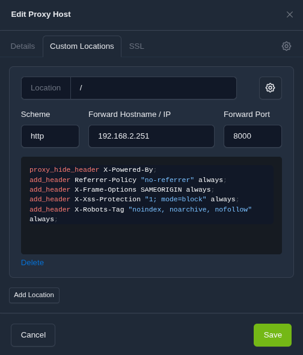
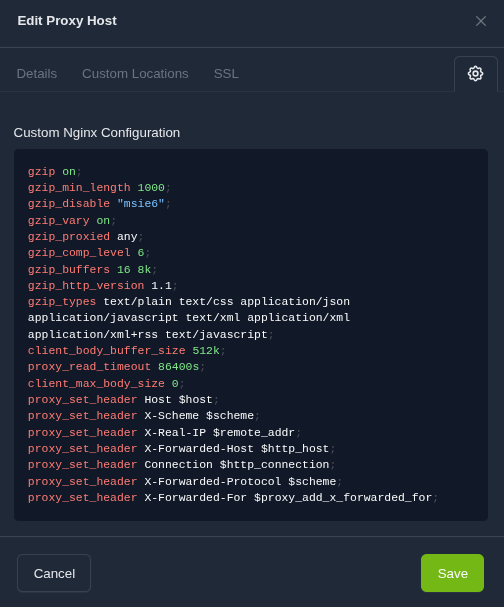

aEn tant que technicien et administrateur système spécialisé dans le reconditionnement de matériel sous Linux, documenter mes configurations est essentiel. Cette page présente les blocs de code **NGINX** personnalisés que j'utilise avec **Nginx Proxy Manager (NPM)** pour garantir une **sécurité maximale** et une **performance optimale** sur mes environnements.

> ℹ️ Toutes les directives NGINX utilisées ici peuvent être vérifiées dans la [documentation officielle NGINX](https://nginx.org/en/docs/).

Cette configuration vise à renforcer la sécurité, optimiser les performances et assurer la bonne transmission des requêtes pour les hôtes gérés par NPM.

-----

## 1\. Bloc `Custom Locations (Advanced)` : sécurité et entêtes HTTP

Ce bloc de code doit être inséré dans la section **Custom Locations (Advanced)** de votre hôte NPM. Il permet de modifier les entêtes HTTP échangés avec le client, principalement pour des raisons de sécurité.

### Le bloc de code complet

```nginx
proxy_hide_header X-Powered-By;
add_header Referrer-Policy "no-referrer" always;
add_header X-Frame-Options SAMEORIGIN always;
add_header X-Xss-Protection "1; mode=block" always;
add_header X-Robots-Tag "noindex, noarchive, nofollow" always;
```



### Explication directive par directive

| Directive | Explication | Objectif |
| :--- | :--- | :--- |
| `proxy_hide_header X-Powered-By;` | **Masque** l'entête `X-Powered-By` (souvent ajouté par PHP/Node.js). | **Sécurité :** Empêche les attaquants de connaître la technologie et la version du serveur d'application. |
| `add_header Referrer-Policy "no-referrer" always;` | Définit la politique de l'entête `Referrer-Policy` à **`no-referrer`**. | **Sécurité/Vie privée :** Assure qu'aucune information sur la page d'origine n'est envoyée lors de la navigation. |
| `add_header X-Frame-Options SAMEORIGIN always;` | Définit l'entête `X-Frame-Options` à **`SAMEORIGIN`**. | **Sécurité :** Protège contre le **Clickjacking** en empêchant l'intégration dans une `<iframe>` externe. |
| `add_header X-Xss-Protection "1; mode=block" always;` | Active le filtre anti-XSS (Cross-Site Scripting) du navigateur avec l'option **`mode=block`**. | **Sécurité :** Bloque le rendu des pages si le navigateur détecte une attaque XSS. |
| `add_header X-Robots-Tag "noindex, noarchive, nofollow" always;` | Ajoute l'entête `X-Robots-Tag` demandant aux robots d'indexation de **ne pas indexer** la page. | **Vie privée/Performance :** Utile pour les services internes/tests. **À retirer pour un site public.** |

-----

## 2\. Bloc `Settings (Custom Nginx Configuration)` : optimisation globale et proxification

Ce bloc doit être inséré dans la section **Settings** de NPM, dans la zone **Custom Nginx Configuration**. Il définit des paramètres globaux pour l'instance **NGINX** (compression, buffers) et les entêtes pour la **communication avec le serveur backend**.

### Le bloc de code complet

```nginx
# Optimisation de la Performance
gzip on;
gzip_min_length 1000;
gzip_disable "msie6";
gzip_vary on;
gzip_proxied any;
gzip_comp_level 6;
gzip_buffers 16 8k;
gzip_http_version 1.1;
gzip_types text/plain text/css application/json application/javascript text/xml application/xml application/xml+rss text/javascript;
# Gestion des Requêtes et du Proxy
client_body_buffer_size 512k;
proxy_read_timeout 86400s;
client_max_body_size 0;
# Transmission des en-têtes vitaux au backend
proxy_set_header Host $host;
proxy_set_header X-Scheme $scheme;
proxy_set_header X-Real-IP $remote_addr;
proxy_set_header X-Forwarded-Host $http_host;
proxy_set_header Connection $http_connection;
proxy_set_header X-Forwarded-Protocol $scheme;
proxy_set_header X-Forwarded-For $proxy_add_x_forwarded_for;
```



### A. Compression GZIP (performance)

> 🔗 Plus de détails sur les directives Gzip dans la [documentation officielle NGINX](https://nginx.org/en/docs/http/ngx_http_gzip_module.html).

| Directive | Explication | Objectif |
| :--- | :--- | :--- |
| `gzip on;` | **Active la compression Gzip** des réponses. | **Performance :** Réduit la taille des données transférées. |
| `gzip_min_length 1000;` | **Taille minimale (en octets)** d'un fichier à compresser. | **Performance/CPU :** Évite de gaspiller des cycles CPU sur des fichiers insignifiants (voir note ci-dessous). |
| `gzip_disable "msie6";` | **Désactive Gzip** pour Internet Explorer 6. | **Compatibilité.** |
| `gzip_vary on;` | Ajoute l'entête `Vary: Accept-Encoding`. | **Cache :** Assure que le cache gère les versions compressées et non compressées. |
| `gzip_proxied any;` | Permet la compression pour toutes les requêtes, même celles qui passent par un proxy. | **Performance :** Assure que Gzip fonctionne en environnement proxy. |
| `gzip_comp_level 6;` | Définit le niveau de compression (6 est le bon compromis). | **Performance/CPU.** |
| `gzip_buffers 16 8k;` | Définit le nombre (16) et la taille (8k) des buffers pour la compression. | **Performance :** Gestion optimale de la mémoire. |
| `gzip_http_version 1.1;` | Spécifie la version HTTP minimale pour la compression. | **Compatibilité.** |
| `gzip_types text/plain ... application/xml+rss text/javascript;` | Liste des **types MIME** à compresser. | **Performance.** |

#### ℹ️ Note sur `gzip_min_length` (clarté sur la compression)

La directive `gzip_min_length` est essentielle pour contrôler précisément ce qui est compressé :

1.  **Valeur par Défaut :**

      * Si la directive **`gzip_min_length` est absente** de votre configuration, Nginx applique la **valeur par défaut de 20 octets** (voir la [documentation officielle NGINX](https://nginx.org/en/docs/)).
      * **Conséquence :** Nginx compressera tous les fichiers au-dessus de 20 octets, générant une charge CPU inutile sur des centaines de petits fichiers.

2.  **Surcharge et Optimisation :**

      * En spécifiant **`gzip_min_length 1000;`**, vous **surchargez** la valeur par défaut de 20 octets.
      * **Le choix des 1000 octets** : Cette valeur est choisie pour des raisons d'**économie de ressources CPU**. Elle garantit que Nginx concentre ses efforts uniquement sur les fichiers qui apportent un **gain de performance significatif** (fichiers \> 1ko), optimisant ainsi l'efficacité de votre machine Linux.

### B. Gestion des connexions et des entêtes (stabilité)

> 🔗 Plus de détails sur les directives de proxy dans la [documentation officielle NGINX](https://nginx.org/en/docs/http/ngx_http_proxy_module.html).

| Directive | Explication | Objectif |
| :--- | :--- | :--- |
| `client_body_buffer_size 512k;` | Définit la taille du buffer pour le corps des requêtes client. | **Stabilité :** Augmente la capacité à gérer de grandes requêtes sans écrire sur le disque. |
| `proxy_read_timeout 86400s;` | Définit le timeout de lecture d'une réponse du serveur backend (**24 heures**). | **Stabilité :** Crucial pour les connexions longues (WebSockets, gros transferts). |
| `client_max_body_size 0;` | Définit la taille maximale autorisée pour le corps de la requête client à **illimitée** (0). | **Fonctionnalité :** Permet l'upload de fichiers de très grande taille. |
| `proxy_set_header Host $host;` | Transmet le nom d'hôte de la requête originale au backend. | **Fonctionnalité :** Indispensable pour que le backend sache quel service répondre. |
| `proxy_set_header X-Real-IP $remote_addr;` | Transmet l'adresse IP réelle du client. | **Fonctionnalité :** Permet aux logs du backend d'afficher l'IP réelle. |
| `proxy_set_header X-Forwarded-For $proxy_add_x_forwarded_for;` | Ajoute l'IP du client à l'entête `X-Forwarded-For`. | **Fonctionnalité :** Standard pour suivre le chemin d'une requête. |
| `proxy_set_header X-Scheme $scheme;` | Transmet le schéma de la requête (HTTP ou HTTPS) au backend. | **Fonctionnalité :** Assure que le backend génère des liens corrects (HTTPS). |
| `proxy_set_header X-Forwarded-Host $http_host;` | Transmet l'hôte original au backend. | **Fonctionnalité.** |
| `proxy_set_header Connection $http_connection;` | Gère l'état de la connexion (peut causer des conflits). | **Fonctionnalité :** Pour les connexions persistantes. |
| `proxy_set_header X-Forwarded-Protocol $scheme;` | Transmet le protocole de la requête (similaire à X-Scheme). | **Fonctionnalité.** |

-----

## 3\. ⚠️ Problèmes courants et solutions

| Problème Rencontré | Cause Potentielle | Solution |
| :--- | :--- | :--- |
| **Indisponibilité soudaine** d'un hôte après l'ajout du bloc (Erreur 502/Timeout). | **1. Conflit Gzip :** Ligne **`gzip_min_length 1000;`** (cause avérée sur certains backends). | **Retirer complètement la ligne `gzip_min_length 1000;`** pour ces hôtes spécifiques pour revenir à la valeur par défaut (20 octets) et éliminer le conflit d'initialisation de la compression. |
| **Indisponibilité persistante** après la correction Gzip. | **2. Conflit de gestion de connexion :** Ligne `proxy_set_header Connection $http_connection;`. | **Remplacer** la ligne pour ces hôtes par **`proxy_set_header Connection "";`** pour forcer une nouvelle connexion à chaque requête. |
| Le service **ne fonctionne plus** après avoir été indexé par Google. | Ligne : `add_header X-Robots-Tag "noindex, noarchive, nofollow" always;` | **Retirer** cette ligne. Elle est destinée aux services privés. Si le service doit être public, supprimez-la. |
| Les **WebSockets** (ex: console web, chat) se déconnectent après une minute. | Ligne : `proxy_read_timeout 86400s;` | Si la coupure persiste, la configuration des headers `Connection` et `Upgrade` doit être vérifiée (souvent déjà gérée par NPM). |
| Les **uploads de fichiers volumineux** sont rejetés. | Ligne : `client_max_body_size 0;` | Si le problème persiste, la limite vient du serveur backend (ex: `upload_max_filesize` en PHP). |

-----

## 💡 Note sur l'optimisation et le logiciel libre

Ces configurations **NGINX** avancées ne sont pas seulement pour la performance : elles sont essentielles dans l'esprit du **logiciel libre** et du **reconditionnement** que je soutiens. En optimisant la compression **Gzip** et la gestion des ressources, on s'assure que même le matériel reconditionné fonctionne avec une efficacité maximale. Chaque cycle CPU gagné, chaque paquet de données réduit, contribue à prolonger la vie du matériel et à garantir une expérience utilisateur rapide, même sur des machines modestes, un principe clé que je partage avec le collectif **Emmabuntüs**.

Adopter ces pratiques est une manière de rendre l'informatique reconditionnée à la fois performante et sécurisée.
