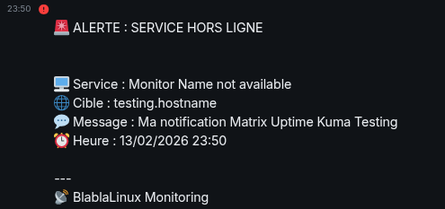

Ce tutoriel explique comment créer un pont de notification entre **Uptime Kuma** et votre serveur **Matrix**. L'utilisation d'un bot permet de recevoir des alertes en temps réel dans un salon sécurisé et chiffré.

## 1. Création du compte bot

Avant de configurer Uptime Kuma, vous avez besoin d'un compte utilisateur dédié sur votre serveur Matrix.

1. **Créez un compte utilisateur** (ex : `bot-kuma`) sur votre instance Matrix ou via votre interface d'administration (ex : Synapse, Dendrite).
2. **Rejoignez un salon** avec ce bot ou créez-en un nouveau (ex : `Notifications monitoring`).
3. **Notez l'ID interne du salon** : dans Element, allez dans *Paramètres du salon > Avancé*. L'ID ressemble à `!abcxyz:votredomaine.tld`.

## 2. Récupération du jeton d'accès

Matrix utilise un jeton sécurisé pour autoriser les applications tierces. **N'utilisez jamais votre mot de passe directement dans Uptime Kuma.**

Exécutez cette commande dans votre terminal (remplacez les valeurs entre crochets) :

```bash
curl -XPOST --json '{
  "type": "m.login.password", 
  "identifier": {"user": "[NOM_UTILISATEUR_BOT]", "type": "m.id.user"}, 
  "password": "[MOT_DE_PASSE_BOT]"
}' 'https://[URL_VOTRE_SERVEUR_MATRIX]/_matrix/client/v3/login'

```

> ⚠️ **Attention à l'URL** : l'URL du serveur doit être celle de votre **homeserver** (souvent `matrix.votredomaine.tld`) et non celle de votre client web (comme Element).

Récupérez la valeur `access_token` dans la réponse JSON.

## 3. Configuration dans Uptime Kuma

Dans votre interface Uptime Kuma, allez dans **Paramètres > Notification > Ajouter une notification**.

* **Type de notification** : Matrix
* **URL du serveur** : `https://[URL_VOTRE_SERVEUR_MATRIX]`
* **ID de la salle interne** : `!votreid:domaine.tld`
* **Jeton d'accès** : `syt_votre_token_ici...`

## 4. Personnalisation du message (template Liquid)

Pour un rendu professionnel, cochez **"Utiliser un modèle de message personnalisé"** et utilisez le format suivant. Ce modèle utilise le langage **LiquidJS** pour afficher l'état et l'heure.

```liquid

✅ SERVICE EN LIGNE

🚨 ALERTE : SERVICE HORS LIGNE


🖥️ Service : {{ name }}
🌐 Cible : {{ hostnameOrURL }}
💬 Message : {{ msg }}
⏰ Heure : {{ "now" | date: "%d/%m/%Y %H:%M" }}

```

> 
> *(Aperçu du message reçu dans Matrix : le template permet d'obtenir un affichage clair et horodaté.)*

## 5. Conseils et personnalisation

* **L'heure** : la variable `{{ "now" | date: ... }}` récupère l'heure système. Vous pouvez changer le format (ex : `%H:%M` pour avoir uniquement l'heure).
* **Émojis** : adaptez les émojis selon la criticité de vos services.
* **Permissions** : assurez-vous que le bot a le droit de "Envoyer des messages" dans les paramètres de modération du salon Matrix.
