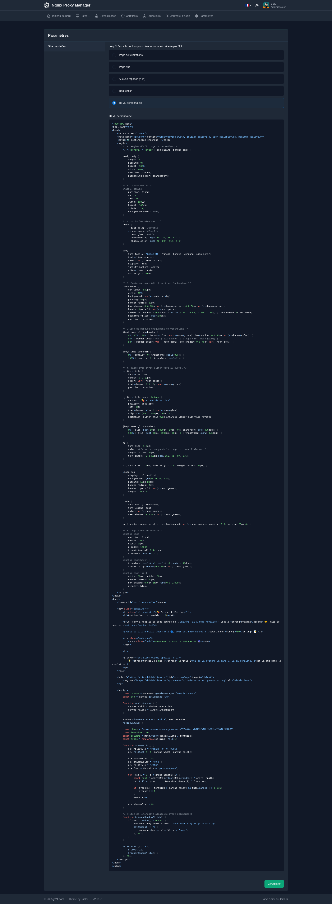
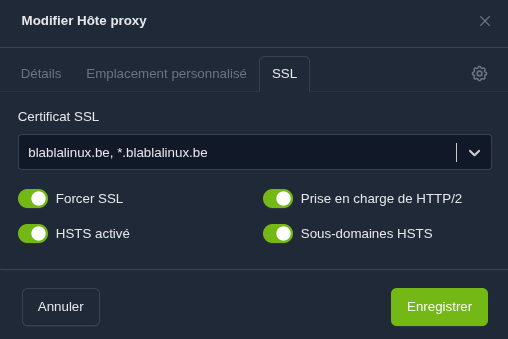
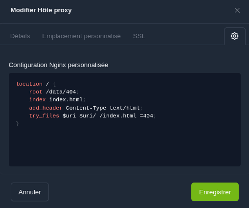
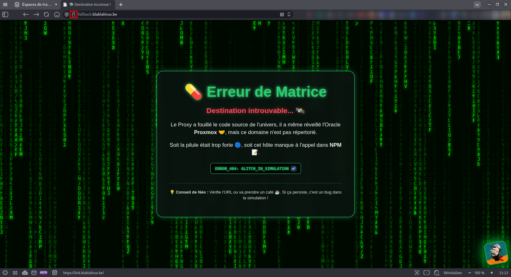
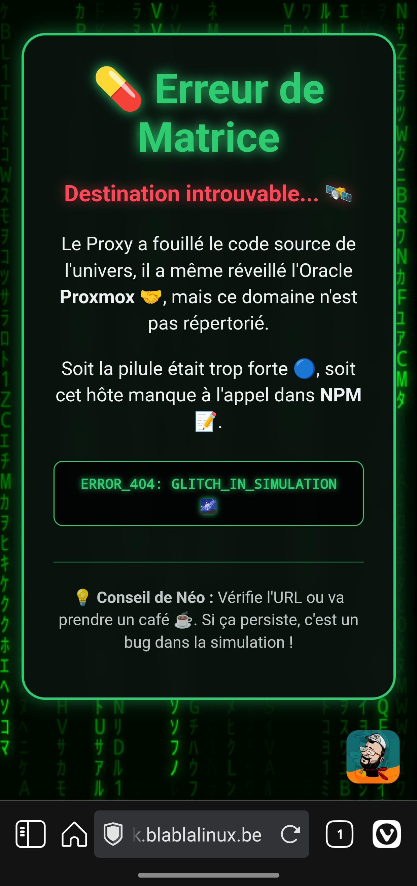

aCe guide détaille comment transformer une erreur de domaine inconnu sur **Nginx Proxy Manager (NPM)** en une page personnalisée, sécurisée par SSL, et hébergée directement via un fichier statique sur votre serveur.

## Pourquoi cette nouvelle méthode ?

Si vous avez utilisé [ma précédente documentation](/fr/page-erreur-npm-hote-inconnu) sur l'injection HTML directe, vous avez remarqué deux limites : l'absence de certificat SSL valide sur les domaines inconnus et la difficulté de maintenir un code complexe dans une petite zone de texte de l'interface.

> 
> *Légende : L'ancienne méthode avec le code HTML injecté directement dans les paramètres globaux.*

### Ce qui change aujourd'hui

| Caractéristique | Ancienne méthode | Nouvelle méthode (celle-ci) |
| --- | --- | --- |
| **Sécurité SSL** | Souvent absente (alerte navigateur) | **SSL Wildcard actif** (Cadenas vert) |
| **Hébergement** | Code stocké en base de données NPM | **Fichier .html** dans votre stockage serveur |
| **Performance** | Basique | **HSTS et HTTP/2** activés pour la vitesse |
| **Maintenance** | Copier-coller fastidieux | Édition directe du fichier en SSH/SFTP |

---

## Étape 1 : préparation du stockage et du fichier HTML

Le but est de rendre votre code accessible au conteneur NPM via un volume.

1. Connectez-vous en SSH à votre instance et créez le dossier :
`mkdir -p ~/npm/data/404/`
2. Créez votre fichier `index.html` :
`nano ~/npm/data/404/index.html`
3. Collez le code complet (disponible en fin de tutoriel) en veillant à personnaliser vos liens.

---

## Étape 2 : configuration de l'hôte "fallback"

Nous créons un hôte proxy dédié qui servira de point d'ancrage pour l'erreur.

1. Dans NPM, cliquez sur **Ajouter un hôte proxy**.
2. **Onglet Détails :** Configurez votre domaine de secours (ex: `fallback.blablalinux.be`) pointant vers `127.0.0.1` sur le port `80`.
> 


3. **Onglet SSL :** Sélectionnez votre certificat **Wildcard** et activez toutes les options de sécurité (Forcer SSL, HTTP/2, HSTS).
> 


4. **Configuration Nginx personnalisée :** Cliquez sur le petit engrenage en haut à droite (paramètres globaux de l'hôte) et insérez le bloc suivant :
> 


```nginx
location / {
    root /data/404;
    index index.html;
    add_header Content-Type text/html;
    try_files $uri $uri/ /index.html =404;
}

```

---

## Étape 3 : activation de la redirection par défaut

Dernière étape pour rediriger les visiteurs "perdus" vers cet hôte sécurisé.

1. Allez dans **Paramètres** (Settings) > **Site par défaut**.
2. Cliquez sur **Modifier** et choisissez **Redirection**.
3. Saisissez l'URL complète : `https://fallback.blablalinux.be`.
4. Effacez tout code restant dans la section "HTML personnalisé" pour éviter les conflits.

---

## Résultat final

Une fois configuré, toute URL inconnue affichera votre page Matrix avec un certificat SSL valide.

> 
> *Le rendu final sur navigateur bureau avec le cadenas SSL bien visible.*

> 
> *Le rendu parfaitement centré et responsive sur mobile.*

---

Voici la toute dernière section de ton tutoriel, incluant le code complet à copier-coller :

---

## Code source complet (index.html)

Voici le code à copier dans votre fichier `~/npm/data/404/index.html`. N'oubliez pas de modifier le lien du logo à la ligne 186 et 187.

```html
<!DOCTYPE html>
<html lang="fr">
<head>
    <meta charset="UTF-8">
    <meta name="viewport" content="width=device-width, initial-scale=1.0, user-scalable=yes, maximum-scale=3.0">
    <title>🛸 Destination Inconnue !</title>
    <style>
        /* 0. Règles d'affichage universelles */
        *, *::before, *::after { box-sizing: border-box; }

        html, body {
            margin: 0;
            padding: 0;
            height: 100%;
            width: 100%;
            overflow: hidden;
            background-color: transparent; 
        }

        /* 1. Canvas Matrix */
        #matrix-canvas {
            position: fixed;
            top: 0;
            left: 0;
            width: 100vw;
            height: 100vh;
            z-index: -1;
            background-color: #000;
        }

        /* 2. Variables Néon Vert */
        :root {
            --text-color: #ecf0f1;
            --neon-green: #2ecc71; 
            --neon-glow: #00ff41;
            --container-bg: rgba(10, 20, 15, 0.9);
            --shadow-color: rgba(46, 204, 113, 0.5);
        }
        
        body {
            font-family: 'Segoe UI', Tahoma, Geneva, Verdana, sans-serif;
            text-align: center;
            color: var(--text-color);
            display: flex;
            justify-content: center;
            align-items: center;
            min-height: 100vh;
            padding: 10px;
        }
        
        /* 3. Conteneur avec Glitch Vert sur la bordure */
        .container {
            max-width: 650px;
            width: 95%; 
            background: var(--container-bg);
            padding: 30px 20px;
            border-radius: 20px;
            box-shadow: 0 0 15px var(--shadow-color), 0 0 30px var(--shadow-color);
            border: 2px solid var(--neon-green);
            animation: bounceIn 0.8s cubic-bezier(0.68, -0.55, 0.265, 1.55), glitch-border 6s infinite;
            backdrop-filter: blur(10px);
            position: relative;
        }

        @keyframes glitch-border {
            0%, 95%, 100% { border-color: var(--neon-green); box-shadow: 0 0 15px var(--shadow-color); }
            96% { border-color: #fff; box-shadow: 0 0 30px var(--neon-glow); }
            98% { border-color: var(--neon-glow); box-shadow: 0 0 40px var(--neon-glow); }
        }

        @keyframes bounceIn {
            0% { opacity: 0; transform: scale(0.3); }
            100% { opacity: 1; transform: scale(1); }
        }
        
        /* 4. Titre avec effet Glitch Vert au survol */
        .glitch-title {
            font-size: 2.2em; 
            margin: 0 0 10px; 
            color: var(--neon-green); 
            text-shadow: 0 0 10px var(--neon-green);
            position: relative;
        }

        .glitch-title:hover::before {
            content: "💊 Erreur de Matrice";
            position: absolute;
            left: 2px;
            text-shadow: -2px 0 var(--neon-glow);
            clip: rect(44px, 450px, 56px, 0);
            animation: glitch-anim 0.2s infinite linear alternate-reverse;
        }

        @keyframes glitch-anim {
            0% { clip: rect(10px, 9999px, 20px, 0); transform: skew(0.5deg); }
            100% { clip: rect(80px, 9999px, 90px, 0); transform: skew(-0.5deg); }
        }

        h2 { 
            font-size: 1.2em; 
            color: #ff4757; 
            margin-bottom: 20px;
            text-shadow: 0 0 10px rgba(255, 71, 87, 0.5);
        }

        p { font-size: 1em; line-height: 1.4; margin-bottom: 12px; }

        .code-box {
            display: inline-block;
            background: rgba(0, 0, 0, 0.8);
            padding: 8px 15px;
            border-radius: 8px;
            border: 1px solid var(--neon-green);
            margin: 10px 0;
        }

        .code { 
            font-family: monospace; 
            font-weight: bold; 
            color: var(--neon-green);
            text-shadow: 0 0 5px var(--neon-green);
        }

        hr { border: none; height: 1px; background: var(--neon-green); opacity: 0.3; margin: 20px 0; }

        /* 5. Logo personnalisé avec Halo et Animation */
        #custom-logo {
            position: fixed;
            bottom: 20px;
            right: 20px; 
            z-index: 10000;
            transition: all 0.4s ease;
            transform: scaleX(-1);
        }

        #custom-logo:hover { 
            transform: scaleX(-1) scale(1.2) rotate(10deg); 
            filter: drop-shadow(0 0 15px var(--neon-glow)); 
        }

        #custom-logo img { 
            width: 60px; height: 60px;
            border-radius: 12px; 
            box-shadow: 0 5px 15px rgba(0,0,0,0.8);
            display: block;
            border: 1px solid var(--neon-green);
        }

        /* 🖥️ Ajustements Tablettes et PC */
        @media (min-width: 768px) {
            .container { padding: 40px; }
            .glitch-title { font-size: 3em; }
            h2 { font-size: 1.5em; }
            p { font-size: 1.1em; }
        }

        /* 📱 Ajustements spécifiques petits mobiles */
        @media (max-width: 480px) {
            #custom-logo img { width: 45px; height: 45px; }
            #custom-logo { bottom: 15px; right: 15px; }
        }
    </style>
</head>
<body>
    <canvas id="matrix-canvas"></canvas>

    <div class="container">
        <h1 class="glitch-title">💊 Erreur de Matrice</h1>
        <h2>Destination introuvable... 🛰️</h2>
        
        <p>Le Proxy a fouillé le code source de l'univers, il a même réveillé l'Oracle <strong>Proxmox</strong> 🤝, mais ce domaine n'est pas répertorié.</p>
        
        <p>Soit la pilule était trop forte 🔵, soit cet hôte manque à l'appel dans <strong>NPM</strong> 📝.</p>
        
        <div class="code-box">
            <span class="code">ERROR_404: GLITCH_IN_SIMULATION 🌌</span>
        </div>
        
        <hr>
        
        <p style="font-size: 0.85em; opacity: 0.9;">
            💡 <strong>Conseil de Néo :</strong> Vérifie l'URL ou va prendre un café ☕. Si ça persiste, c'est un bug dans la simulation !
        </p>
    </div>

    <a href="https://link.blablalinux.be" id="custom-logo" target="_blank">
        
    </a>

    <script>
        const canvas = document.getElementById('matrix-canvas');
        const ctx = canvas.getContext('2d');

        function resizeCanvas() {
            canvas.width = window.innerWidth;
            canvas.height = window.innerHeight;
        }

        window.addEventListener('resize', resizeCanvas);
        resizeCanvas();

        const chars = '01ABCDEFGHIJKLMNOPQRSTUVWXYZｦｱｲｳｴｵｶｷｸｹｺｻｼｽｾｿﾀﾁﾂﾃﾄﾅﾆﾇﾈﾉﾊﾋﾌﾍﾎﾏﾐﾑﾒﾓﾔﾕﾖﾗﾘﾙﾚﾛﾜﾝ';
        const fontSize = 16;
        const columns = Math.floor(canvas.width / fontSize);
        const drops = new Array(columns).fill(1);

        function drawMatrix() {
            ctx.fillStyle = 'rgba(0, 0, 0, 0.05)';
            ctx.fillRect(0, 0, canvas.width, canvas.height);

            ctx.shadowBlur = 8;
            ctx.shadowColor = '#0F0';
            ctx.fillStyle = '#0F0';
            ctx.font = fontSize + 'px monospace';

            for (let i = 0; i < drops.length; i++) {
                const text = chars[Math.floor(Math.random() * chars.length)];
                ctx.fillText(text, i * fontSize, drops[i] * fontSize);

                if (drops[i] * fontSize > canvas.height && Math.random() > 0.975) {
                    drops[i] = 0;
                }
                drops[i]++;
            }
            ctx.shadowBlur = 0;
        }

        function triggerRandomGlitch() {
            if (Math.random() > 0.985) { 
                document.body.style.filter = "contrast(1.5) brightness(1.2)";
                setTimeout(() => {
                    document.body.style.filter = "none";
                }, 40);
            }
        }

        setInterval(() => {
            drawMatrix();
            triggerRandomGlitch();
        }, 35);
    </script>
</body>
</html>

```

## BONUS

> 🫸 [[Catalogue] 7 modèles de pages d'erreur 404 pour Nginx Proxy Manager](/fr/catalogue-modeles-erreurs-404-npm) 🫷
