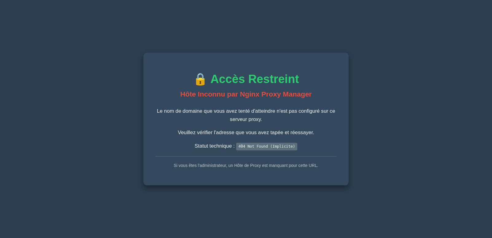
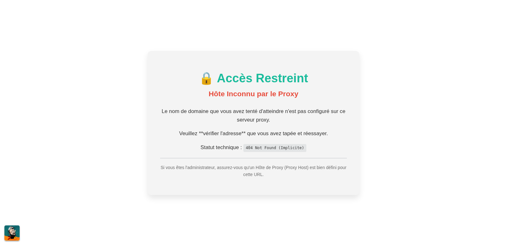
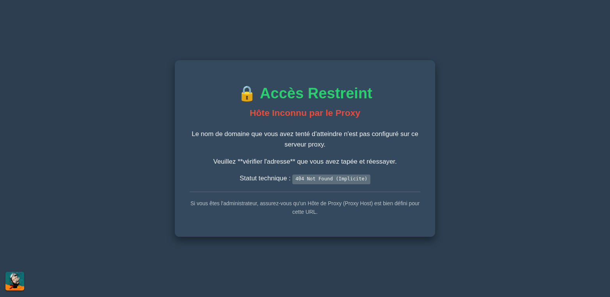

Cette page explique le rôle, la structure, et la méthode d'utilisation de la page HTML/CSS que **j'utilise** comme réponse par défaut dans **Nginx Proxy Manager (NPM)**.

-----

## 1\. Mon objectif avec cette page d'erreur

Mon objectif est de fournir une **réponse propre et cohérente** lorsque le **proxy inverse** reçoit une requête pour une adresse qu'il ne sait pas traiter.

### A. Pourquoi j'ai mis en place cette page

  * **Gestion des hôtes inconnus :** Mon proxy inverse (NPM) agit comme un filtre intelligent. S'il n'existe aucune règle de redirection (aucun "**hôte proxy**") correspondant au nom de domaine demandé, **j'ai configuré** NPM pour qu'il affiche cette page personnalisée.
  * **Expérience utilisateur :** J'ai choisi de remplacer le message d'erreur Nginx brut par une interface conviviale, centrée, et adaptative, afin de maintenir une image professionnelle de mon infrastructure.
  * **Accessibilité (mode sombre et zoom) :** Je me suis assuré qu'elle s'adapte automatiquement au **mode sombre** du navigateur de l'utilisateur et qu'elle autorise le **zoom** sur mobile, pour une lecture confortable.

-----

## 2\. Structure technique (HTML/CSS)

Cette page est un document **HTML5 autonome** qui utilise uniquement du **CSS embarqué** pour garantir une facilité de copie/coller dans l'interface de NPM.

### A. Le logo cliquable flottant (Version avancée)

J'ai intégré un logo cliquable pour l'identité visuelle de la communauté qui reste ancré dans le coin inférieur de l'écran.

| Élément technique | Rôle | Comment changer de position ? |
| :--- | :--- | :--- |
| **`position: fixed`** | Cette propriété CSS est essentielle : elle permet au logo de rester visible à l'écran, même si l'utilisateur fait défiler la page (important en mode zoom). | — |
| **`bottom: 15px; left: 15px;`** | Ancre le logo à **15 pixels du bord inférieur et gauche**. | Pour le positionner **en bas à droite**, il suffit de remplacer `left: 15px;` par **`right: 15px;`** dans le CSS. |
| **`z-index: 10000;`** | J'ai donné une valeur très élevée pour garantir que le logo soit toujours affiché **au-dessus** de tout autre élément. | — |
| **`<a href="..." target="_blank">`** | J'utilise une balise d'ancre HTML pour rendre le logo cliquable et l'ouvrir dans un nouvel onglet. | — |

### B. Les technologies clés que j'utilise (Base)

| Élément technique | Description | Rôle |
| :--- | :--- | :--- |
| **`viewport` meta tag** | Ligne dans le `<head>` qui définit la zone d'affichage mobile. | **Je l'utilise pour autoriser le zoom** (`user-scalable=yes`) sur les appareils mobiles. |
| **Media queries** | `@media (prefers-color-scheme: dark)` | Cela permet de détecter si le système d'exploitation de l'utilisateur est en mode sombre et de **surcharger les variables de couleur** en conséquence. |
| **Flexbox (centrage)** | Propriétés `display: flex;` sur le `<body>`. | J'utilise Flexbox pour assurer un **centrage vertical et horizontal** parfait du conteneur d'erreur sur tous les types d'écrans. |
| **`box-sizing: border-box;`** | Règle CSS universelle. | Je l'ai ajoutée pour empêcher le débordement horizontal en garantissant que le rembourrage (`padding`) est inclus dans la largeur totale (`width`). |

-----

## 3\. Mon utilisation avec Nginx Proxy Manager (NPM)

L'insertion de cette page se fait dans la configuration globale de NPM.

### A. Procédure d'implémentation

1.  **Connexion** : Je me connecte à l'interface d'administration de **Nginx Proxy Manager**.
2.  **Accès aux paramètres** : Je clique sur l'onglet **Settings** (Paramètres).
3.  **Choix du HTML personnalisé** : Dans les options des paramètres (Settings), je sélectionne le champ de configuration **"Custom HTML"**.
4.  **Coller le code** : Je choisis la version du code souhaitée ci-dessous et je la colle dans le champ de texte prévu.
5.  **Sauvegarde** : Je clique sur le bouton de sauvegarde pour rendre la page active immédiatement.

### B. Code HTML/CSS de base (SANS logo)

Ce code fournit la page d'erreur centrée, responsive, avec le mode sombre, mais sans aucun élément flottant.

```html
<!DOCTYPE html>
<html lang="fr">
<head>
    <meta charset="UTF-8">
    <meta name="viewport" content="width=device-width, initial-scale=1.0, user-scalable=yes, maximum-scale=3.0">
    <title>Accès Restreint - Hôte Inconnu</title>
    <style>
        /* 0. Règles d'affichage universelles pour la largeur et le débordement */
        *, *::before, *::after {
            box-sizing: border-box; 
        }

        /* Réinitialisation de la hauteur et suppression du défilement horizontal. */
        html, body {
            margin: 0;
            padding: 0;
            height: 100%;
            overflow-x: hidden; 
            /* Laisse le scroll vertical par défaut pour le zoom mobile */
        }

        /* 1. Définition des Couleurs */
        :root {
            --bg: #ffffff;
            --text: #333333;
            --accent: #1abc9c;
            --container-bg: #f4f4f4;
            --shadow: rgba(0, 0, 0, 0.1);
            --hr-color: #bdc3c7;
        }

        /* Surcharge des Couleurs pour le Mode Sombre */
        @media (prefers-color-scheme: dark) {
            :root {
                --bg: #2c3e50;
                --text: #ecf0f1;
                --accent: #2ecc71;
                --container-bg: #34495e;
                --shadow: rgba(0, 0, 0, 0.4);
                --hr-color: #5d6d7e;
            }
        }
        
        /* 2. Styles Généraux utilisant les Variables et Flexbox pour le Centrage */
        body {
            font-family: 'Segoe UI', Tahoma, Geneva, Verdana, sans-serif;
            text-align: center;
            background-color: var(--bg);
            color: var(--text);
            transition: background-color 0.3s, color 0.3s;

            /* CENTRAGE VERTICAL/HORIZONTAL */
            display: flex;
            flex-direction: column;
            justify-content: center;
            align-items: center;
            min-height: 100vh;
            
            /* Padding vertical pour forcer l'espace autour du conteneur sur mobile */
            padding: 20px 0; 
        }
        
        .container {
            max-width: 700px;
            width: 90%; 
            position: relative; 

            background: var(--container-bg);
            padding: 40px;
            border-radius: 12px;
            box-shadow: 0 10px 20px var(--shadow);
            transition: all 0.3s;
            
            /* Centrage horizontal */
            margin: 0 auto; 
        }
        
        h1 {
            font-size: 2.5em;
            color: var(--accent);
            margin-bottom: 15px;
            font-weight: 600;
        }
        
        h2 {
            font-size: 1.5em;
            color: #e74c3c;
            margin-top: 0;
            margin-bottom: 30px;
        }
        
        p {
            font-size: 1.1em;
            line-height: 1.6;
            margin-bottom: 15px;
        }

        .code {
            display: inline-block;
            background-color: rgba(189, 195, 199, 0.3);
            color: var(--text);
            padding: 3px 8px;
            border-radius: 4px;
            font-family: monospace;
            font-size: 0.9em;
        }

        hr {
            border: none;
            height: 1px;
            background-color: var(--hr-color);
            margin: 20px 0;
        }
    </style>
</head>
<body>
    <div class="container">
        <h1>🔒 Accès Restreint</h1>
        <h2>Hôte Inconnu par le Proxy</h2>
        
        <p>Le nom de domaine que vous avez tenté d'atteindre n'est pas configuré sur ce serveur proxy.</p>
        
        <p>Veuillez **vérifier l'adresse** que vous avez tapée et réessayer.</p>
        
        <p>Statut technique : <span class="code">404 Not Found (Implicite)</span></p>
        
        <hr>
        
        <p style="font-size: 0.9em; opacity: 0.7;">Si vous êtes l'administrateur, assurez-vous qu'un Hôte de Proxy (Proxy Host) est bien défini pour cette URL.</p>
    </div>
</body>
</html>
```



### C. Code HTML/CSS avec logo (Ancrage Bas à Gauche)

Ce code inclut le logo flottant cliquable ancré en **bas à gauche** de l'écran.

**⚠️ IMPORTANT :** Vous devez remplacer `https://VOTRE-URL-DE-DESTINATION.COM` et `https://VOTRE-DOMAINE.COM/CHEMIN/VERS/VOTRE-LOGO.PNG` par vos propres URLs.

```html
<!DOCTYPE html>
<html lang="fr">
<head>
    <meta charset="UTF-8">
    <meta name="viewport" content="width=device-width, initial-scale=1.0, user-scalable=yes, maximum-scale=3.0">
    <title>Accès Restreint - Hôte Inconnu</title>
    <style>
        /* 0. Règles d'affichage universelles pour la largeur et le débordement */
        *, *::before, *::after {
            box-sizing: border-box; 
        }

        /* Réinitialisation de la hauteur et suppression du défilement horizontal. */
        html, body {
            margin: 0;
            padding: 0;
            height: 100%;
            overflow-x: hidden; 
            /* Laisse le scroll vertical par défaut pour le zoom mobile */
        }

        /* 1. Définition des Couleurs */
        :root {
            --bg: #ffffff;
            --text: #333333;
            --accent: #1abc9c;
            --container-bg: #f4f4f4;
            --shadow: rgba(0, 0, 0, 0.1);
            --hr-color: #bdc3c7;
        }

        /* Surcharge des Couleurs pour le Mode Sombre */
        @media (prefers-color-scheme: dark) {
            :root {
                --bg: #2c3e50;
                --text: #ecf0f1;
                --accent: #2ecc71;
                --container-bg: #34495e;
                --shadow: rgba(0, 0, 0, 0.4);
                --hr-color: #5d6d7e;
            }
        }
        
        /* 2. Styles Généraux utilisant les Variables et Flexbox pour le Centrage */
        body {
            font-family: 'Segoe UI', Tahoma, Geneva, Verdana, sans-serif;
            text-align: center;
            background-color: var(--bg);
            color: var(--text);
            transition: background-color 0.3s, color 0.3s;

            /* CENTRAGE VERTICAL/HORIZONTAL */
            display: flex;
            flex-direction: column;
            justify-content: center;
            align-items: center;
            min-height: 100vh;
            
            /* Padding vertical pour forcer l'espace autour du conteneur sur mobile */
            padding: 20px 0; 
        }
        
        .container {
            max-width: 700px;
            width: 90%; 
            position: relative; 

            background: var(--container-bg);
            padding: 40px;
            border-radius: 12px;
            box-shadow: 0 10px 20px var(--shadow);
            transition: all 0.3s;
            
            /* Centrage horizontal */
            margin: 0 auto; 
        }
        
        h1 {
            font-size: 2.5em;
            color: var(--accent);
            margin-bottom: 15px;
            font-weight: 600;
        }
        
        h2 {
            font-size: 1.5em;
            color: #e74c3c;
            margin-top: 0;
            margin-bottom: 30px;
        }
        
        p {
            font-size: 1.1em;
            line-height: 1.6;
            margin-bottom: 15px;
        }

        .code {
            display: inline-block;
            background-color: rgba(189, 195, 199, 0.3);
            color: var(--text);
            padding: 3px 8px;
            border-radius: 4px;
            font-family: monospace;
            font-size: 0.9em;
        }

        hr {
            border: none;
            height: 1px;
            background-color: var(--hr-color);
            margin: 20px 0;
        }

        /* --- CODE DU LOGO EN BAS À GAUCHE --- */
        #custom-logo {
            position: fixed;
            bottom: 15px;
            left: 15px; /* ANCRAGE À GAUCHE */
            z-index: 10000;
            transition: transform 0.3s ease;
        }
        #custom-logo:hover {
            transform: scale(1.1);
        }
        #custom-logo img {
            height: auto;
            border-radius: 5px;
            box-shadow: 0 2px 4px rgba(0,0,0,0.4); 
            cursor: pointer;
            width: 50px; /* Taille fixe */
            height: 50px; /* Taille fixe */
        }
    </style>
</head>
<body>
    <div class="container">
        <h1>🔒 Accès Restreint</h1>
        <h2>Hôte Inconnu par le Proxy</h2>
        
        <p>Le nom de domaine que vous avez tenté d'atteindre n'est pas configuré sur ce serveur proxy.</p>
        
        <p>Veuillez **vérifier l'adresse** que vous avez tapée et réessayer.</p>
        
        <p>Statut technique : <span class="code">404 Not Found (Implicite)</span></p>
        
        <hr>
        
        <p style="font-size: 0.9em; opacity: 0.7;">Si vous êtes l'administrateur, assurez-vous qu'un Hôte de Proxy (Proxy Host) est bien défini pour cette URL.</p>
    </div>

    <a href="https://VOTRE-URL-DE-DESTINATION.COM" id="custom-logo" target="_blank">
        
    </a>
</body>
</html>
```





### D. Code HTML/CSS avec logo (Ancrage Bas à Droite)

Ce code inclut le logo flottant cliquable ancré en **bas à droite** de l'écran. C'est la seule ligne de CSS qui diffère de la version Bas à Gauche.

**⚠️ IMPORTANT :** Vous devez remplacer `https://VOTRE-URL-DE-DESTINATION.COM` et `https://VOTRE-DOMAINE.COM/CHEMIN/VERS/VOTRE-LOGO.PNG` par vos propres URLs.

```html
<!DOCTYPE html>
<html lang="fr">
<head>
    <meta charset="UTF-8">
    <meta name="viewport" content="width=device-width, initial-scale=1.0, user-scalable=yes, maximum-scale=3.0">
    <title>Accès Restreint - Hôte Inconnu</title>
    <style>
        /* 0. Règles d'affichage universelles pour la largeur et le débordement */
        *, *::before, *::after {
            box-sizing: border-box; 
        }

        /* Réinitialisation de la hauteur et suppression du défilement horizontal. */
        html, body {
            margin: 0;
            padding: 0;
            height: 100%;
            overflow-x: hidden; 
            /* Laisse le scroll vertical par défaut pour le zoom mobile */
        }

        /* 1. Définition des Couleurs */
        :root {
            --bg: #ffffff;
            --text: #333333;
            --accent: #1abc9c;
            --container-bg: #f4f4f4;
            --shadow: rgba(0, 0, 0, 0.1);
            --hr-color: #bdc3c7;
        }

        /* Surcharge des Couleurs pour le Mode Sombre */
        @media (prefers-color-scheme: dark) {
            :root {
                --bg: #2c3e50;
                --text: #ecf0f1;
                --accent: #2ecc71;
                --container-bg: #34495e;
                --shadow: rgba(0, 0, 0, 0.4);
                --hr-color: #5d6d7e;
            }
        }
        
        /* 2. Styles Généraux utilisant les Variables et Flexbox pour le Centrage */
        body {
            font-family: 'Segoe UI', Tahoma, Geneva, Verdana, sans-serif;
            text-align: center;
            background-color: var(--bg);
            color: var(--text);
            transition: background-color 0.3s, color 0.3s;

            /* CENTRAGE VERTICAL/HORIZONTAL */
            display: flex;
            flex-direction: column;
            justify-content: center;
            align-items: center;
            min-height: 100vh;
            
            /* Padding vertical pour forcer l'espace autour du conteneur sur mobile */
            padding: 20px 0; 
        }
        
        .container {
            max-width: 700px;
            width: 90%; 
            position: relative; 

            background: var(--container-bg);
            padding: 40px;
            border-radius: 12px;
            box-shadow: 0 10px 20px var(--shadow);
            transition: all 0.3s;
            
            /* Centrage horizontal */
            margin: 0 auto; 
        }
        
        h1 {
            font-size: 2.5em;
            color: var(--accent);
            margin-bottom: 15px;
            font-weight: 600;
        }
        
        h2 {
            font-size: 1.5em;
            color: #e74c3c;
            margin-top: 0;
            margin-bottom: 30px;
        }
        
        p {
            font-size: 1.1em;
            line-height: 1.6;
            margin-bottom: 15px;
        }

        .code {
            display: inline-block;
            background-color: rgba(189, 195, 199, 0.3);
            color: var(--text);
            padding: 3px 8px;
            border-radius: 4px;
            font-family: monospace;
            font-size: 0.9em;
        }

        hr {
            border: none;
            height: 1px;
            background-color: var(--hr-color);
            margin: 20px 0;
        }

        /* --- CODE DU LOGO EN BAS À DROITE --- */
        #custom-logo {
            position: fixed;
            bottom: 15px;
            right: 15px; /* ANCRAGE À DROITE (CORRIGÉ) */
            z-index: 10000;
            transition: transform 0.3s ease;
        }
        #custom-logo:hover {
            transform: scale(1.1);
        }
        #custom-logo img {
            height: auto;
            border-radius: 5px;
            box-shadow: 0 2px 4px rgba(0,0,0,0.4); 
            cursor: pointer;
            width: 50px; /* Taille fixe */
            height: 50px; /* Taille fixe */
        }
    </style>
</head>
<body>
    <div class="container">
        <h1>🔒 Accès Restreint</h1>
        <h2>Hôte Inconnu par le Proxy</h2>
        
        <p>Le nom de domaine que vous avez tenté d'atteindre n'est pas configuré sur ce serveur proxy.</p>
        
        <p>Veuillez **vérifier l'adresse** que vous avez tapée et réessayer.</p>
        
        <p>Statut technique : <span class="code">404 Not Found (Implicite)</span></p>
        
        <hr>
        
        <p style="font-size: 0.9em; opacity: 0.7;">Si vous êtes l'administrateur, assurez-vous qu'un Hôte de Proxy (Proxy Host) est bien défini pour cette URL.</p>
    </div>

    <a href="https://VOTRE-URL-DE-DESTINATION.COM" id="custom-logo" target="_blank">
        
    </a>
</body>
</html>
```

### E. Comportement suite à l'implémentation

Une fois la page sauvegardée, toute requête arrivant à mon serveur dont le **nom d'hôte n'a pas d'hôte proxy associé** affichera cette page personnalisée au lieu de l'erreur Nginx standard.

## 4\. Nouvelle façon de faire

> ⚠️ [Une autre méthode (plus sécurisée 😉) existe sur ce wiki 💡](/fr/page-erreur-404-statique-ssl-npm)

## 5\. BONUS

> 🫸 [[Catalogue] 7 modèles de pages d'erreur 404 pour Nginx Proxy Manager](/fr/catalogue-modeles-erreurs-404-npm) 🫷
