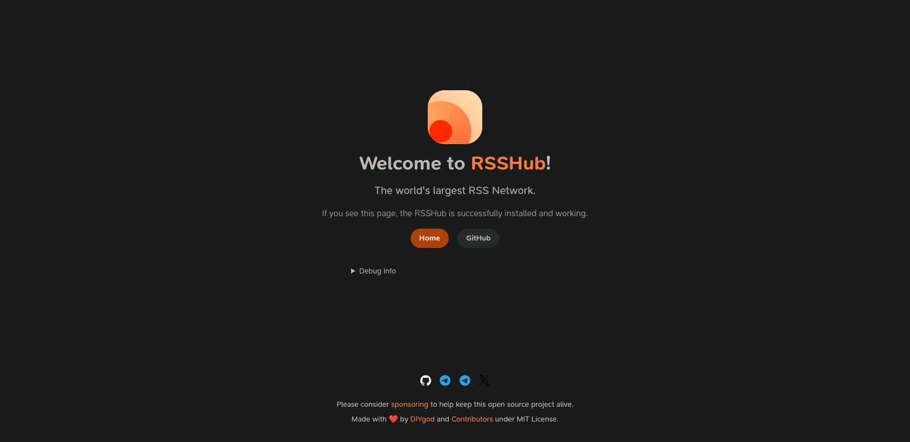
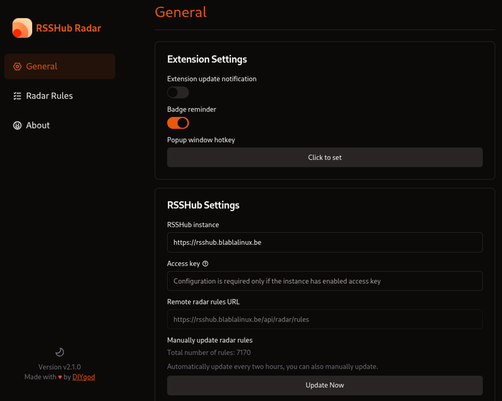
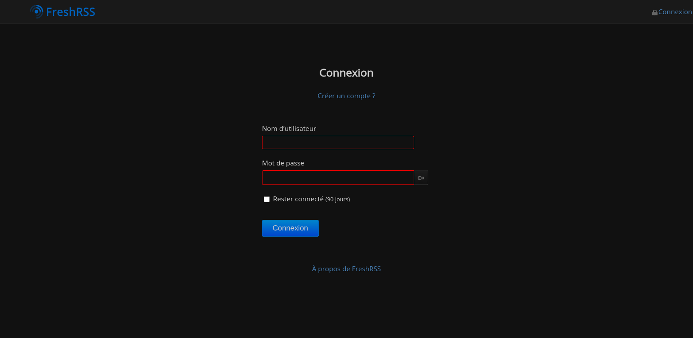
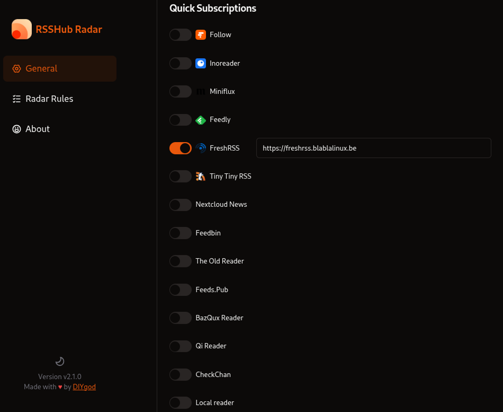

## 🌟 Introduction à RSSHub : le pont vers le contenu

**RSSHub** est un service libre et *open source* qui permet de générer des flux RSS pour des sites web ou des sources qui n'en proposent pas nativement. Il agit comme un agrégateur universel, transformant le contenu de plateformes dynamiques (réseaux sociaux, sites d'actualités complexes, forums, etc.) en flux RSS standard que vous pouvez lire dans votre agrégateur préféré.

* **L'instance Blabla Linux** : Dans l'esprit de l'auto-hébergement et du logiciel libre, **Blabla Linux** met à disposition une instance publique de RSSHub.
* **Adresse de l'instance Blabla Linux** : `https://rsshub.blablalinux.be/`

## 🛠️ Utilisation avancée : le plugin navigateur (RSSHub Radar)

Le moyen le plus simple d'utiliser l'instance RSSHub de Blabla Linux est d'installer le plugin officiel **RSSHub Radar** dans votre navigateur.

* **Lien vers le code source (GitHub)** : [Voir le code source du plugin](https://github.com/DIYgod/RSSHub-Radar)

### Étape 1 : installation du plugin

1.  **Pour Firefox** : Rendez-vous sur la page du module complémentaire **RSSHub Radar** :
    > **[Installer sur Firefox](https://addons.mozilla.org/firefox/addon/rsshub-radar/)**
2.  **Pour Chrome, Chromium et Vivaldi** : Rendez-vous sur la page de l'extension **RSSHub Radar** sur le Chrome Web Store. Ce lien fonctionne pour tous les navigateurs basés sur Chromium (y compris Vivaldi) :
    > **[Installer l'extension Chrome/Vivaldi](https://chrome.google.com/webstore/detail/kefjpfngnndepjbopdmoebkipbgkggaa)**

### Étape 2 : configuration de l'instance Blabla Linux

Pour utiliser l'instance auto-hébergée de Blabla Linux :

1.  Cliquez sur l'icône **RSSHub Radar** dans votre navigateur.
2.  Accédez aux **Paramètres** (⚙️).
3.  Dans le champ pour l'**URL de l'instance RSSHub**, entrez :
    > `https://rsshub.blablalinux.be`
4.  Enregistrez.

---

## 🔄 Intégration directe avec FreshRSS : simplifiez l'abonnement

Notre service **FreshRSS** est l'agrégateur idéal pour lire les flux générés par RSSHub.

* **Adresse du service FreshRSS** : `https://freshrss.blablalinux.be/`

### Configuration de l'intégration dans le plugin RSSHub Radar

Pour que le plugin envoie directement le flux détecté vers votre agrégateur :

1.  Ouvrez les **Paramètres** du plugin **RSSHub Radar** (⚙️).
2.  Dans la liste des services disponibles, cherchez et **activez** l'option **"FreshRSS"**.
3.  Entrez l'URL de votre instance FreshRSS dans le champ dédié :
    > `https://freshrss.blablalinux.be/`
4.  Enregistrez les changements.

### Ajouter un flux RSSHub en un clic

Le plugin vous permet alors d'ajouter n'importe quel flux détecté directement à votre compte FreshRSS en un seul clic ! Il devient simple, par exemple, d'obtenir le flux RSS d'un profil Mastodon, de l'envoyer directement vers FreshRSS, de copier son lien ou de visualiser le flux généré en pleine page 😉

## ❓ Une question ?

N'hésitez pas à [me contacter](https://blablalinux.be/contact/) si vous avez besoin d'aide pour générer un flux complexe ou pour configurer votre plugin.
