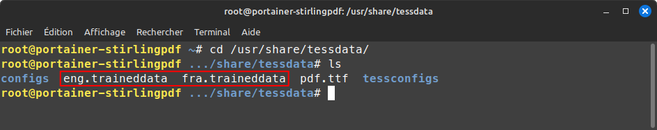
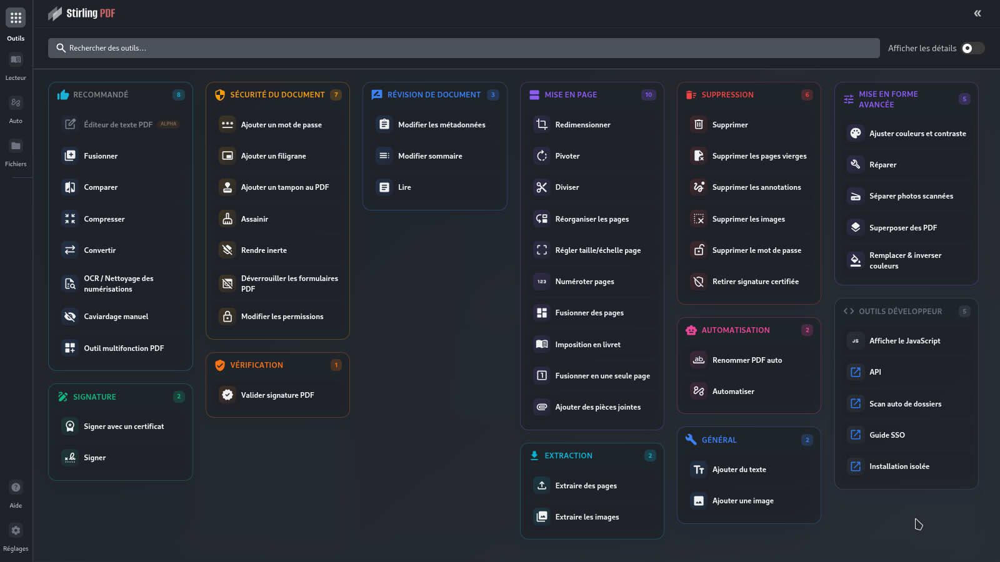

## 1\. Stirling PDF, qu'est-ce que c'est ?

Stirling PDF est une boîte à outils pour fichiers PDF permettant de fusionner, diviser, convertir et plus encore. L'application met l'accent sur la **sécurité et la confidentialité** : elle ne conserve aucun fichier, suivi ou donnée, et fonctionne entièrement sur votre machine locale. L'interface, le nom et la description sont personnalisables.

> 💡 **Version V2 :** La version 2 apporte des améliorations majeures au niveau de l'architecture, une meilleure gestion des utilisateurs et des fonctionnalités avancées. Ce Compose propose une installation simplifiée pour un usage personnel.

### Liens utiles

  * [Site officiel](https://stirlingtools.com)
  * [GitHub](https://github.com/Stirling-Tools/Stirling-PDF)
  * [Docker Hub](https://hub.docker.com/r/stirlingtools/stirling-pdf)

-----

## 2\. Fichier `docker-compose.yml` de base (V2 simple)

Ce fichier Compose est conçu pour une installation **rapide et stable** de Stirling PDF V2. Notez que l'option d'optimisation Java est **commentée par défaut** pour éviter les conflits avec la fonction de conversion.

```yaml
services:
  stirling-pdf:
    image: stirlingtools/stirling-pdf:latest-fat
    container_name: stirling-pdf
    restart: always
    ports:
      - 8080:8080
    healthcheck: # Vérification de l'état de l'application
      test:
        - CMD-SHELL
        - curl -f http://localhost:8080/api/v1/info/status | grep -q 'UP' &&
          curl -fL http://localhost:8080/ | grep -qv 'Please sign in'
      interval: 5s
      timeout: 10s
      retries: 16
    volumes:
      - ./tessdata:/usr/share/tessdata
      - ./configs:/configs
      - ./logs:/logs
      - ./pipeline:/pipeline
    environment:
      - DISABLE_ADDITIONAL_FEATURES=false
      - SECURITY_ENABLELOGIN=false # Application ouverte par défaut
      - LANGS=fr_FR
      - SYSTEM_MAXFILESIZE=250
      - SPRING_SERVLET_MULTIPART_MAX_FILE_SIZE=250MB
      - SPRING_SERVLET_MULTIPART_MAX_REQUEST_SIZE=250MB
      #- JAVA_TOOL_OPTIONS="-Xms512m -Xmx6g" # ⚠️ Commenté par défaut (voir section 3.5)
      - ALLOW_GOOGLE_VISIBILITY=true
```

### Explications des volumes

| Volume | Chemin conteneur | Description |
| :--- | :--- | :--- |
| **OCR** | `./tessdata:/usr/share/tessdata` | **Obligatoire** pour ajouter des langues supplémentaires pour la reconnaissance de caractères (OCR). |
| **Configs** | `./configs:/configs` | Contient le fichier de configuration principal **`settings.yml`**. |
| **Logs** | `./logs:/logs` | Contient les fichiers journaux (logs) de l'application. |
| **Pipeline** | `./pipeline:/pipeline` | Utilisé pour le traitement des tâches asynchrones et l'automatisation. |

-----

## 3\. Personnalisation et configuration

La configuration peut se faire soit via des **variables d'environnement** (qui priment toujours), soit en modifiant le fichier **`settings.yml`** situé dans le volume `/configs`.

### Choix de l'image Docker (tags)

La version V2 utilise des tags simples pour les dernières versions :

| Tag | Fonctionnalités | Utilisation |
| :--- | :--- | :--- |
| **`latest-fat`** | **Totalité** des fonctionnalités, y compris OCR. | **Recommandé** (celui utilisé dans le Compose). |
| **`latest-lite`** | Moins de fonctionnalités (plus léger). | Si l'espace est une contrainte. |
| **`latest`** | Alias de `latest-lite` ou `latest-fat` selon les dernières conventions. | À utiliser avec prudence ; préférez `fat` ou `lite`. |

### Activation de la sécurité et de la connexion

Par défaut, l'application est accessible sans identifiant (`SECURITY_ENABLELOGIN=false`). Pour activer la connexion :

1.  **Variable Compose :** Passer la variable d'environnement `SECURITY_ENABLELOGIN` à **`true`**.
2.  **Identifiants initiaux :** Ajoutez et personnalisez les lignes suivantes dans `environment` :
    ```plaintext
    - SECURITY_INITIALLOGIN_USERNAME=your_username
    - SECURITY_INITIALLOGIN_PASSWORD=your_secure_password
    ```

### Configuration de la langue (locale)

La langue est définie par défaut en français (`LANGS=fr_FR`).

### 🗄️ Gestion de la taille des fichiers

La taille maximale des fichiers est gérée par les variables suivantes (définies ici à **250 Mo**) :

```plaintext
- SYSTEM_MAXFILESIZE=250
- SPRING_SERVLET_MULTIPART_MAX_FILE_SIZE=250MB
- SPRING_SERVLET_MULTIPART_MAX_REQUEST_SIZE=250MB
```

### 3.5. ⚠️ Problèmes de conversion et optimisation Java

La variable `JAVA_TOOL_OPTIONS` est utilisée pour allouer des ressources spécifiques à la machine virtuelle Java (ex : `-Xms512m -Xmx6g` pour la RAM).

> ⚠️ **Avertissement important :**
> L'outil de **conversion** interne de Stirling PDF (ex : HTML vers PDF) peut parfois entrer en conflit ou être rendu instable par la variable `JAVA_TOOL_OPTIONS`. Si vous rencontrez des problèmes lors de la conversion, **dé-commentez-la uniquement si vous êtes certain de la nécessité de l'allocation RAM personnalisée.**

### 3.6. 💾 Intégration avancée de PostgreSQL

Pour activer la gestion des utilisateurs, les rôles avancés et l'historique des actions de la V2, une base de données externe est requise. PostgreSQL est l'option recommandée.

#### Modification du `docker-compose.yml`

Pour intégrer PostgreSQL, vous devez :

1.  Ajouter le service `db` à la fin de votre fichier Compose.
2.  Ajouter la dépendance (`depends_on: - db`) et les variables de connexion (`SPRING_DATASOURCE_*`) au service `stirling-pdf`.

<!-- end list -->

```yaml
# --- À ajouter dans la section environment de stirling-pdf (à la suite des autres variables) ---
      - SPRING_DATASOURCE_URL=jdbc:postgresql://db:5432/stirling_pdf
      - SPRING_DATASOURCE_USERNAME=admin
      - SPRING_DATASOURCE_PASSWORD=stirling # ⚠️ À CHANGER !
      # -------------------------------------------------------------------------------------

# --- À ajouter à la fin du fichier compose (après le service stirling-pdf) ---
  db:
    image: postgres:17.2-alpine
    container_name: db_stirling_pdf
    restart: always
    volumes:
      - ./postgres_data:/var/lib/postgresql/data # Volume de persistance des données
    environment:
      - POSTGRES_DB=stirling_pdf
      - POSTGRES_USER=admin
      - POSTGRES_PASSWORD=stirling # ⚠️ Mot de passe de la DB. Doit correspondre à SPRING_DATASOURCE_PASSWORD
```

### Ajout de langues pour la reconnaissance OCR

Par défaut, seul l'anglais est géré. Pour ajouter d'autres langues :

1.  **Téléchargez** les fichiers de reconnaissance de langue (`.traineddata`) nécessaires (fichiers légers ou lourds) depuis la documentation.

Je suis gentil, je vous fournis ces fichiers grâce au [cloud Blabla Linux](https://yourls.blablalinux.be/nextcloud).

  * [Fichiers légers](https://nextcloud.blablalinux.be/index.php/s/4ezDSHy3XoTZARb)
  * [Fichiers lourds](https://nextcloud.blablalinux.be/index.php/s/bPp4C7YXtTeKpXt)

<!-- end list -->

2.  **Placez** ces fichiers dans le répertoire de votre hôte que vous avez monté sur `/usr/share/tessdata` (ici : `./tessdata`).
    > **Note :** Ne supprimez pas le fichier **`eng.traineddata`**, Stirling PDF en a besoin.
    


-----

## 4\. Lancement et minimum requis

Une fois configuré, lancez votre pile :

```bash
docker compose up -d
```

### Ressources

  * **Mémoire vive au repos :** Minimum **1 Go**.
  * **Mémoire vive en usage :** Les fonctionnalités gourmandes peuvent demander des pics de RAM.

Vous accédez à l'interface à l'adresse **`http://<Votre_IP_Hôte>:8080`**.



[Stirling PDF Blabla Linux - Outils](https://yourls.blablalinux.be/stirlingpdf)
