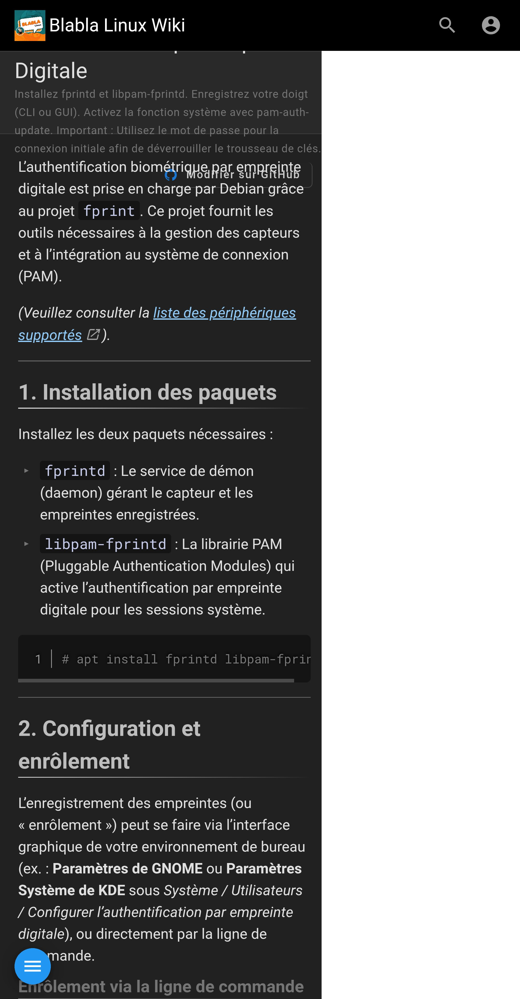
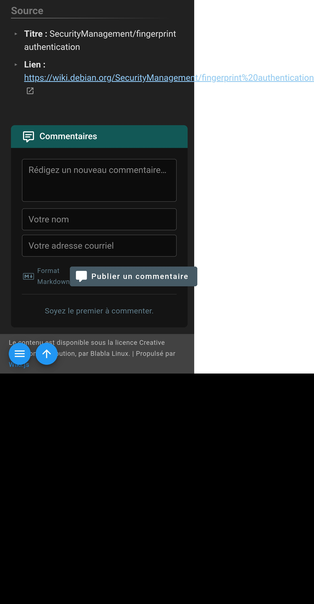
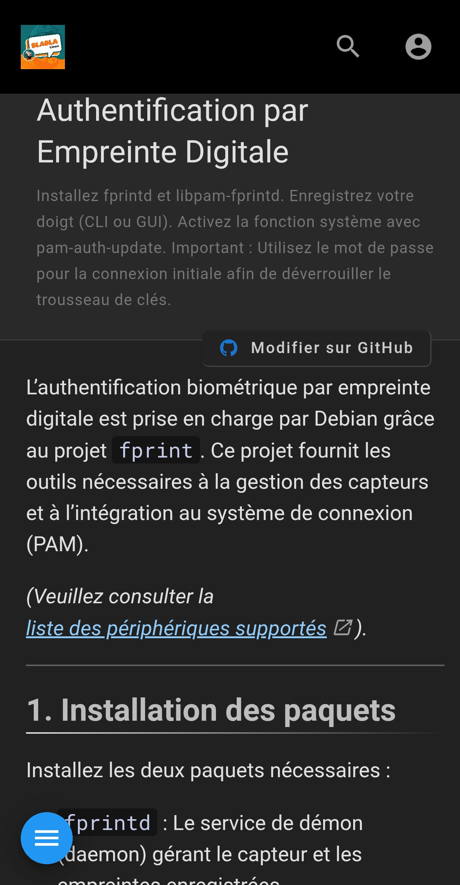
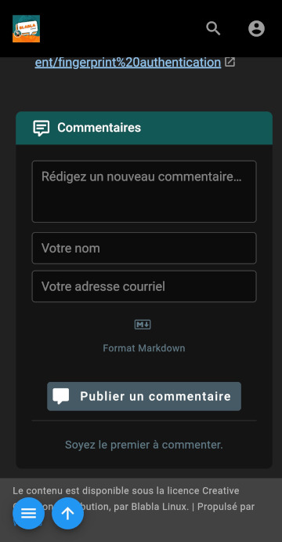

### ⚠️ Avertissements importants

  * **Thème par défaut requis :** Ce code CSS est spécifiquement écrit pour les classes HTML et les sélecteurs du **thème par défaut de Wiki.js (Clarity)**. L'utilisation d'un thème tiers ou d'un thème profondément modifié peut entraîner des résultats inattendus ou inefficaces.
  * **Visiteurs seulement :** Cette amélioration est principalement destinée à offrir un visuel **acceptable** pour les **visiteurs non connectés**.
  * **Utilisateurs connectés :** Le rendu pour les utilisateurs connectés pourrait ne pas être parfait, en raison des éléments d'interface supplémentaires (barre d'édition, etc.).
  * **Administration :** Le code **n'est pas conçu** pour l'interface d'administration de Wiki.js. L'administration doit toujours être effectuée sur un écran de taille appropriée (ordinateur de bureau ou grande tablette).

-----

## 🔧 Explication et intégration du code

Le code que vous allez utiliser se divise en deux parties : une balise HTML essentielle pour le mobile et un bloc de règles CSS spécifiques pour les petits écrans.

### 1\. La balise `viewport` (HTML)

#### Explication

La balise `meta name="viewport"` est **cruciale** pour le développement web mobile. Sans elle, le navigateur mobile considère la page comme un site de bureau et la zoome pour la faire tenir.

Le code :

```html
<meta name="viewport" content="width=device-width, initial-scale=1.0">
```

signifie :

  * `width=device-width` : La largeur de la page doit correspondre à la largeur de l'écran de l'appareil en pixels CSS.
  * `initial-scale=1.0` : Le niveau de zoom initial doit être de 100 %.

Ceci garantit que la page s'affiche correctement à l'échelle sur tous les téléphones.

#### Où l'intégrer dans Wiki.js

Dans votre interface d'administration Wiki.js :

1.  Allez dans **Administration** ($\rightarrow$ l'icône de la roue dentée).
2.  Dans le menu de gauche, sélectionnez **Thème**.
3.  À droite, cherchez la section **Injection de code**.
4.  Collez la ligne de code HTML dans le champ **Injection HTML dans le head**.

-----

### 2\. Le code CSS (Feuille de style)

Ce code utilise des **Media Queries** (`@media screen and (max-width:480px)`) pour n'appliquer les styles que sur les écrans dont la largeur est inférieure ou égale à **480 pixels** (typiquement les smartphones). Il corrige le défilement horizontal et réarrange les éléments de la barre de navigation et de l'en-tête de page.

#### Explication détaillée des blocs CSS

| Sélecteur/Bloc | Fonction |
| :--- | :--- |
| `body, html { ... }` | **Correction du défilement horizontal.** Force la page à ne pas dépasser la largeur de l'écran (`max-width: 100vw; overflow-x: hidden;`) pour éviter d'avoir une barre de défilement horizontale sur mobile. |
| **`@media screen and (max-width:480px) { ... }`** | **Début des règles mobiles.** Tout ce qui suit entre les accolades ne s'applique que sur les petits écrans. |
| `.nav-header, .v-toolbar, ...` | **Ajustement de la barre de navigation.** Garantit que la barre supérieure a une hauteur flexible et que tous les éléments sont bien alignés. |
| `.v-toolbar__title.mx-1` | **Masque le titre du site** dans la barre de navigation sur mobile, ce qui est souvent trop encombrant. |
| `.page-header-section` | **Réarrangement de l'en-tête de page.** Force l'en-tête à utiliser toute la largeur, permet aux éléments de s'enrouler (`flex-wrap: wrap;`) et donne plus d'espace. |
| `.page-edit-shortcuts.is-right` | **Mise en page des boutons d'édition.** Au lieu de flotter à droite, les boutons sont affichés en colonne ou en ligne flexible sous le titre pour être plus accessibles sur mobile. |
| `#discussion .caption, #discussion .d-flex.align-center.pt-3` | **Correction des discussions/commentaires.** Ces règles ajustent spécifiquement le formatage des commentaires (taille de police, alignement, boutons) pour qu'ils soient lisibles et que les boutons soient utilisables sur un petit écran. |
| `a.is-external-link` | **Correction des liens externes.** Permet aux longs liens URL de se couper correctement et de passer à la ligne plutôt que de déborder de l'écran. |

#### Où l'intégrer dans Wiki.js

Dans votre interface d'administration Wiki.js :

1.  Allez dans **Administration** ($\rightarrow$ l'icône de la roue dentée).
2.  Dans le menu de gauche, sélectionnez **Thème**.
3.  À droite, cherchez la section **Injection de code**.
4.  Collez le bloc de code CSS complet dans le champ **Remplacement de CSS**.

-----

## 📋 Code complet à intégrer

### 1\. HTML `<head>` Injection

```html
<meta name="viewport" content="width=device-width, initial-scale=1.0">
```

### 2\. CSS personnalisé

```css
body,
html {
  overflow-x: hidden;
  max-width: 100vw;
  box-sizing: border-box;
  position: relative
}
@media screen and (max-width:480px) {
  .nav-header,
  .nav-header-inner,
  .v-toolbar,
  .v-toolbar__content {
    height: auto!important;
    min-height: 64px!important;
    box-sizing: border-box;
    align-items: center!important;
    flex-wrap: nowrap!important;
    overflow: hidden!important
  }
  .v-toolbar__title.mx-1 {
    display: none!important;
    width: 0!important;
    height: 0!important;
    padding: 0!important;
    margin: 0!important;
    overflow: hidden!important
  }
  .navHeaderLoading[style*="display: none"] {
    width: 0!important;
    margin: 0!important;
    padding: 0!important;
    overflow: hidden!important
  }
  .v-btn[style*="height: 64px"] {
    height: 56px!important;
    max-height: 56px!important;
    box-sizing: border-box;
    align-items: center!important
  }
  .nav-header-inner .v-toolbar__content > * {
    flex-shrink: 0!important;
    margin-right: 6px
  }
  .page-header-section {
    height: auto!important;
    min-height: 120px;
    display: flex;
    flex-wrap: wrap;
    align-items: flex-start;
    padding: 12px;
    box-sizing: border-box;
    max-width: 100vw;
    overflow-y: visible!important
  }
  .page-col-content.is-page-header {
    margin-top: 0!important;
    margin-bottom: 0!important;
    width: 100%;
    max-width: 100vw;
    box-sizing: border-box
  }
  .page-header-headings {
    display: block;
    width: 100%;
    max-width: 100vw
  }
  .page-edit-shortcuts.is-right {
    display: flex;
    flex-direction: row;
    flex-wrap: wrap;
    justify-content: flex-start;
    align-items: center;
    gap: 8px;
    margin-top: 8px
  }
  .caption,
  .headline {
    display: block;
    word-break: break-word;
    overflow-wrap: break-word;
    margin-bottom: .5rem;
    max-width: 100%;
    box-sizing: border-box
  }
  #discussion .caption {
    writing-mode: horizontal-tb!important;
    transform: none!important;
    white-space: normal!important;
    word-break: normal!important;
    overflow-wrap: break-word!important;
    font-size: 1rem
  }
  #discussion .caption.blue-grey--text,
  #discussion .caption.mr-3 {
    text-align: center!important;
    justify-content: center;
    align-items: center;
    display: flex
  }
  #discussion .d-flex.align-center.pt-3 {
    flex-direction: column!important;
    align-items: center!important;
    justify-content: center!important;
    gap: 8px;
    text-align: center
  }
  #discussion .d-flex.align-center.pt-3 > * {
    width: auto;
    max-width: 100%;
    box-sizing: border-box;
    text-align: center
  }
  #discussion .v-btn {
    max-width: 100%;
    width: 100%;
    box-sizing: border-box;
    white-space: normal!important;
    text-align: center;
    padding: 8px 12px;
    margin-top: 8px
  }
  #discussion .v-btn__content {
    display: flex;
    align-items: center;
    justify-content: center;
    flex-wrap: wrap;
    gap: 6px;
    word-break: break-word;
    overflow-wrap: break-word;
    font-size: .95rem;
    max-width: 100%;
    box-sizing: border-box
  }
  #discussion a.is-external-link {
    word-break: break-word;
    overflow-wrap: break-word;
    max-width: 100%;
    display: inline-block;
    box-sizing: border-box
  }
  a.is-external-link {
    display: inline-block;
    max-width: 100%;
    overflow-wrap: anywhere;
    word-break: break-word;
    white-space: normal
  }
}
```

-----

## 📸 Visualisation des résultats (Avant / Après)

### 1\. Aperçu avant la modification (Visuel par défaut)





### 2\. Aperçu après la modification (Visuel optimisé)





-----

## 🎨 Aller plus loin : personnalisation des couleurs de l'interface

Si, en plus de rendre votre wiki adaptable aux mobiles, vous souhaitez modifier les couleurs par défaut du thème pour correspondre à votre charte graphique, nous avons créé un article dédié expliquant comment utiliser l'injection HTML dans le `<head>` de Wiki.js pour cela.

👉 **Consultez la page :** [**Changement des couleurs du thème de Wiki.js**](https://wiki.blablalinux.be/fr/wikijs-html-head)
