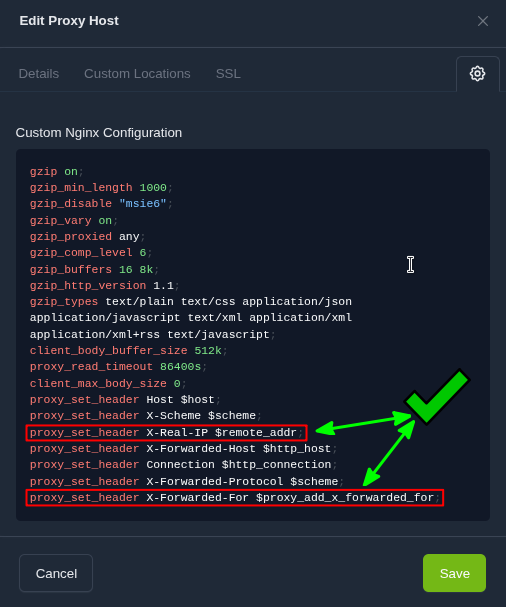

## 🎯 Problème
Lors de l'utilisation d'un **proxy inverse** (tel que Nginx Proxy Manager – NPM) devant une installation WordPress (hébergée par exemple dans un conteneur LXC sur Proxmox VE), WordPress enregistre l'adresse IP de la **machine proxy** elle-même au lieu de l'adresse IP réelle du visiteur.

Ceci affecte :

* La journalisation (logs) et les statistiques d'accès.
* Les plugins de sécurité (qui voient le trafic malveillant comme provenant du proxy).
* L'enregistrement des adresses IP des commentateurs.

## 💡 Cause technique
Par défaut, WordPress et le serveur web (Apache/Nginx) lisent l'adresse IP du client via la variable environnementale `$_SERVER['REMOTE_ADDR']`.

Lorsque le trafic passe par un proxy inverse, le client qui contacte WordPress n'est plus l'utilisateur final, mais le **proxy**.  Le proxy, cependant, transmet l'adresse IP réelle de l'utilisateur dans un en-tête HTTP spécifique, le plus souvent `X-Forwarded-For`.

**La solution consiste à modifier la configuration de WordPress pour qu'il lise l'adresse IP depuis l'en-tête `X-Forwarded-For` au lieu de la variable par défaut.**

## 🛠️ Prérequis
1. Accès SSH/Console au conteneur LXC hébergeant l'installation WordPress.
2. Le fichier de configuration Nginx du proxy inverse doit inclure les en-têtes de transfert d'IP :
```nginx
proxy_set_header X-Real-IP $remote_addr;
proxy_set_header X-Forwarded-For $proxy_add_x_forwarded_for; 

```




### ⚙️ Solution : modification de `wp-config.php`
La méthode la plus propre et la plus efficace consiste à ajouter un bloc de code PHP directement dans le fichier de configuration principal de WordPress.

#### Étape 1 : accès au fichier
Connectez-vous au conteneur LXC et ouvrez le fichier `wp-config.php` (le chemin exact peut varier, souvent `/var/www/html/wp-config.php`) :

```bash
nano /chemin/vers/votre/wp-config.php

```

#### Étape 2 : insertion du code
Localisez la ligne de fin de configuration : `/* That's all, stop editing! Happy publishing. */`.

Insérez le bloc de code suivant **juste avant** cette ligne :

```php
// ----------------------------------------------------------------------
// DÉBUT DE LA CORRECTION D'ADRESSE IP RÉELLE DERRIÈRE PROXY INVERSE (NPM)
// ----------------------------------------------------------------------
if ( isset( $_SERVER['HTTP_X_FORWARDED_FOR'] ) ) {
    $ips = explode( ', ', $_SERVER['HTTP_X_FORWARDED_FOR'] );
    // L'adresse IP du client réel est toujours la première de la liste
    $_SERVER['REMOTE_ADDR'] = $ips[0];
}
// ----------------------------------------------------------------------
// FIN DE LA CORRECTION D'ADRESSE IP RÉELLE DERRIÈRE PROXY INVERSE (NPM)
// ----------------------------------------------------------------------

```

#### Étape 3 : sauvegarde et sortie
Sauvegardez les modifications et quittez l'éditeur.

#### Étape 4 : vider le cache
Si vous utilisez un plugin de cache, cette modification ne sera visible qu'après avoir vidé le cache du site.

1. Connectez-vous au tableau de bord WordPress.
2. Naviguez vers les réglages de votre plugin de cache.
3. **Videz/supprimez l'intégralité du cache.**

## ✅ Vérification
Après avoir vidé le cache, testez en laissant un commentaire ou en utilisant un plugin de diagnostic d'IP. L'adresse affichée dans vos logs et dans WordPress doit maintenant être l'adresse IP publique de votre poste de travail.
