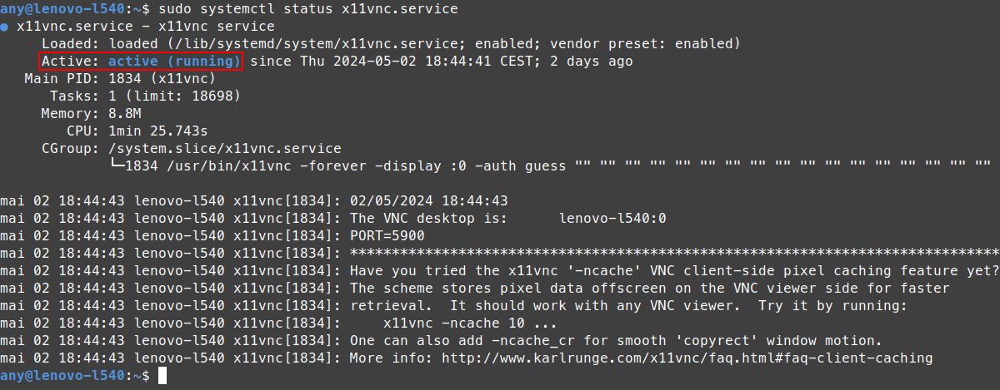

> **Testé et fonctionnel** sur Ubuntu (22.04 à 23.10) et Linux Mint (21.x à 23.x) 👍

-----

## 1\. Installation du Serveur VNC

Commencez par installer le paquet `x11vnc` ainsi que le client **Remmina** (recommandé pour les connexions) :

1.  **Installer `x11vnc` :**
    ```bash
    sudo apt install x11vnc
    ```
2.  **Installer Remmina (Client VNC) :**
    ```bash
    sudo apt install remmina
    ```

-----

## 2\. Configuration du Service `systemd`

Pour que X11VNC démarre automatiquement et de manière persistante, vous devez créer et configurer un fichier de service `systemd`.

1.  **Éditer le fichier de service `x11vnc.service` :**

    ```bash
    sudo nano /lib/systemd/system/x11vnc.service
    ```

2.  **Copier et coller la configuration suivante** en remplaçant impérativement `"password"` par votre **mot de passe personnel** :

    ```ini
    [Unit]
    Description=x11vnc service
    After=display-manager.service network.target syslog.target

    [Service]
    Type=simple
    ExecStart=/usr/bin/x11vnc -forever -display :0 -auth guess -passwd password
    ExecStop=/usr/bin/killall x11vnc
    Restart=on-failure

    [Install]
    WantedBy=multi-user.target
    ```

    > ⚠️ **SÉCURITÉ :** Le paramètre `-passwd` stocke le mot de passe directement dans le fichier de service. Pour une meilleure sécurité, considérez l'option de créer un fichier de mot de passe haché avec `x11vnc -storepasswd` et utilisez le paramètre `-usepw` à la place de `-passwd` dans la ligne `ExecStart`.

3.  **Sauvegarder** les modifications (Taper `CTRL + X`, puis `O`, puis `ENTER`).

-----

## 3\. Activation et Démarrage du Service

Après avoir modifié le fichier de service, vous devez recharger le système, l'activer au démarrage et le démarrer immédiatement.

1.  **Recharger le *daemon* systemd :**

    ```bash
    sudo systemctl daemon-reload
    ```

    *(Nécessaire après toute modification d'un fichier `.service`)*

2.  **Activer le service au démarrage du système :**

    ```bash
    sudo systemctl enable x11vnc.service
    ```

3.  **Démarrer immédiatement le service :**

    ```bash
    sudo systemctl start x11vnc.service
    ```

-----

## 4\. Vérification et Connexion

1.  **Vérifier le statut du service :**

    ```bash
    sudo systemctl status x11vnc.service
    ```
    
    Le statut doit indiquer **`active (running)`**.
    


2.  **Connexion :** Utilisez le client **Remmina** (ou tout autre client VNC) pour vous connecter à l'adresse IP de votre machine Linux en utilisant le mot de passe défini.

Démonstration en vidéo : [https://peertube.blablalinux.be/w/d9XZWoPWkAQoti7h27rY22](https://peertube.blablalinux.be/w/d9XZWoPWkAQoti7h27rY22)
